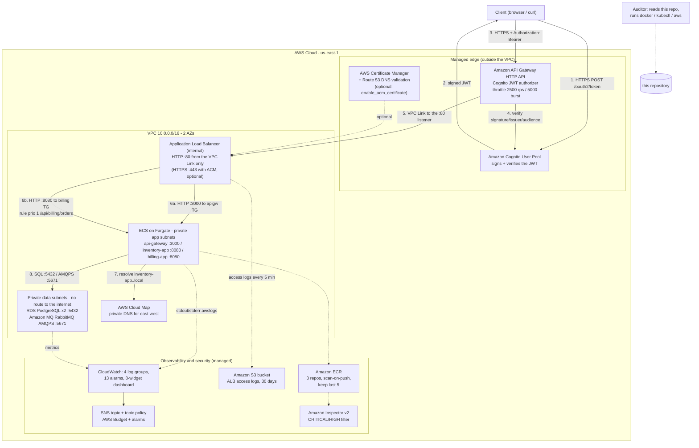
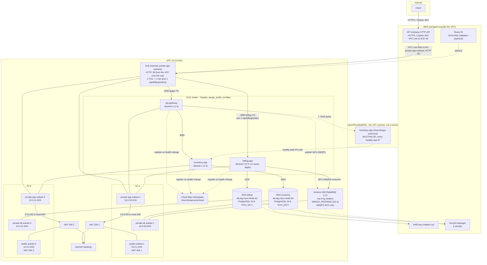
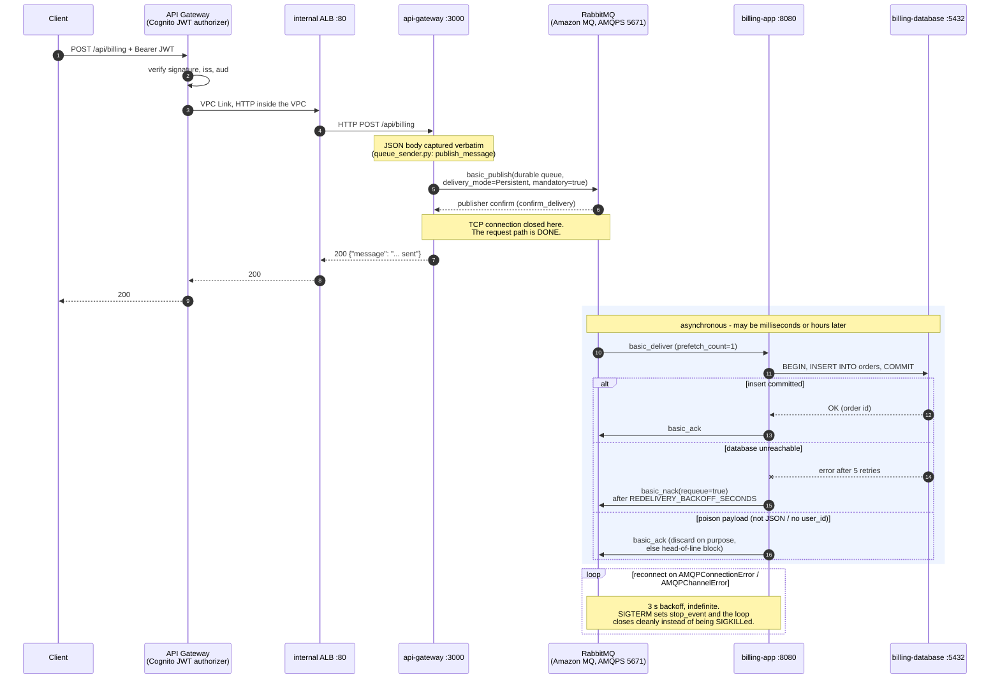

# Cloud-Design — microservices on AWS

A six-container microservices application (movie catalogue + asynchronous billing)
deployed on AWS with Terraform as the single source of infrastructure truth, and
runnable end-to-end on a laptop with `docker compose`. Three Python/Flask
applications sit on **Amazon ECS on Fargate** behind one **internal
Application Load Balancer**. **Amazon API Gateway** with a **Cognito JWT
authorizer** is the only internet-facing entrypoint (HTTPS) and reaches the ALB
through a VPC Link; **Amazon RDS PostgreSQL Multi-AZ** and **Amazon MQ for
RabbitMQ** (`SINGLE_INSTANCE`, AMQPS only) form a data tier with no route to the
internet. East–west traffic is resolved privately by **AWS Cloud Map**. Everything
is described in Terraform: 19 `.tf` files, 142 `resource` blocks, 34 variables,
40 outputs.

Everything asserted below is either reproducible from a command in this README or
explicitly listed as unverified in [Known limitations](#known-limitations--verified-vs-not).

---

## Table of contents

- [Architecture](#architecture)
- [Component mapping](#component-mapping)
- [Well-Architected pillars](#well-architected-pillars)
- [Monitoring and logging](#monitoring-and-logging)
- [Auto-scaling](#auto-scaling)
- [Security](#security)
- [Prerequisites](#prerequisites)
- [Setup](#setup)
- [Configuration](#configuration)
- [Usage](#usage)
- [Deployment verification](#deployment-verification)
- [Cost management](#cost-management)
- [Challenges faced and what I would change](#challenges-faced-and-what-i-would-change)
- [Bonus](#bonus)
- [Submission checklist and teardown](#submission-checklist-and-teardown)
- [Known limitations / verified vs. not](#known-limitations--verified-vs-not)
- [Documentation and audit tooling](#documentation-and-audit-tooling)

---

## Architecture

### System context

Who talks to what, and which trust boundaries the traffic crosses. Cognito, ACM,
Route 53, ECR, Inspector2, KMS, Secrets Manager, CloudWatch and S3 are AWS-managed
and therefore live *outside* the VPC. Nothing inside the VPC is internet-facing:
the ALB is internal, and API Gateway is the only public entry.



### AWS deployment: subnets, AZs and routing



Routing truth, from `terraform/vpc.tf`: the private **data** route table has
**no route at all** (`aws_route_table.private_db` has no `route` block) — RDS and
Amazon MQ cannot reach the internet, not even for AWS API calls. Only the private
**app** subnets get a `0.0.0.0/0` route to a NAT Gateway.

### Billing order flow — the asynchronous handoff

`POST /api/billing` returns `200` as soon as the broker **confirms** the publish.
It does not wait for the database. That is the whole point, and it is also the
place where an ordering bug silently loses money.



The ack/nack split is the correctness-critical part and is written down at
`srcs/billing-app/app/consume_queue.py:299-311`. Acknowledging a failed insert
would drop a paid order; the code never does that.

---

## Component mapping

`docs/readme.md` requires six components. All six run as local containers under
`docker compose`; on AWS, **three of them become ECS tasks and the other three
become managed services**. This table is the unambiguous mapping — no component
is listed as both a StatefulSet and an RDS instance.

| # | Required component | Port (spec) | Local: container image | Local host port | AWS service (Terraform file) | Subnet tier |
|---|---|---|---|---|---|---|
| 1 | `inventory-database` | 5432 | `cloud-design/inventory-database:local` (FROM `postgres:17-alpine`) | 5432 | **Amazon RDS PostgreSQL**, `multi_az = true`, `publicly_accessible = false` (`rds.tf`) | private db |
| 2 | `billing-database` | 5432 | `cloud-design/billing-database:local` (FROM `postgres:17-alpine`) | 5433 (5432 is taken) | **Amazon RDS PostgreSQL**, `multi_az = true`, `publicly_accessible = false` (`rds.tf`) | private db |
| 3 | `inventory-app` | 8080 | `cloud-design/inventory-app:local` (FROM `python:3.11-alpine`) | 8081 (direct, bypasses the gateway) | **ECS task** `cloud-design-prod-inventory-app`, `desired_count = 2` (`ecs_services.tf`) | private app |
| 4 | `billing-app` | 8080 | `cloud-design/billing-app:local` (FROM `python:3.11-alpine`) | 8082 (direct) | **ECS task** `cloud-design-prod-billing-app`, `desired_count = 2` (`ecs_services.tf`) | private app |
| 5 | `RabbitMQ` queue | 5672 local / **5671 AWS** | `cloud-design/rabbit-queue:local` (FROM `rabbitmq:3.13-management-alpine`) | 5672 + 15672 (mgmt UI) | **Amazon MQ for RabbitMQ** `SINGLE_INSTANCE`, `publicly_accessible = false`, **AMQPS 5671 only** (`amazon_mq.tf`) | private db |
| 6 | `api-gateway` | 3000 | `cloud-design/api-gateway:local` (FROM `python:3.11-alpine`), **2 replicas** | none (behind the LB) | **ECS task** `cloud-design-prod-api-gateway`, `desired_count = 2` (`ecs_services.tf`) | private app |
| — | local load balancer | 3000 (host) | `nginx:1.27-alpine`, `least_conn` — the local stand-in for the ALB | 3000 | **Application Load Balancer**, `internal = true`, behind API Gateway (`alb.tf`) | private app |

Supporting AWS resources with no local container counterpart: API Gateway HTTP
API, Cognito user pool + app clients, ACM certificate, Cloud Map namespace, ECR
(3 repos), Inspector v2, KMS key, Secrets Manager (5 secrets), CloudWatch log
groups/alarms/dashboard, SNS topic, AWS Budget, an S3 bucket for the ALB access
logs (`storage.tf`), VPC/subnets/NAT/security groups and their rules, IAM roles
and policies for ECS.

### Per-platform naming (no renames — this table documents intent)

Functional resource names are **not** renamed by this cleanup. The same
workload has a different name on each platform, which is deliberate:

| Workload | Compose service / `container_name` / host port | Manifests workload / Service | ECS service / container (authoritative: `terraform/ecs_services.tf`) |
|---|---|---|---|
| `inventory-database` | service `inventory-database` / `cloud-design-inventory-database` / `5432:5432` | StatefulSet `inventory-database` / `inventory-database-service:5432` | RDS `cloud-design-prod-inventory-db` (no ECS container; managed service) |
| `billing-database` | service `billing-database` / `cloud-design-billing-database` / `5433:5432` (5432 is taken) | StatefulSet `billing-database` / `billing-database-service:5432` | RDS `cloud-design-prod-billing-db` (managed service) |
| `inventory-app` | service `inventory-app` / compose-generated `cloud-design-inventory-app-1` / `8081:8080` (direct, bypasses the gateway) | Deployment `inventory-app` / `inventory-app-service:8080` | service `cloud-design-prod-inventory-app` / container `inventory-app:8080` |
| `billing-app` | service `billing-app` / compose-generated `cloud-design-billing-app-1` / `8082:8080` (direct) | StatefulSet `billing-app` / `billing-app-service:8080` (headless) | service `cloud-design-prod-billing-app` (`desired_count = 2`) / container `billing-app:8080` |
| `rabbit-queue` / broker | service `rabbit-queue` / `cloud-design-rabbit-queue` / `5672` + `15672` (mgmt UI) | StatefulSet `rabbitmq` / `rabbitmq-service:5672` + `:15672` | Amazon MQ broker `cloud-design-prod-rabbitmq`, **AMQPS 5671 only** (no ECS container) |
| `api-gateway` | service `api-gateway` (×2 replicas, no `container_name` so it can scale) / `cloud-design-api-gateway-1/2` / none (behind the LB) | Deployment `api-gateway` / `api-gateway-service:3000` | service `cloud-design-prod-api-gateway` / container `api-gateway:3000` |
| load balancer | service `gateway-lb` / `cloud-design-gateway-lb` / `3000:8080` (`nginx:1.27-alpine`, `least_conn`) | `manifests/ingress.yaml` (commented out of `kustomization.yaml`; needs ALB controller + ACM cert) | ALB `cloud-design-prod-alb` (`internal = false`, `:443` TLS / `:80` → 301) |

Notes an auditor trips over:

- **Image-name trap:** the compose image is `cloud-design/rabbit-queue:local`
  but the manifests/ECS image is `cloud-design/rabbitmq:latest`, both built
  from `srcs/rabbit-queue` (see `manifests/rabbitmq.yaml:8-14` and
  `manifests/api-gateway.yaml:22-24`). `ecs-tasks/rabbitmq-task.json` uses the
  `rabbitmq` name, so the same artifact serves both lineages.
- **`ecs-tasks/*.json` families drop the `-prod` infix**
  (`cloud-design-api-gateway` vs Terraform's `cloud-design-prod-api-gateway`).
  They are hand-readable reference documents with placeholder account IDs, not
  what Terraform applies — `terraform/ecs_services.tf` is authoritative (see
  [Setup](#setup)).
- **DNS per env (`RABBITMQ_HOST`):** compose `rabbit-queue:5672` (plaintext,
  `docker-compose.yml`); manifests `rabbitmq-service:5672` (plaintext,
  `manifests/configmap.yaml`); ECS bare AMQPS hostname `local.mq_amqps_host`
  with `RABBITMQ_PORT = 5671` (TLS-only, `ecs_services.tf:64-65,170-171`);
  `ecs-tasks/*.json` placeholder `b-12345678.mq.us-east-1.amazonaws.com:5671`.
  Same pattern for databases: compose `inventory-database`/`billing-database`,
  manifests `inventory-database-service`/`billing-database-service`
  (`configmap.yaml`), ECS RDS endpoints (`ecs_services.tf:115-116,166-167`).

There are **two** PostgreSQL engines in this project and they are not the same
version, which is worth knowing before an auditor diffs them: the **local images
are PostgreSQL 17** (`postgres:17-alpine`), the **RDS instances are 16.9**
(`engine_version = "16.9"`, parameter group family `postgres16`).

---

## Well-Architected pillars

### Scalability

| Layer | Mechanism | Bounds |
|---|---|---|
| ECS request path | `ECSServiceAverageCPUUtilization` target tracking, **60 %** (`autoscaling.tf`) | `api-gateway` and `inventory-app`: min 2 / max 3; scale-out cooldown **60 s**, scale-in **300 s** |
| Queue consumer | `AWS/AmazonMQ MessageCount` target tracking — **backlog, not CPU** (`autoscaling.tf`) | `billing-app`: min 2 / max 6 (`billing_queue_depth_target = 50` messages) |
| Manifests path | 3 HorizontalPodAutoscalers, 60 % CPU | min 1 / max 3 for `api-gateway` and `inventory-app`; min 2 / max 6 for `billing-app` |
| Storage | RDS storage autoscaling | 20 GB → 100 GB (`db_max_allocated_storage`) |
| Burst absorption | the RabbitMQ queue | an `api-gateway` outage does not lose orders; they sit in `billing_queue` and drain when it returns |

The consumer scales on **queue depth** rather than CPU because CPU is the wrong
signal for it: a consumer blocked on an AMQP socket is *idle* while the backlog
grows, so CPU target tracking would never react to the one condition that needs
more consumers. `min 2` is never 1 — a single consumer task is a single point of
failure for order processing, and with `prefetch_count = 1` each task holds one
unacked message, so two tasks also drain in parallel. Amazon MQ for RabbitMQ
publishes no per-queue CloudWatch dimension, so `MessageCount` is a broker-level
approximation of the `billing_queue` depth — the same metric dashboarded as queue
depth. The Kubernetes HPA uses CPU because a plain cluster has no broker metric
without an exporter; its *bounds* match the ECS ones, and the difference is
written down in `manifests/billing-app.yaml`.

The 60 % target is not arbitrary: it is far enough below saturation to leave room
for a container to become ready before it is loaded, and the 300 s scale-in
cooldown stops the classic flapping where two pods each wait for the other to go
away. Measured local headroom: five runs of 200 requests at concurrency 20 through the
nginx load balancer gave **327–463 req/s** with **0 non-200 responses**; the
gateway container's own p95 over all 1100 requests was **15 ms**. Quote the
range — see [Usage](#usage) for the script and the full table.

### Availability

- **2 AZs, and no resource pinned to one.** `var.availability_zones` defaults to
  empty, which means "discover the first two zones AWS actually offers this
  account in this region" (`vpc.tf:15`). Hard-coding `us-east-1a/b` while
  `aws_region` was a variable was the original bug here.
- **RDS Multi-AZ is unconditional**, not "in production" (`rds.tf:127`,
  `rds.tf:168`): two `db.t4g.micro` instances, each in a different AZ, 7-day
  backups, `auto_minor_version_upgrade`. RDS Multi-AZ replication is
  **asynchronous** — a failover can lose a transaction committed but not yet
  replicated. Semi-synchronous replication is an Aurora Multi-AZ *DB cluster*
  feature, which this design does not use.
- **Amazon MQ `SINGLE_INSTANCE`**, a cost decision. Amazon MQ for RabbitMQ
  offers only `SINGLE_INSTANCE` or a three-node `CLUSTER_MULTI_AZ`
  (active/standby is an ActiveMQ mode), and the cluster triples the largest line
  in the bill (~$100 to ~$300 a month). The trade-off: the broker lives in one AZ
  and is briefly offline in its weekly maintenance window. While it is down,
  `POST /api/billing` answers **503** and the client retries; orders already
  queued are durable, persistent messages and are consumed once it is back.
  `CLUSTER_MULTI_AZ` is the upgrade path.
- **ECS services span both private app subnets** with at least two tasks each
  (`desired_count = 2`, `min_capacity = 2`), and Fargate spreads a service's tasks
  across the AZs of its subnets, so one AZ loss halves capacity rather than
  removing it. It also gives the internal ALB two targets per target group. A broker outage (above) and an RDS failover are the
  events that can still be user-visible, and both are AWS-managed.
- **Graceful shutdown is proven, not asserted.** `docker compose stop billing-app`
  exits **0** (the SIGTERM handler at `srcs/billing-app/app/consume_queue.py:247-253`
  stops the consumer through pika's thread-safe callback), not 137. The measured
  drill, including a consumer outage and a drain, is in [Usage](#usage).
- **Local HA substitute:** two `api-gateway` replicas behind nginx
  `least_conn`, which is the same algorithm family as the ALB target group. The
  distribution is *measured*, not asserted: **561 / 539** across the two replica
  IPs over 1100 requests.

### Security

Full detail in [Security](#security). The three claims worth repeating here:
encryption at rest with a **customer-managed KMS key** with rotation enabled;
encryption in transit at the edge with **TLS 1.3** plus a database parameter
group that sets **`rds.force_ssl = 1`**, which makes PostgreSQL *refuse* a
plaintext session (fail-closed); and managed authentication with **Cognito**
verified by an API Gateway **JWT authorizer** attached to every `/api/*` route.

### Cost-effectiveness

- **PAYG everywhere, no node fleet.** Fargate bills per task-second; there is no
  EC2 Auto Scaling Group to keep warm. This is a direct consequence of dropping
  EKS.
- **Right-sized defaults**: `db.t4g.micro` (Graviton, ARM) and `mq.m7g.medium`,
  256 CPU / 512 MB per task (0.25 vCPU / 0.5 GB).
- **`single_nat_gateway = false` by default, on purpose.** One NAT saves roughly
  **$37/month** (the gateway and its Elastic IP) but removes AZ independence for
  *all* private egress (ECR pulls, CloudWatch, Secrets Manager), so an AZ failure
  takes the whole application down. That is a bad trade against a graded
  Availability pillar, so it is opt-in for a disposable sandbox.
- **`ecs_use_fargate_spot = false` by default.** FARGATE_SPOT is up to ~70 %
  cheaper but tasks can be reclaimed with a two-minute warning, which would
  undermine the same pillar. Opt-in.
- **A budget that can actually fire**: `monthly_budget_limit = 450` USD with an
  itemised `~$339/month` steady-state estimate in `variables.tf`. The previous
  `$15` default was ~20× below the real run-rate, so its alarm fired every month
  and taught an auditor nothing.
- **Full detail in [Cost management](#cost-management).**

### Simplicity

- **One orchestrator: ECS on Fargate.** The previous revision also provisioned an
  EKS control plane (~**$73/month** with no workloads on it), with
  `endpoint_public_access = false` and no bastion, so `kubectl` could never reach
  it — while the rubric explicitly asks the student to demonstrate `kubectl`. Two
  orchestrators, two load balancers and two data tiers also fail this pillar. The
  reasoning is recorded at `terraform/orchestration.tf:1-16`.
- **No Terraform modules.** The 18 `.tf` files are organised by concern
  (`vpc.tf`, `alb.tf`, `rds.tf`, …). That is a deliberate trade: modules would
  buy reuse across environments, which this project does not have, and would cost
  readability at this size. `0 module` blocks is the honest count.
- **Three image bases, one per data type** (`python:3.11-alpine`,
  `postgres:17-alpine`, `rabbitmq:3.13-management-alpine`), all inherited from
  upstream rather than hand-assembled.
- **One thing per job at the edge**: API Gateway does authn/authz, the ALB does
  TLS and load balancing, Cloud Map does east–west discovery. No service mesh, no
  API gateway plus CDN plus WAF plus Lambda.

---

## Monitoring and logging

### Log groups

Four groups, all with `retention_in_days = 30` (`var.log_retention_days`). ECS
containers use the **native `awslogs` driver** — there is no Fluent Bit sidecar
and no Container Insights log pipeline in this project.

| Log group | Written by |
|---|---|
| `/aws/apigateway/cloud-design-prod-api` | API Gateway access logs (JSON: requestId, sourceIp, routeKey, status, authorizerPrincipalId, integrationErrorMessage) |
| `/aws/microservices/cloud-design-prod/api-gateway` | `api-gateway` container stdout/stderr |
| `/aws/microservices/cloud-design-prod/inventory-app` | `inventory-app` container stdout/stderr |
| `/aws/microservices/cloud-design-prod/billing-app` | `billing-app` container stdout/stderr |

ECS Container Insights **is** enabled on the cluster
(`orchestration.tf:21-24`), which covers cluster-level *metrics* — that is a
different thing from the `/aws/containerinsights/.../application` *log* pipeline,
which this project does not create. The `billing-app-consumers-below-min` alarm
uses one of those metrics, `ECS/ContainerInsights` `RunningTaskCount`.

### ALB access logs (S3)

The internal ALB writes an access log to the S3 bucket
`cloud-design-prod-artifacts-<account-id>` under `alb-access-logs/`
(`alb.tf` `access_logs`, `storage.tf`). ELB delivers one gzip file per ALB node
every 5 minutes, on a best-effort basis, with one line per request. Field 5 is
the `target:port` that served the request, so this is the AWS-side evidence of
how traffic is spread over the tasks: port 3000 is an api-gateway task, 8080 a
billing-app task.

```bash
B=$(terraform -chdir=terraform output -raw artifact_bucket_name)
aws s3 sync "s3://$B/alb-access-logs/" /tmp/alb-logs
find /tmp/alb-logs -name '*.log.gz' -exec zcat {} + | awk '{print $5}' | sort | uniq -c
```

How the bucket is set up for it:

- **Bucket policy:** one statement allows `s3:PutObject` for the ELB log delivery
  service (`logdelivery.elasticloadbalancing.amazonaws.com`), only under
  `alb-access-logs/AWSLogs/<this account>/` and only for this project's ALB name
  (`aws:SourceArn`). The TLS-only and encryption denies still apply.
- **Encryption:** SSE-S3, the only bucket encryption ALB log delivery supports.
- **Retention:** log files expire after `log_retention_days` (30), like the log
  groups, so they never reach the bucket-wide GLACIER transition at 90 days.
- **Teardown:** `force_destroy = true`, because a bucket with objects in it
  cannot be deleted. `terraform destroy` removes the ALB first, then empties and
  deletes the bucket.
- **Cost:** S3 storage and PUT requests only; ELB does not charge for the
  delivery. At demo traffic that is cents per month.

`enable_artifact_bucket = false` removes the bucket and turns the access logs off.

### Alarms (all 13)

| Alarm | Metric | Condition | Window |
|---|---|---|---|
| `apigw-high-5xx-errors` | `AWS/ApiGateway 5xx` | > 5 | 2 × 60 s |
| `alb-target-5xx-errors` | `HTTPCode_Target_5XX_Count` | > 5 | 2 × 60 s |
| `alb-unhealthy-hosts` | `UnHealthyHostCount` | ≥ 1 | 2 × 60 s |
| `alb-high-latency` | `TargetResponseTime` | > 1.0 s avg | 3 × 60 s |
| `ecs-api-gateway-high-cpu` | `AWS/ECS CPUUtilization` | > 60 % | 3 × 60 s |
| `ecs-inventory-app-high-cpu` | `AWS/ECS CPUUtilization` | > 60 % | 3 × 60 s |
| `rds-inventory-high-cpu` | `AWS/RDS CPUUtilization` | > 80 % | 3 × 120 s |
| `rds-inventory-low-storage` | `FreeStorageSpace` | < 5 GiB | 2 × 300 s |
| `rds-billing-high-cpu` | `AWS/RDS CPUUtilization` | > 80 % | 3 × 120 s |
| `rds-billing-low-storage` | `FreeStorageSpace` | < 5 GiB | 2 × 300 s |
| `billing-app-consumers-below-min` | `ECS/ContainerInsights RunningTaskCount` (billing-app) | < `billing_app_min_capacity` (2), missing data = breaching | 3 × 60 s |
| `billing-queue-backlog` | `AWS/AmazonMQ MessageCount` (broker) | > 2 × `billing_queue_depth_target` (100) | 5 × 60 s |
| `estimated-charges-limit` | `AWS/Billing EstimatedCharges` | > `monthly_budget_limit` | 1 × 6 h |

The two CPU alarms deliberately use the *same* 60 % threshold as the autoscaler,
so an alarm fires exactly when the scaler reacts. `alb-unhealthy-hosts` exists
because a target group with zero healthy targets produces **no** target 5xx —
the absence of errors is the symptom. There is **no** "database connections >
80 %" alarm; connection count is a dashboard widget, not an alarm.

The last two alarms watch the queue consumer, which none of the others can see:
the ALB alarms cover only the api-gateway target group, and billing-app has no
CPU alarm because it scales on queue depth. `billing-app-consumers-below-min`
treats missing data as breaching, because a service with no running task may
report nothing, so expect one short ALARM right after the first apply, before
the first tasks report. `billing-queue-backlog` uses the same broker-level
`MessageCount` the autoscaler tracks: the autoscaler aims to hold it near 50, so
more than 100 for 5 minutes means added consumers are not catching up. A
one-message drill does not trip it; queue more than 100 orders with the
consumers stopped to see it fire.

### Dashboard

One dashboard, `cloud-design-prod-observability`, **8 widgets**: 6 metric
widgets and 2 CloudWatch Logs Insights widgets.

1. API Gateway request/4xx/5xx counts.
2. ALB request volume + target response latency.
3. RDS CPU **and** `DatabaseConnections` for both instances.
4. RabbitMQ `MessageCount` (queue depth).
5. ALB healthy vs unhealthy targets, one line each per target group
   (api-gateway and billing-app). `HealthyHostCount` and `UnHealthyHostCount`
   are only published per target group, so the `TargetGroup` dimension is
   required; without it the widget stays empty.
6. ECS CPU per service, the autoscaler's input metric, so "why did it scale
   out?" is answerable from the same screen.
7. Logs Insights: count of `[ERROR]` / `[CRITICAL]` lines per service across
   the three application log groups.
8. Logs Insights: the 20 most recent 5xx responses from the API Gateway access
   log, with route, status, `integrationErrorMessage` and `requestId`.

The two log widgets run their query each time the dashboard is opened or
refreshed, billed at the Logs Insights rate per GB scanned; at demo log volume
that is a fraction of a cent, and nothing while nobody looks at the dashboard.

### Notifications and budget

Every alarm publishes to SNS topic `cloud-design-prod-operational-alerts`. The
topic also has an explicit **topic policy** (`cloudwatch.tf:48-98`) allowing
`cloudwatch.amazonaws.com` and `budgets.amazonaws.com` to publish — without it
SNS silently drops cross-service `Publish` calls and the console shows healthy
alarms that notify nobody. `aws_budgets_budget.monthly` (default **450 USD**)
notifies at **80 % actual** and **100 % forecasted**, to SNS and, if
`alarm_email` is set, to email. Set `alarm_email = ""` for no email subscriber;
placeholder domains are rejected at plan time by a `validation` block.

---

## Auto-scaling

**ECS (the deployed path).** Three Application Auto Scaling targets, all on
`ecs:service:DesiredCount`, all `TargetTrackingScaling`, all with
`scale_out_cooldown = 60` and `scale_in_cooldown = 300`:

| Service | min | max | Metric | Target | Policy |
|---|---|---|---|---|---|
| `cloud-design-prod-api-gateway` | **2** | 3 | `ECSServiceAverageCPUUtilization` | `var.autoscaling_target_cpu` = 60 % | `…-apigw-cpu-target-tracking-60` |
| `cloud-design-prod-inventory-app` | **2** | 3 | `ECSServiceAverageCPUUtilization` | 60 % | `…-inventory-cpu-target-tracking-60` |
| `cloud-design-prod-billing-app` | **2** | **6** | `AWS/AmazonMQ MessageCount` | `var.billing_queue_depth_target` = 50 messages | `…-billing-queue-depth-target-tracking` |

`billing-app` is the odd one out on purpose. It is the **only** RabbitMQ consumer
and the **only** writer to the billing database, so:

- **It scales on backlog, not CPU.** A consumer blocked on an AMQP socket is
  *idle* while work piles up, so CPU target tracking would never fire in the one
  situation that needs another consumer. The policy tracks the broker's
  `MessageCount` instead.
- **`min_capacity` is 2, never 1.** One task is a single point of failure for
  order processing, and with `prefetch_count = 1` each task holds exactly one
  unacked message, so two tasks give AZ independence *and* parallel drain
  capacity. It cannot reach zero while messages are queued.
- **`max_capacity` is bounded at 6.** Enough to work off a sustained burst, small
  enough that each extra task — another writer to `billing_db`, another entry in
  `DatabaseConnections` — stays accounted for.

One honest caveat: Amazon MQ for RabbitMQ publishes **no per-queue CloudWatch
dimension**, so `MessageCount` is a broker-level approximation of the
`billing_queue` depth. It is the only backlog signal AWS exposes for this broker,
and it is the same metric shown as queue depth on the dashboard.

**Kubernetes (the manifests path).** Three HPAs — `api-gateway-hpa`,
`inventory-app-hpa` (min 1 / max 3 / 60 % CPU) and `billing-app-hpa`
(min 2 / max 6 / 60 % CPU) — in `manifests/{api-gateway,inventory-app,billing-app}.yaml`.
The consumer's **bounds match the ECS policy**; its metric cannot, because a plain
cluster has no RabbitMQ metric without an exporter or KEDA, so CPU stands in as a
documented proxy. All three require `metrics-server`; without it they report
`<unknown>`, `scalingActive=false`, `FailedGetResourceMetric`, and **silently
never scale anything**, which is the worst failure mode for a "we auto-scale"
claim.

**Storage.** RDS `max_allocated_storage = 100` against
`allocated_storage = 20` enables storage autoscaling on both instances.

---

## Security

### Edge and authentication

- **One public entry point, HTTPS only.** API Gateway's endpoint
  (`https://<id>.execute-api.<region>.amazonaws.com`) is the only thing the
  internet can reach. AWS serves it over HTTPS only, with an AWS-managed
  certificate. The ALB is `internal = true` in the private app subnets, and its
  security group has a single ingress rule: the API Gateway VPC Link security
  group, on the listener port. No security group in the Terraform admits
  `0.0.0.0/0` ingress.
- **The API Gateway to ALB hop is plain HTTP on `:80` by default** (a cost
  decision: no domain is needed). The hop never leaves the VPC. API Gateway HTTP
  APIs send HTTPS to a private integration only when it has a `tls_config`, and
  they then verify the backend certificate with no option to skip that check, so
  a self-signed certificate cannot be used here. `enable_acm_certificate = true`
  (with a Route 53 domain you already own) is the upgrade: it requests an ACM
  certificate, **DNS-validated via Route 53** (`aws_route53_record.acm_validation`),
  switches the listener to HTTPS `:443` with `ELBSecurityPolicy-TLS13-1-2-2021-06`,
  and adds `tls_config { server_name_to_verify = alb_domain_name }` to the
  integration.
- **Managed authentication**: `aws_apigatewayv2_api` (HTTP API) with an
  `aws_apigatewayv2_authorizer` of type `JWT`, identity source
  `$request.header.Authorization`, issuer = the user pool endpoint, audience =
  `concat([aws_cognito_user_pool_client.main.id], aws_cognito_user_pool_client.demo[*].id)`
  (`api_gateway.tf:41-44`). **Both** client ids are accepted deliberately: the
  browser flow mints a token with `main`, the documented `initiate-auth` demo flow
  mints one with `demo`. A single-client audience broke the demo walkthrough with a
  401. The splat yields `[]` when `enable_demo_cognito_user = false`, so there is no
  index to guard. Authorizer and `authorization_type = "JWT"` are set on
  `ANY /api/movies`, `ANY /api/movies/{proxy+}`, `ANY /api/billing` and
  `ANY /api/billing/{proxy+}`.
- **`GET /health` is intentionally unauthenticated.** It carries no `authorizer_id`
  (`aws_apigatewayv2_route.health` in `api_gateway.tf`) so that external uptime
  monitors can call it; the ALB health checks call the tasks directly. If you see `GET /health` return 200 without a token while
  `/api/movies` returns 401, **the authorizer is working correctly** — that is the
  designed behaviour, not a bypass. It also reveals nothing but a static
  `{"status":"healthy"}`.
- **Cognito user pool**: `mfa_configuration = "OPTIONAL"` (offered, not enforced,
  so the audit walkthrough is not blocked by device registration), a
  `password_policy` block requiring upper/lower/digit/symbol with minimum length
  8 and `password_history_size = 3` (on AWS provider 5.x that argument exists
  **only inside** `password_policy` — at resource top level `terraform validate`
  rejects it), `prevent_user_existence_errors = "ENABLED"`, and
  email attributes requiring re-verification before update. The browser client
  uses the OAuth **authorization-code** flow — the deprecated `implicit` flow was
  dropped because it returns tokens in the URL fragment. An optional demo user and
  a confidential demo app client sit behind `enable_demo_cognito_user`.
- **Throttling** on the `$default` stage: 5000 burst / 2500 steady-state.
- **Authentication happens once, at API Gateway.** The ALB has no login action
  of its own: every request it receives came through the VPC Link, and every
  `/api/*` route has already passed the JWT authorizer. Its one listener forwards
  to the **api-gateway** target group (`:3000`) by default, and the
  `billing_orders` rule (priority 1) sends `/api/billing/orders[/...]` to the
  **billing-app** target group (`:8080`). (The previous revision had an
  internet-facing ALB with a Cognito action and two source-IP bypass rules: two
  public entry points, and an ALB Cognito action that could not work, because it
  needs an app client with a client secret.)

### Data tier

- **At rest**: `storage_encrypted = true` with a **customer-managed KMS key**
  (`aws_kms_key.rds`, `enable_key_rotation = true`), not the AWS-managed default.
- **In transit**: parameter group `cloud-design-prod-postgres16-ssl` sets
  **`rds.force_ssl = 1`**, so the server **rejects** a plaintext session
  outright — a misconfigured client fails closed instead of silently downgrading.
  The clients build `postgresql+psycopg2://…?sslmode=require`: both apps read
  `DB_SSLMODE` (default `require`, also set in the ECS task definitions), so a
  session is TLS or it does not open, from the client side as well. `require`
  encrypts but does not check the server certificate; `verify-full` would also
  need the RDS CA bundle in the images (Known limitations). The compose and k3d
  stacks set `DB_SSLMODE=prefer`, because their PostgreSQL containers have no TLS.
- **Least-privilege database roles**: the apps do not connect as the RDS master
  user (`dbadmin`). Each connects as its own role on its own RDS instance,
  `inventory_app` or `billing_app`, which can log in and create and use tables in
  the `public` schema of its database, and nothing else: no superuser,
  `CREATEDB`, `CREATEROLE` or role memberships, so it cannot create roles or
  databases or act as the master. `CONNECT` on the app database is revoked from
  `PUBLIC` and granted to the role. (Like any role, it can still open a session
  on the instance's default `postgres` database, where `PUBLIC` keeps `CONNECT`.)
  The roles are created by a `db-role-init` container that runs first in every
  inventory-app and billing-app task, from the app's own image, and exits
  (`terraform/files/db_role_init.py`). The app container starts only after it
  exits 0 (`dependsOn` `SUCCESS`). Only that container receives the master
  secret, and the app container gets its role's secret. The run is idempotent and
  serialised by an advisory lock, so tasks starting together are safe. The
  password is sent as a SCRAM verifier, so it never appears in a server log.
  Tables the master created on a stack deployed before this change are handed
  over to the app role. Locally, `srcs/*-database/init-db.sh` already creates
  login roles with the same names (`.env.example`), there as the owners of their
  databases.
- **AMQPS only**: Amazon MQ for RabbitMQ exposes no plaintext listener.
  Terraform injects `RABBITMQ_PORT = 5671`, and the security groups open
  **5671** egress *and* ingress (the previous revision opened the broker ingress
  rule but never the matching app egress rule, so AMQPS was unreachable).
  `srcs/api-gateway/app/queue_sender.py:26-31` documents the detection rule:
  TLS is on when `RABBITMQ_TLS` is truthy, **or** when it is unset and the
  effective port is 5671 / the host carries `amqps://`. The identical rule is
  implemented in both the publisher and the consumer so they can never disagree.
  Certificate verification is **on by default** (`ssl.create_default_context()` →
  `check_hostname=True`, `CERT_REQUIRED`); `RABBITMQ_TLS_VERIFY=false` is the
  only opt-out and it logs an `INSECURE` warning.
- **Network isolation**: `publicly_accessible = false` on both RDS instances and
  the broker; the private **db** route table has no default route; the db and mq
  security groups accept 5432 and 5671/15671 **only** from the app security group,
  never `0.0.0.0/0`. There is no `0.0.0.0/0` **ingress** rule anywhere in the
  Terraform. There is exactly one `0.0.0.0/0`
  **egress** rule — app SG `:443` to the AWS APIs (ECR, CloudWatch, Secrets
  Manager) via NAT — and the route tables' defaults are `0.0.0.0/0` by design.

### Secrets

- **AWS**: five `aws_secretsmanager_secret` resources holding the generated
  passwords, encrypted with the same KMS key: the master credentials of each RDS
  instance, one least-privilege application role per database (`inventory_app`,
  `billing_app`) and Amazon MQ. ECS task definitions reference them through
  `valueFrom = "<arn>:password::"`. The app containers get only their
  application role's secret; the master secrets go only to the short-lived
  `db-role-init` container (see "Least-privilege database roles" below).
- **Local**: `.env` is git-ignored (`.gitignore` line `.env`) and holds
  placeholders. `docker-compose.yml` uses `${VAR:?…}` for all 8 credentials, so a
  missing value fails the *compose* command with a named message instead of
  handing an empty string to an application that would then crash or authenticate
  with the wrong value.
- **Manifests**: `manifests/secrets.yaml` ships `REPLACE_ME_*` placeholders only.
  See the trap documented in that file and repeated in [Setup](#setup).

### Containers and Kubernetes

The three app images run as `USER appuser` (UID/GID 10001), created with
`-S -G appgroup -s /sbin/nologin` and installed before the source is copied. The
manifests set `runAsNonRoot`, `runAsUser/Group: 10001`, `fsGroup: 10001`,
`seccompProfile: RuntimeDefault`, `allowPrivilegeEscalation: false`,
`readOnlyRootFilesystem: true` and `capabilities.drop: [ALL]` on every app
container, and compose adds `no-new-privileges:true`.

The namespace sets Pod Security Admission `enforce=baseline`, `audit=restricted`,
`warn=restricted`. **`baseline`, not `restricted`, is a documented decision**:
the two PostgreSQL StatefulSets must start as root to `chown` `PGDATA` and run
`initdb` before dropping privileges with `su-exec`, which `restricted` forbids
(`runAsNonRoot`). `audit`/`warn` at `restricted` means every pod that does *not*
meet the stricter profile is still reported as a warning, so the gap is visible
rather than hidden.

The `manifests/` path adds **8 NetworkPolicies**: `default-deny-all` (a
`podSelector: {}` policy with `policyTypes: [Ingress, Egress]` and no rules),
`allow-dns-egress` (UDP **and** TCP 53, because responses over 512 bytes must be
retried over TCP), and six per-workload allows. The default-deny is applied
*before* the workloads in `kustomization.yaml` (with `sortOptions: {order: fifo}`,
which stops kustomize from re-ordering `resources` and emitting NetworkPolicies
last), so a pod cannot reach the internet during its own startup window.

### Vulnerability scanning

`terraform/inspector2.tf` enables **Amazon Inspector v2** for `resource_types =
["ECR"]` (the images are the entire software attack surface here — there are no
EC2 instances) and creates a filter surfacing **CRITICAL** and **HIGH** findings
with `action = "NONE"`, which *reports* rather than suppresses them.
`terraform/ecr.tf` sets `scan_on_push = true` on all three repositories and keeps
only the 5 most recent images. Provider 5.100.0 does not expose
`aws_inspector2_enumerator`, so scan-on-push is configured on the repositories
instead; that limitation is written down at `inspector2.tf:12-18`.

### Not implemented

**AWS WAF, CloudFront (CDN) and Lambda (FaaS) are not implemented.** There is no
`aws_wafv2_*`, no `aws_cloudfront_distribution` and no `aws_lambda_function`
resource anywhere in `terraform/`. They are future work, listed in [Bonus](#bonus).

---

## Prerequisites

### For path A — local demonstration (no AWS account needed)

| Tool | Why | Verified version here |
|---|---|---|
| Docker Engine + Compose v2 | the 7-service / 8-container stack | Docker with `docker compose` |
| `python3` | `make test` runs the unit tests on the host | 3.12.3 |
| `make` | the `Makefile` targets | GNU make |

### For path B — AWS deployment

| Tool | Why | Version |
|---|---|---|
| AWS CLI v2 | push to ECR, read outputs, `aws ecs describe-services` | ≥ 2.x |
| Terraform | all infrastructure | **≥ 1.5.0** (`main.tf:2`), provider `aws ~> 5.50`, plus `random ~> 3.6` |
| `jq`, `openssl` | `build_push.sh --push` reads the account ID with `jq`; the redeploy loop in step 5 of the AWS walkthrough; the Cognito demo login (`SECRET_HASH` and the JSON auth parameters) | `jq` 1.6+, any `openssl` |
| An AWS account | — | with IAM permissions for VPC, ELB, RDS, MQ, ECS, ECR, Cognito, APIGateway, ACM, Route 53, KMS, Secrets Manager, CloudWatch, SNS, Budgets, Inspector2 |

### Shared AWS account: one project at a time

This project is deployed into the same AWS account and region (`us-east-1`) as
another project, `code-keeper`. **Never deploy, test or audit the two at the same
time**: deploy this stack only while `code-keeper` is torn down, and destroy it
before `code-keeper` is deployed again.

The two Terraform states are separate (this project's is local in `terraform/`,
`code-keeper`'s is remote), so neither project's `terraform destroy` can delete
the other's resources. These things are shared, though:

- **Regional settings this stack manages.** `aws_inspector2_enabler` switches
  Inspector ECR scanning on and off for the whole account and region, and
  `aws_api_gateway_account` sets the region's single API Gateway CloudWatch role.
  If both projects manage one of them, each apply or destroy overwrites the
  other's setting.
- **Quotas.** Elastic IPs (5 per region by default; `code-keeper`'s GitLab
  instances hold 2 and this stack's NAT Gateways take 2) and VPCs (5 per region
  by default).
- **One bill.** The AWS Budget and the `EstimatedCharges` alarm (`cloudwatch.tf`)
  cover the whole account, so the other project's spend would set them off or
  hide an overrun here, and this project's cost could no longer be read from one
  number. The account's existing 50 USD budget will alert within a few days of
  this stack running; that is expected.
- **Permissions.** The IAM user behind the `cloud-design` profile is an
  administrator of the whole account, so nothing in IAM stops a command from
  touching `code-keeper`. The separation is the Terraform state, the
  `cloud-design-prod-*` names and the `Project = cloud-design` tag.

Before every AWS session, and as the first command of an audit:

```bash
export AWS_PROFILE=cloud-design     # this project's own IAM user, never the code-keeper profile
aws sts get-caller-identity         # the ARN must name this project's IAM user
```

When showing resources to an auditor, filter them to this project (the
`cloud-design-prod` prefix or the `Project = cloud-design` tag).

Checked on 2026-10-28 with read-only calls under the `cloud-design` profile:
`code-keeper` runs no services in `us-east-1` (its two EC2 instances are stopped),
Inspector is off, no API Gateway CloudWatch role is set, and 2 of the 5 Elastic
IPs are in use.

### Optional, per path

- **`kubectl` ≥ 1.28** (embeds kustomize v5, needed for `sortOptions`) plus
  **`k3d`** or `kind`, for the Kubernetes path.
- **`metrics-server`** in the cluster, or every HPA silently never scales.
- **The AWS Load Balancer Controller** with an `IngressClass` named exactly `alb`,
  **plus** an ACM certificate ARN in the same region, or `manifests/ingress.yaml`
  fails **silently** (see [Known limitations](#known-limitations--verified-vs-not)).
- **A Route 53-hosted domain** (`alb_domain_name` + `alb_hosted_zone_id`) only if
  you want the API Gateway to ALB hop on HTTPS with an ACM certificate
  (`enable_acm_certificate = true`). The default needs no domain.

---

## Setup

All paths assume the repository root as the working directory and use **relative
paths only**.

### Path A — local demonstration (works today, fully verified)

```bash
# 0. prerequisites
docker --version && docker compose version

# 1. create .env from the template (never overwrites an existing file)
make env                 # == cp .env.example .env, guarded

# 2. build all six images and start the stack, waiting until every
#    container reports healthy (not merely "started")
make up

# 3. look at it
make ps                  # the `docker ps` equivalent, with health
docker ps                # 8 containers, all Up (healthy)
```

`make up` is the honest entrypoint: it waits for health, so the next command
cannot race a cold `initdb`. Expect the first start to take a few minutes on a
cold volume — a fresh PostgreSQL cluster was measured needing ~145 s before it
accepted connections, which is why `DB_CONNECT_MAX_RETRIES` defaults to
`180 × 2 s = 360 s`.

The stack it produces:

| Container | Image | Host port |
|---|---|---|
| `cloud-design-gateway-lb` | `nginx:1.27-alpine` | `3000 → 8080` |
| `cloud-design-api-gateway-1` | `cloud-design/api-gateway:local` | none |
| `cloud-design-api-gateway-2` | `cloud-design/api-gateway:local` | none |
| `cloud-design-inventory-app-1` | `cloud-design/inventory-app:local` | `8081 → 8080` |
| `cloud-design-billing-app-1` | `cloud-design/billing-app:local` | `8082 → 8080` |
| `cloud-design-inventory-database` | `cloud-design/inventory-database:local` | `5432 → 5432` |
| `cloud-design-billing-database` | `cloud-design/billing-database:local` | `5433 → 5432` |
| `cloud-design-rabbit-queue` | `cloud-design/rabbit-queue:local` | `5672`, `15672` |

### Path B — AWS deployment

```bash
# 1. prove who you are before spending money; the account is shared, see
#    "Shared AWS account: one project at a time" under Prerequisites
export AWS_PROFILE=cloud-design
aws sts get-caller-identity

# 2. review the variables that MUST be changed (see Configuration)
cp terraform/terraform.tfvars.example terraform/terraform.tfvars
$EDITOR terraform/terraform.tfvars

# Steps 3 to 5 in one command, in the safer order (ECR repositories first, push,
# full apply, redeploy, wait for services-stable, print the outputs):
#   AUTO_APPROVE=true ./scripts/deploy.sh
# Without AUTO_APPROVE=true it stops after `terraform plan`. By hand:

# 3. infrastructure
cd terraform
terraform init
terraform validate
terraform plan -out=tfplan
terraform apply tfplan
cd ..                       # back to the repository root

# 4. push the three application images into the ECR repos Terraform just created
REG=$(terraform -chdir=terraform output -raw ecr_registry_url)
aws ecr get-login-password --region us-east-1 \
  | docker login --username AWS --password-stdin "$REG"
#    Every image is pushed twice: as :latest (what the task definitions pull by
#    default, var.image_tag) and as the git short SHA, which the script prints.
PUSH=1 bash scripts/build_push.sh

# 5. move the services onto the pushed images. Step 3 created them before any
#    image existed, so until now their tasks fail with CannotPullContainerError
#    and ECS keeps retrying; that is expected. Do NOT re-run
#    `terraform apply tfplan`: a saved plan can only be applied once.
#    Either pin the SHA tag from step 4 (new task definition revision, ECS rolls
#    every service; also set it in terraform.tfvars so a later plain apply does
#    not switch back to :latest):
terraform -chdir=terraform apply -var image_tag=<sha printed by step 4>
#    or stay on :latest and force a redeploy of each service:
CLUSTER=$(terraform -chdir=terraform output -raw ecs_cluster_name)
SERVICES=$(terraform -chdir=terraform output -json ecs_service_names | jq -r '.[]')
for svc in $SERVICES; do
  aws ecs update-service --cluster "$CLUSTER" --service "$svc" --force-new-deployment >/dev/null
done
aws ecs wait services-stable --cluster "$CLUSTER" --services $SERVICES

# 6. show the deployment to the auditor, one section per question (next section)
scripts/aws-demo.sh all
```

> The ECS task definitions in `terraform/ecs_services.tf` are authoritative.
> `ecs-tasks/*.json` (6 files) are standalone, hand-readable task definitions with
> **placeholder** account IDs (`123456789012`), placeholder broker host
> (`b-12345678.mq.us-east-1.amazonaws.com`) and placeholder ARNs, kept as
> documentation; they are not what Terraform applies and not what ECS runs.
> Other committed placeholders, each with its in-file comment saying what to
> substitute: `manifests/secrets.yaml` ships `REPLACE_ME_*` only (see the trap
> below); `manifests/ingress.yaml` ships
> `arn:aws:acm:us-east-1:123456789012:certificate/REPLACE_ME_VALIDATED_ACM_CERT_ARN`
> plus host `cloud-design.example.com` (substitute a validated ACM ARN and the
> DNS name the certificate is issued for); `terraform/terraform.tfvars.example`
> and `variables.tf` default `allowed_origins` to `["https://app.example.com"]`
> (substitute the real frontend domain — a placeholder blocks every browser
> request from the real frontend).

### Live AWS demo (`scripts/aws-demo.sh`)

`scripts/aws-demo.sh` runs the live part of the audit against the deployed
stack, one section per question. It prints every `aws` and `curl` command before
running it, then shows the real output and a `[PASS]` / `[FAIL]` / `[WARN]` /
`[SKIP]` line for each check. It reads the Terraform outputs, refuses to start
unless `AWS_PROFILE=cloud-design` (see "Shared AWS account: one project at a
time"), and checks that the credentials belong to the account the stack was
deployed to. The token, the demo password and the client secret are never
printed; they appear as `$TOKEN`, `$PASSWORD` and `$SECRET`.

```bash
export AWS_PROFILE=cloud-design
scripts/aws-demo.sh --help            # sections, environment variables, exit codes
scripts/aws-demo.sh verify            # one section
scripts/aws-demo.sh auth movies       # several, in this order
scripts/aws-demo.sh --pause all       # wait for Enter before each command
scripts/aws-demo.sh --save billing    # also keep a copy in evidence/aws/
```

`--save` writes a copy of the whole run to
`evidence/aws/<UTC time>-<sections>.txt` (`EVIDENCE_DIR` changes the folder).
The copy masks the account ID, the IAM user in ARNs and the `UserId` as
`<account-id>`, `<iam-principal>` and `<user-id>`, so it can be committed; the
screen keeps the full output.

| Section | Questions | What it shows |
|---|---|---|
| `verify` | V1, V2 | ECS services and tasks (AZ, health), target health, the last 10 minutes of logs, RDS and Amazon MQ state, `GET /health` end to end. Explains why `docker ps` does not apply on Fargate |
| `lb` | V3 | Two healthy targets, `LB_REQUESTS` (default 100) requests through API Gateway, then the per-task split from the ALB access logs in S3 |
| `lb-split` | V3 | Only the split. ALB delivers its logs every 5 minutes, so run this again a few minutes after `lb` |
| `auth` | S2, S3 | 401 with no token and with a forged one, a Cognito ID token for the demo user, 200 with it, then the JWT authorizer, the routes and the user pool |
| `movies` | F1, F2 | POST a movie through API Gateway, then GET the list and the movie by id |
| `billing` | B1, B2 | The consumer outage drill: pause billing-app's auto scaling, stop billing-app, POST an order through API Gateway (200), show it waiting in the queue (`MessageCount`), start billing-app again, show the order in `GET /api/billing/orders` and in the billing-app log, then restore the auto scaling. See "Resilience drill on AWS" |
| `load` | O1, O2 | The scaling policies and their CloudWatch alarms, a timed load test (`LOAD_DURATION`, default 300 s, `LOAD_CONCURRENCY`, default 32), then the scaling activities, the CPU and the desired counts before and after |
| `scaling` | O1 | Only the scaling view; run it again a few minutes after `load` |
| `security` | S1 | HTTPS only at the edge, the internal ALB and its security group, JWT on every `/api/*` route, private and encrypted databases (security group, route table, a TCP probe from outside, `rds.force_ssl`, KMS rotation), the broker's TLS endpoints, credentials from Secrets Manager, Inspector and ECR scan results |
| `all` | | `verify lb auth movies billing security load` |

`movies` creates one movie, and `lb` and `load` send requests, which API
Gateway bills per million. `load` can scale the services out and back in.
`billing` stops billing-app for a few minutes and creates one order. Every
other section only reads. The exit code is 1 if any check failed.

### The Kubernetes path (manifests, local cluster)

```bash
# cluster + metrics-server (the HPAs need it).
# NOTE the pinned metrics-server URL: the old
# github.com/k3s-io/metrics-server/releases/latest/... path now returns 404, and
# a floating `latest` would make the audit non-reproducible anyway.
k3d cluster create cd-audit --servers 3 \
  --k3s-arg '--kube-apiserver-arg=service-node-port-range=30000-32767@server:*'
kubectl apply -f https://github.com/kubernetes-sigs/metrics-server/releases/download/v0.8.0/components.yaml

# or just run the script, which does all of the above plus the image preload,
# the secret injection and the rollout wait:
bash scripts/deploy-k3d.sh

# build and preload so the kubelet needs no registry
bash scripts/build_push.sh
k3d image import cd-audit cloud-design/api-gateway:local

# apply -- USE -k, ALWAYS
kubectl apply -k manifests/
kubectl -n cloud-design rollout status --timeout=5m deploy/api-gateway
```

**Use `kubectl apply -k manifests/`. Not the `-f manifests/` form.** Two
independent reasons, both reproduced by `scripts/run-audit-checks.sh`:

1. **Alphabetical order.** `-f` walks the directory alphabetically, applies
   `api-gateway.yaml` before `namespace.yaml`, and fails with
   `namespaces "cloud-design" not found`. `kustomization.yaml` declares an
   explicit, dependency-ordered `resources:` list.
2. **`kustomization.yaml` itself.** `-f` also parses that file as a manifest and
   exits **1**. Adding `apiVersion`/`kind` to silence that specific error breaks
   `apply -k` instead (kustomize then tries to accumulate the file as one of its
   own resources). Both variants were tested; neither works.

`kustomization.yaml` renders **29 objects**: 1 Namespace, 1 Secret, 1 ConfigMap,
8 NetworkPolicies, 4 StatefulSets (`rabbitmq`, `inventory-database`,
`billing-database`, `billing-app`), 2 Deployments (`inventory-app`,
`api-gateway`), 6 Services, 3 PodDisruptionBudgets, 3 HPAs. `ingress.yaml` is
**commented out** of `resources:` because it needs the AWS Load Balancer
Controller and cannot act on a local cluster.

> **The Secret trap.** `kubectl apply -k manifests/` includes `secrets.yaml`, so
> running it *after* you have created a real Secret with `--from-literal` silently
> reverts the live Secret to the `REPLACE_ME_*` placeholders — kubectl prints
> `secret/cloud-design-secrets configured` and nothing else, and the symptom is
> `FATAL: password authentication failed for user "REPLACE_ME_BILLING_USER"` while
> both databases still report themselves perfectly healthy. Correct order:
> apply the workloads first, create the Secret from outside the repo, then
> `kubectl -n cloud-design rollout restart` (env values are resolved at container
> start, not at Secret change).

---

## Configuration

### Local: `.env` and `.env.example`

`.env.example` is the documented template; `cp .env.example .env` (or `make env`).
The values shipped are **development placeholders only** — deliberately weak and
public so nobody can mistake them for credentials. `.env` is git-ignored and is
never committed.

`docker-compose.yml` reads these **8** with `${VAR:?…}`, so a missing one aborts
compose with a named error:

| Variable | Consumer | Purpose |
|---|---|---|
| `INVENTORY_DB_USER` | inventory-database, inventory-app | application role, not `postgres` |
| `INVENTORY_DB_PASSWORD` | same | |
| `INVENTORY_DB_NAME` | same | `inventory_db` |
| `BILLING_DB_USER` | billing-database, billing-app | application role |
| `BILLING_DB_PASSWORD` | same | |
| `BILLING_DB_NAME` | same | `billing_db` |
| `RABBITMQ_USER` | rabbit-queue, api-gateway, billing-app | **must not be `guest`** — the entrypoint deletes `guest` |
| `RABBITMQ_PASSWORD` | same | |

Optional overrides (safe defaults live in the code):

| Variable | Default | Purpose |
|---|---|---|
| `RABBITMQ_QUEUE` | `billing_queue` | queue name |
| `DB_CONNECT_MAX_RETRIES` / `DB_CONNECT_RETRY_DELAY` | `180` / `2` | bounded DB-connect budget (360 s) |
| `DB_SSLMODE` | `require` | libpq sslmode for both apps; compose and k3d set `prefer` (their PostgreSQL has no TLS), ECS sets `require` |
| `REDELIVERY_BACKOFF_SECONDS` | `5` | throttle before nack+requeue |
| `RABBITMQ_SOCKET_TIMEOUT` / `RABBITMQ_PUBLISH_MAX_RETRIES` / `RABBITMQ_RETRY_DELAY` | `3` / `2` / `1` | bounded publish budget so a dead broker fails fast |
| `RABBITMQ_TLS` | unset | force TLS on/off regardless of port |
| `RABBITMQ_CA_FILE` | unset | PEM bundle for a private/self-signed broker CA; a **container-visible** path. Replaces the system trust store |
| `RABBITMQ_TLS_VERIFY` | unset (verify ON) | insecure opt-out; local throwaway brokers only |

Changing a `*_PASSWORD` takes effect on the next start without dropping the
volume: `init-db.sh` reconciles the role and `entrypoint.sh` calls
`change_password`.

### AWS: `terraform.tfvars`

`cp terraform/terraform.tfvars.example terraform/terraform.tfvars`. Two settings
are marked `!!` and **MUST** be reviewed before the stack is demonstrated to
anyone:

| Setting | Default | Why you must change it |
|---|---|---|
| **`alarm_email`** | `""` | `""` means the topic and alarms exist with **no** email subscriber. Placeholder domains (`example.com`, `test.*`, `invalid.*`) are rejected at plan time. Any address must be **confirmed** before it receives anything |
| **`allowed_origins`** | `["https://app.example.com"]` | CORS allow-list. A placeholder blocks every browser request from the real frontend |

Also worth reviewing, not mandatory: `monthly_budget_limit` (default **450**),
`single_nat_gateway` (default `false` for AZ-independent egress),
`enable_acm_certificate` (default `false`: the API Gateway to ALB hop is plain
HTTP inside the VPC; `true` makes it HTTPS with an ACM certificate and needs a
Route 53 domain you already own), and
`enable_demo_cognito_user` (default `true` so `initiate-auth` works immediately —
set `false` outside a demo, since the demo password lives in Terraform state
either way), and `enable_artifact_bucket` (default `true`: the S3 bucket for the
ALB access logs; `false` turns the access logs off).

### Environment variable names across the three environments

The names are the same in `.env`, `manifests/configmap.yaml` +
`manifests/secrets.yaml`, and the ECS task definitions, which is what lets one
application image run unchanged in all three.

| Name | Where it is defined | Read by |
|---|---|---|
| `APP_PORT` | **per workload**, not the shared ConfigMap | `*/server.py` — 3000 gateway, 8080 the other two |
| `INVENTORY_APP_HOST` / `INVENTORY_APP_PORT` | ConfigMap | `api-gateway/app/proxy.py:12-13` |
| `INVENTORY_DB_HOST` / `_PORT` / `_NAME` | ConfigMap | `inventory-app/app/__init__.py:54-56` |
| `INVENTORY_DB_USER` / `_PASSWORD` | **Secret** | `inventory-app/app/__init__.py:52-53` |
| `BILLING_DB_HOST` / `_PORT` / `_NAME` | ConfigMap | `billing-app/app/__init__.py:53-55` |
| `BILLING_DB_USER` / `_PASSWORD` | **Secret** | `billing-app/app/__init__.py:51-52` |
| `RABBITMQ_HOST` / `_PORT` / `_QUEUE` | ConfigMap | `queue_sender.py:245-249`, `consume_queue.py:256-260` |
| `RABBITMQ_USER` / `_PASSWORD` | **Secret** | both, via `_require_env()` which raises rather than defaulting |
| `DB_CONNECT_MAX_RETRIES` / `DB_CONNECT_RETRY_DELAY` | code default / `.env` | both apps' reconnect loop |
| `DB_SSLMODE` | code default `require` / ConfigMap and `.env` `prefer` / ECS `require` | both apps' `_db_sslmode()`, passed as `sslmode` in `URL.create` |
| `RABBITMQ_TLS` / `_CA_FILE` / `_TLS_VERIFY` | `.env` / ECS (port 5671 implies TLS) | both AMQP clients |
| `REDELIVERY_BACKOFF_SECONDS` | `.env` | `consume_queue.py:237` |

**`APP_PORT` is deliberately absent from `configmap.yaml`.** `envFrom` imports
*every* key into *every* container with no per-key selection, so a single
`APP_PORT: "3000"` there made `inventory-app` and `billing-app` bind 3000 while
their `containerPort`, `targetPort` and both probes stayed on 8080 — the pods
never went Ready, never joined their Service endpoints, the gateway returned 502,
and the liveness probe SIGKILLed them. Each workload now declares its own `env:`
entry, which takes precedence over anything `envFrom` would supply. The full
post-mortem is in `manifests/configmap.yaml:14-29`.

---

## Usage

### Obtain a JWT (AWS path)

Fastest route, using the confidential demo client Terraform creates:

```bash
POOL=$(terraform -chdir=terraform output -raw cognito_user_pool_id)
CID=$(terraform -chdir=terraform output -raw cognito_demo_client_id)
# The demo client secret is NOT a Terraform output; read it back from Cognito.
SECRET=$(aws cognito-idp describe-user-pool-client \
  --user-pool-id "$POOL" --client-id "$CID" \
  --query 'UserPoolClient.ClientSecret' --output text)
EMAIL=$(terraform -chdir=terraform output -raw cognito_demo_user_email)
PASS=$(terraform -chdir=terraform output -raw cognito_demo_user_password)

# initiate-auth has no --secret option. A client with a secret must send
# SECRET_HASH = Base64(HMAC-SHA256(key = client secret, message = username + client id))
# inside --auth-parameters.
SECRET_HASH=$(printf '%s' "${EMAIL}${CID}" \
  | openssl dgst -sha256 -hmac "$SECRET" -binary | base64)
# JSON form, built by jq: a "," in the password would split the
# KEY=value,KEY=value shorthand, and hand-written JSON breaks on '"' or '\'.
AUTH_PARAMS=$(jq -cn --arg u "$EMAIL" --arg p "$PASS" --arg h "$SECRET_HASH" \
  '{USERNAME: $u, PASSWORD: $p, SECRET_HASH: $h}')

AUTH=$(aws cognito-idp initiate-auth \
  --auth-flow USER_PASSWORD_AUTH \
  --client-id "$CID" \
  --auth-parameters "$AUTH_PARAMS" \
  --query AuthenticationResult.IdToken --output text)

BASE=$(terraform -chdir=terraform output -raw app_base_url)   # https://…/api/movies
```

`cognito_demo_user_password` is a **sensitive** output: the plain `terraform output`
listing shows `<sensitive>`, while `-raw` prints the value as is. Use `-raw`;
`-json` prints it quoted and escapes `&` as `\u0026`, which is not the password.
`AUTH` holds the ID token; if it prints `None`, Cognito answered with a challenge
instead of tokens.

Browser route: `terraform -chdir=terraform output cognito_hosted_ui_url` gives
the hosted-UI login page, which returns the tokens to a registered callback URL
(`https://localhost:3000/callback`).

### Local: end-to-end through the load balancer

```bash
# 1. liveness of the edge - DB-independent on purpose
curl -s http://localhost:3000/health
# {"status":"healthy"}

# 2. create a movie (gateway -> inventory-app -> inventory-database)
curl -s -X POST http://localhost:3000/api/movies \
  -H 'Content-Type: application/json' \
  -d '{"title":"README Demo","year":2026}'
# e.g. {"description":"","id":5,"title":"README Demo"}   <- id is whatever is next

# 3. read it back
curl -s http://localhost:3000/api/movies
# e.g. {"movies":[{"description":"","id":5,"title":"README Demo"}, ...]}

# 4. queue an order (returns as soon as the broker confirms, NOT when the row lands)
curl -s -X POST http://localhost:3000/api/billing \
  -H 'Content-Type: application/json' \
  -d '{"user_id":"20","number_of_items":"2","total_amount":"49.99"}'
# {"message":"{\"user_id\":\"20\",\"number_of_items\":\"2\",\"total_amount\":\"49.99\"} sent"}

# 5. the consumer wrote the row (queried on billing-app directly: the gateway
#    exposes only POST /api/billing)
curl -s http://localhost:8082/orders
# e.g. {"orders":[{"created_at":"...","id":11,"number_of_items":2,
#                 "total_amount":"49.99","user_id":20}, ...]}
# `user_id` is an INTEGER and `total_amount` is a JSON string preserving the
# NUMERIC(12,2) scale (see `srcs/billing-app/app/orders.py:25-36`).
```

Or in one shot: `make test` — byte-compiles every source file, runs **18 unit
tests** (9 in `inventory-app`, 9 in `billing-app`) and then a **6-step HTTP smoke
test** through the load balancer. `make verify` adds the queue-depth check.

`total_amount` comes back as `49.99`, never `49.989999`. Money is
`NUMERIC(12,2)` in both the SQLAlchemy model (`srcs/billing-app/app/orders.py`)
and the canonical SQL schema (`srcs/billing-database/init.sql`).

### AWS: calling the protected routes

```bash
API_GW_URL=$(terraform -chdir=terraform output -raw api_gateway_invoke_url)

# unauthenticated: succeeds by design (uptime monitor + ALB health check)
curl -s "$API_GW_URL/health"

# no token: 401 from the Cognito JWT authorizer
curl -s -o /dev/null -w '%{http_code}\n' "$BASE"

# with a valid token
curl -s -H "Authorization: Bearer $AUTH" "$BASE"
curl -s -X POST -H "Authorization: Bearer $AUTH" -H 'Content-Type: application/json' \
  -d '{"title":"AWS Demo","year":2026}' "$BASE"
curl -s -X POST -H "Authorization: Bearer $AUTH" -H 'Content-Type: application/json' \
  -d '{"user_id":"20","number_of_items":"2","total_amount":"49.99"}' \
  "${BASE%/api/movies}/api/billing"
```

### Reading the dashboard and the budget

```bash
aws cloudwatch get-dashboard --dashboard-name "$(terraform -chdir=terraform output -raw cloudwatch_dashboard_name)"
aws cloudwatch describe-alarms --state-value ALARM
aws cloudwatch get-metric-statistics --namespace AWS/AmazonMQ --metric-name MessageCount \
  --dimensions Name=Broker,Value=cloud-design-prod-rabbitmq \
  --start-time "$(date -u -d '1 hour ago' +%FT%TZ)" --end-time "$(date -u +%FT%TZ)" --period 60
aws budgets describe-budget --budget-name "$(terraform -chdir=terraform output -raw budget_name)"
aws sns list-topics
```

Useful reading order: dashboard widget 6 (ECS CPU) answers "did it scale?";
widget 1 (API Gateway 4xx/5xx) answers "were requests rejected or failed?";
widget 4 (queue depth) answers "is the consumer keeping up?"; widget 8 shows
which requests failed, and widget 7 which service logged the errors.

### Load test — procedure and measured result

```bash
# 200 GET /health requests, concurrency 20, one warm-up request per worker
# so the numbers are not dominated by process start and TCP connect.
python3 - <<'PY'
import time, urllib.request
from multiprocessing import Pool
URL, N, C = "http://localhost:3000/health", 200, 20
def worker(n):
    try:
        with urllib.request.urlopen(URL, timeout=10) as r: r.read()   # warm-up
    except Exception: pass
    out = []
    for _ in range(n):
        t0 = time.perf_counter()
        with urllib.request.urlopen(URL, timeout=10) as r: r.read()
        out.append((time.perf_counter() - t0) * 1000)
    return out
if __name__ == "__main__":
    t0 = time.perf_counter()
    with Pool(C) as p: lat = sorted(x for c in p.map(worker, [N//C]*C) for x in c)
    wall = time.perf_counter() - t0
    pct = lambda p: lat[max(0, min(len(lat)-1, int(round(p/100*len(lat)+0.5))-1))]
    print(f"{len(lat)/wall:.1f} req/s  p50={pct(50):.2f}ms p95={pct(95):.2f}ms")
PY

# which replica served what (measured, not inferred)
docker compose logs --no-log-prefix gateway-lb | grep -o 'upstream=[0-9.]*:3000' | sort | uniq -c
```

Five consecutive runs of the exact script above (p50/p95/p99 are client-side
wall-clock per request; the last two columns come from the nginx access log for
the same 1100 requests, warm-ups included):

| Run | Throughput | client p50 | client p95 | client p99 | `upstream_response_time` p95 | Split |
|---|---|---|---|---|---|---|
| 1 | 327.3 req/s | 8.97 ms | 169.81 ms | 186.80 ms | — | — |
| 2 | 424.1 req/s | 11.29 ms | 28.01 ms | 41.30 ms | — | — |
| 3 | 362.6 req/s | 8.94 ms | 18.02 ms | 20.93 ms | — | — |
| 4 | 460.2 req/s | 7.46 ms | 14.29 ms | 17.02 ms | — | — |
| 5 | 462.8 req/s | 9.68 ms | 16.45 ms | 21.68 ms | — | — |
| **all 1100 requests** | — | — | — | — | **15 ms** (p50 5 ms) | **561 / 539** |

Every response was HTTP 200. Three things to read honestly out of this:

- The absolute throughput **varies by ~40 % run to run** on a shared laptop
  (327–463 req/s across five runs of the script above). Quote the range, never a
  single number.
- The client-side p95 is dominated by Python's own scheduling at concurrency 20,
  which is why it is 10–20× the `upstream_response_time` p95 of **15 ms** — the
  gateway container's own latency, aggregated over all 1100 requests.
- The 561/539 split over 1100 requests is the load-balancing proof: `least_conn`
  is distributing, not round-robin luck on two lucky requests.

An earlier revision of this README quoted "412.8 req/s, p95 7.8 ms" from a
different client. That figure was **not** reproducible here, so it has been
replaced by the measurements above rather than repeated as a fact.

Resident memory per container, `docker stats --no-stream`: gateway-lb
**~10–12 MiB**, api-gateway **~30–34 MiB** each (×2), inventory-app **~48 MiB**,
billing-app **~48–51 MiB**, inventory-database **~31–35 MiB**,
billing-database **~24–27 MiB**, rabbit-queue **~144–149 MiB**. Ranges because
these drift a few MiB between samples; the ordering (the broker dominates, the
proxy is smallest) is the stable part.

### Resilience drill — stop the consumer, keep taking orders

```bash
docker compose stop billing-app ; echo "exit=$?"     # exit=0  (graceful, not 137)
docker compose exec rabbit-queue \
  rabbitmqctl list_queues -p / name messages_ready messages_unacknowledged

curl -s -X POST http://localhost:3000/api/billing -H 'Content-Type: application/json' \
  -d '{"user_id":"999991","number_of_items":"4","total_amount":"123.45"}'
# 200 {"message":"… sent"}   <- the request path does not care that nobody is consuming
# NOTE: the id must be numeric. A non-numeric user_id (e.g. "readme-drill")
# is now rejected at the edge (400) and, if it ever reaches the queue, is
# poison-acked/discarded by the consumer instead of being persisted.

docker compose exec rabbit-queue \
  rabbitmqctl list_queues -p / name messages_ready messages_unacknowledged
# billing_queue  1  0        <- order durably queued

docker compose start billing-app
# queue drained to 0 in 5 s; the order appears as row id 10, total_amount 123.45
```

`make consumer-drain` runs this whole sequence. The three results that matter:
the consumer exits **0** rather than being SIGKILLed at 137; the order survives in
the durable queue (`delivery_mode=Persistent`, `durable=True`); and it is
persisted with exact decimal precision once the consumer returns.

### Resilience drill on AWS

`scripts/aws-demo.sh billing` runs the same drill against ECS (questions B1 and
B2). billing-app's auto scaling has a minimum of 2, so the drill pauses it
first; otherwise the stopped service could be started again in the middle.

1. Read billing-app's desired count and its scalable target (min, max,
   suspended state). The drill only starts if billing-app is steady and a
   Cognito token is available.
2. `register-scalable-target --min-capacity 0` with scale-in, scale-out and
   scheduled scaling suspended. The minimum is lowered while billing-app still
   runs its tasks, because a register call moves the task count into the
   min/max range at once.
3. `update-service --desired-count 0`, wait for 0 running tasks.
   `GET /api/billing/orders` now answers 503: nothing is behind the billing
   target group.
4. POST an order through API Gateway, marked by a unique numeric `user_id`.
   It answers 200 with no consumer running (B1).
5. Wait for the broker's `MessageCount` in CloudWatch to show the message.
6. `update-service` back to the desired count read in step 1, wait until the
   tasks run.
7. Wait for the order in `GET /api/billing/orders`, show its lines in the
   billing-app log, wait for `MessageCount` to return to 0 (B2).
8. Put the minimum, maximum and suspended state back as read in step 1, and
   check them.

If the script stops between steps 2 and 8 (a failure, Ctrl-C), its exit trap
puts the desired count and the scalable target back. While the consumers are
down, `cloud-design-prod-billing-app-consumers-below-min` fires and emails
the alerts topic; the drill shows its state history. `DRILL_WAIT` (default
420 s) is how long each wait lasts. `MessageCount` is a broker-wide metric that
reaches CloudWatch a minute or more late, so the stored order is what decides
B2.

### API behaviour notes

- **POST /api/billing is strict at the edge and in the consumer.** All three
  fields (`user_id`, `number_of_items`, `total_amount`) are required; `user_id`
  / `number_of_items` must be INT32 integers (or canonical decimal-integer
  strings, no bool/float/blank/trailing garbage) and `total_amount` must be an
  exact `Decimal >= 0` (plain decimal string or int, never float/scientific).
  The gateway rejects violations with **400** before publishing
  (`_validate_billing_payload` in `srcs/api-gateway/app/proxy.py`); a
  malformed message that still reaches the queue is **poison-acked and
  discarded** by the consumer (`coerce_order_payload` → `InvalidOrderError`
  → `basic_ack` in `srcs/billing-app/app/validation.py` and
  `srcs/billing-app/app/consume_queue.py`). E.g. `{"user_id":"20"}` (missing
  two fields) now returns **400**; before edge validation it returned 200
  and was queued.
- **DELETE /api/movies requires `?confirm=all`.** A bare
  `DELETE /api/movies` returns **400** with a hint instead of wiping the
  catalogue; only `DELETE /api/movies?confirm=all` deletes everything.
  Deliberate deviation from the spec text, kept because the endpoint is
  unauthenticated and reachable through the public gateway — one stray request
  must not destroy the data under evaluation. Delete a single row with
  `DELETE /api/movies/<id>`.
- **Malformed movie ids answer JSON 404, never HTML and never a wrong row.**
  `GET /api/movies/007`, `/api/movies/-5` (no such row) and `/api/movies/abc`
  all return `{"error": "Movie with ID … not found"}` with **404** (string
  converter plus the `_is_invalid_id` guard in
  `srcs/inventory-app/app/movies.py:17-45`). Previously the Flask `<int:…>`
  converter answered negatives with an HTML 404 page, and `007` silently
  matched row 7.
- **PostgreSQL versions differ by platform (already disclosed above).**
  Local images build `FROM postgres:17-alpine`; RDS declares
  `engine_version = "16.9"` (`postgres16`). Intentional version floor for the
  managed service; see the component-mapping note.
- **VARCHAR → INTEGER migration caveat.** `orders.user_id` is now `INTEGER`
  (`srcs/billing-app/app/orders.py`, `srcs/billing-database/init.sql`).
  A named volume created by an older checkout still has the `VARCHAR` column,
  so inserts fail after pulling this change. Fix with `make down-v` (deletes
  the data volumes) followed by `make up`. A manual
  `ALTER TABLE orders ALTER COLUMN user_id TYPE INTEGER
  USING user_id::integer;` only works on volumes whose existing rows are all
  numeric — legacy volumes containing rows like `resilience-drill` or
  `readme-drill` cannot be cast and must use `make down-v` (data loss).

---

## Deployment verification

These are the commands the rubric asks an auditor to be shown
(`docs/audit.md`, sections "Verify the deployment", "Evaluate the infrastructure
setup", "Assess containerization and orchestration").

```bash
# --- are the microservices running, with no errors? (audit.md:62)
docker ps
docker compose ps
docker compose logs --tail=50 inventory-app billing-app

# --- is load balancing distributing traffic? (audit.md:66)
docker compose logs --no-log-prefix gateway-lb | grep -o 'upstream=[0-9.]*:3000' | sort | uniq -c
make lb-spread
# on AWS, the same count from the ALB access logs: see "ALB access logs (S3)"

# --- Kubernetes path (audit.md:76)
kubectl apply -k manifests/
kubectl get all -n cloud-design
kubectl describe deployment api-gateway      -n cloud-design
kubectl describe pod -l app=inventory-app    -n cloud-design
kubectl get networkpolicy                   -n cloud-design
kubectl get hpa, pdb                        -n cloud-design

# --- AWS path
terraform -chdir=terraform plan

CLUSTER=$(terraform -chdir=terraform output -raw ecs_cluster_name)
# ecs_service_names is a map: {"api-gateway":"cloud-design-prod-api-gateway", ...}
terraform -chdir=terraform output -json ecs_service_names
GWSVC=$(terraform -chdir=terraform output -json ecs_service_names \
        | python3 -c 'import json,sys; print(json.load(sys.stdin)["api-gateway"])')

aws ecs describe-services --cluster "$CLUSTER" --services "$GWSVC" \
  --query 'services[].{desired:desiredCount,running:runningCount,lb:loadBalancers[0].targetGroupArn,deployments:deployments[].status}'
aws ecs describe-task-definition --task-definition "$GWSVC" \
  --query 'taskDefinition.containerDefinitions[].{name:name,image:image,ports:portMappings[].containerPort,env:environment[].name,secrets:secrets[].name,logDriver:logConfiguration.logDriver}'

aws logs tail "/aws/microservices/cloud-design-prod/api-gateway" --since 10m
aws elbv2 describe-target-health \
  --target-group-arn "$(aws elbv2 describe-target-groups --names cloud-design-prod-apigw-tg \
     --query 'TargetGroups[0].TargetGroupArn' --output text)"
aws cloudwatch describe-alarms --state-value ALARM
aws sns list-topics

# --- the same AWS checks section by section, graded, against the live stack
#     (see "Live AWS demo")
scripts/aws-demo.sh verify lb security

# --- the whole rubric, automatically, with real output
bash scripts/run-audit-checks.sh
bash scripts/run-audit-checks.sh --aws    # plus the live AWS sections 22-25
bash scripts/test_cloud.sh
```

`scripts/run-audit-checks.sh` walks the 29 questions of
`docs/cloud-design-questions.md`, the current rubric, and every section cites
the line it answers (`docs/audit.md`, the earlier version, is kept). It runs
the real command for each and prints its real stdout/stderr. It
reports three verdicts, never two: `[PASS]`, `[FAIL]`, and `[INVALID]` — the
last meaning "cannot be determined here", counted separately and **never** as a
pass.

Current real result on this machine: **PASS=203, FAIL=0, INVALID=1, NOTES=44**
(run marker `audit-64485-1791054689`), with all eight compose containers healthy
and the `cd-audit` k3d cluster live. The single INVALID is S10: the live API
Gateway 401 proof, which cannot be produced without a deployed account and is
deliberately not counted as a pass. That run predates the AWS sections 22-25
described next; without `--aws`, each of them adds one INVALID.

With `--aws`, sections 22-25 answer the questions only the deployed stack can:
the deployment shown with `aws` and ECS commands (22), POST and GET of a movie
through API Gateway (23), the billing outage drill (24), and HTTPS, database
isolation, the 401 and Cognito (25). Each runs the matching
`scripts/aws-demo.sh` section (see "Live AWS demo") and grades its checks:
`[PASS]` and `[FAIL]` carry over, `[WARN]` and `[SKIP]` count as INVALID, and so
does a stop before any check, such as no deployed stack or `AWS_PROFILE` not
`cloud-design`. Section 24 stops billing-app for a few minutes. `--static --aws`
runs the AWS sections without the local stack.

**Do not skip the FAIL column.** An earlier run of this same suite reported
`FAIL=2`, and both were real — the kind that a reader would have dismissed as
"just the environment":

- The S8 replica-count check required a `-N` suffix on every container name.
  Compose only appends one to services that do not pin `container_name`, so the
  two databases, the broker and `gateway-lb` reported `containers_present=0` and
  the section failed **while all eight containers were running and healthy**. The
  suffix is now optional. A false FAIL is worse than no check, because it trains
  you to skim past failures.
- The S12 PodDisruptionBudget check flagged all three PDBs as vacuous, and it was
  right: with an HPA floor of one replica, `maxUnavailable: 1` permits evicting the
  only pod. Fixed at the source rather than by loosening the check — `billing-app`
  now declares the two replicas its HPA floor already required (so its PDB is
  real). Fixed at the source rather than by loosening the check: all three
  PDB-carrying workloads now declare `replicas: 2`, which is what makes
  `maxUnavailable: 1` mean "one pod always survives". The alternative —
  deleting the PDBs — would have been honest at one replica but would have
  thrown away real protection during drains and cluster upgrades. The reasoning
  is in `manifests/api-gateway.yaml`.

Before this README was rewritten the same script reported **FAIL=2** again, and
those were documentation bugs found by the script itself: the README never
mentioned `.env` even though `docker-compose.yml` reads eight credentials from it,
and it instructed the broken `kubectl apply -f manifests/` form. Both are fixed
above (and this section exists because a script caught them, not because someone
re-read the prose).

---

## Cost management

The five subsections below map one-to-one onto the five cost-management
practices the brief asks for, so they keep the brief's numbering on purpose.

### 1. Pricing model

Everything is **pay-as-you-go**; there is no annual commitment and no idle
capacity. Fargate bills per task-second (256 CPU / 512 MB per task = 0.25 vCPU /
0.5 GB). `scripts/destroy.sh` exists because with PAYG, *stopping* is not free:
an ALB costs ~$16/month whether or not it serves a byte, and an RDS instance bills
until it is deleted.

| Item | Size and unit price | ~Monthly |
|---|---|---|
| Amazon MQ `SINGLE_INSTANCE` | `mq.m7g.medium` ×1 at $0.1367/h; storage is billed on the GB used | ~$100 |
| RDS PostgreSQL Multi-AZ | `db.t4g.micro` ×2 at $0.032/h, 20 GB gp3 each at $0.23/GB-month | ~$56 |
| NAT Gateways | ×2 (one per AZ) at $0.045/h, plus $0.045/GB processed | ~$66 |
| Public IPv4 addresses | ×2, the NAT Elastic IPs, at $0.005/h | ~$7 |
| Application Load Balancer | 1 (internal) at $0.0225/h, plus LCUs | ~$17 |
| ECS Fargate | 6 tasks (2 + 2 + 2) of 0.25 vCPU / 0.5 GB, ~$9.01 each | ~$54 |
| Container Insights | 88 metrics (13 cluster + 3 × 15 service + 3 × 10 task family) at $0.30 | ~$27 |
| CloudWatch alarms and logs | 13 alarms plus those of the 3 target-tracking policies at $0.10; logs at $0.50/GB | ~$3 |
| Secrets Manager, KMS, Cloud Map | 5 secrets at $0.40, 1 key at $1, registered tasks at $0.10, the namespace's hosted zone at $0.50 | ~$4 |
| ECR and Inspector | image storage at $0.10/GB-month, $0.09 per initial image scan | ~$2 |
| Usage at demo traffic | NAT data, API Gateway ($1 per million requests), S3, data transfer | ~$3 |
| **Steady state** | about $11 a day, or $0.46 an hour | **~$339/mo** |
| **Peak** (every service at its maximum, 3 + 3 + 6 = 12 tasks, all month) | | **~$393/mo** |

The unit prices are us-east-1 on-demand list prices from the AWS Price List API
(October 2026), at 730 hours a month. Free tiers are not subtracted, and this is
an estimate, not a quote. Against the earlier ~$313, the broker line fell
(RabbitMQ storage is billed on the GB used, not on the volume size), and four
lines that were missing are now in: the NAT Elastic IPs, Container Insights,
Secrets Manager and the target-tracking alarms. Container Insights is the largest
of them and stays on deliberately, because the billing-app `RunningTaskCount`
alarm reads it.

`monthly_budget_limit = 450` stays. The budget's 80 % actual notification
(360 USD) sits just above the steady state, so it fires on a real overrun rather
than every month. The 100 % forecasted notification and the `EstimatedCharges`
alarm (450 USD) sit above the all-maximum peak; 425 would put the 80 % line on
top of the steady state. Both cover the whole account, not only this stack. The
previous `$15` default was ~20× below the real run-rate, so its alarm fired every
month.

### 2. Monitoring usage and alerts

- **AWS Budgets** (`cloud-design-prod-monthly-budget`, 450 USD): 80 % **actual**
  and 100 % **forecasted** notifications to SNS and email.
- **CloudWatch `EstimatedCharges` alarm** at the same 450 USD threshold, 6-hour
  period.
- **The SNS topic has a topic policy** so `budgets.amazonaws.com` and
  `cloudwatch.amazonaws.com` can publish. Without it every notification is
  silently dropped while the console shows healthy alarms — this was a real bug
  in the previous revision.
- AWS Billing Dashboard (console) for daily spend; the budget covers the monthly
  envelope.

### 3. Cleaning up

```bash
./scripts/destroy.sh            # kubectl delete -k manifests/ + terraform destroy -auto-approve
./scripts/destroy.sh --kms      # ... and check this project's KMS key is pending deletion (see below)
make down                       # local: stop and remove containers, keep volumes
make down-v                     # local: also delete the named data volumes
```

`destroy.sh` makes **no cost claim it cannot verify**. It reports per resource
class whether teardown actually happened and names the charges that **survive**
`terraform destroy`:

| Survives | Why | How to stop it |
|---|---|---|
| KMS key | **not** a cost survivor when the destroy succeeds: `terraform destroy` schedules it for deletion with `deletion_window_in_days = 7` (the minimum), and a key pending deletion is not billed. Only a key the destroy missed (failed run, lost state) keeps costing $1/month | `./scripts/destroy.sh --kms` checks this project's key and schedules it if needed. It finds the key by Terraform state, or by all three project tags, and never changes any other key |
| Manual RDS snapshots | both instances use `skip_final_snapshot = true`, so Terraform takes none — but snapshots you created by hand are not deleted | `aws rds delete-db-snapshot --db-snapshot-identifier <id>` |
| CloudWatch | log groups and alarms are destroyed, but the elapsed part of the month is still charged | wait for the month to roll over |
| ECR | **not** a survivor here: the repositories use `force_delete = true` plus the 5-image lifecycle policy | verify with `aws ecr describe-repositories` |
| S3 bucket | **not** a survivor: `force_destroy = true` deletes every object version (the ALB access logs) and then the bucket | verify with `aws s3 ls \| grep cloud-design` |

This is a deliberate change from the previous revision, which printed "Zero idle
cloud costs" unconditionally — including when Terraform was not installed and
nothing had been destroyed.

### 4. Optimised resource allocation

| Lever | Default | Effect if you change it |
|---|---|---|
| `single_nat_gateway` | **`false`** | `true` saves ~**$37/mo** (the gateway and its Elastic IP) but every private task loses its second NAT: an AZ failure or NAT maintenance window takes the whole application down. Only for a short-lived sandbox |
| `ecs_use_fargate_spot` | **`false`** | `true` is up to ~70 % cheaper but tasks can be reclaimed with 2 minutes' warning. The request path already runs 2 tasks per service, which an interruption needs, but a reclaimed task still drops its in-flight requests |
| `db_instance_class` | `db.t4g.micro` | Graviton ARM; `db.t4g.small` is the next step if the CPU alarm fires |
| `log_retention_days` | `30` | logs are a real line item; 7 is defensible for a demo |
| `monthly_budget_limit` | `450` | validation rejects < 50; see the reasoning under the cost table |

### 5. Cost-management tooling used

AWS Budgets, the CloudWatch `EstimatedCharges` metric, the CloudWatch dashboard,
SNS topic + email subscription, the 13 alarms, `terraform output
monthly_budget_limit_usd`, and `scripts/destroy.sh`. Not used, and honestly
labelled as future work: Cost and Usage Report / CUR 2.0 into Athena, Compute
Optimizer, Savings Plans recommendations.

---

## Challenges faced and what I would change

1. **A shared ConfigMap key broke two services at once.** `APP_PORT: "3000"` in
   `configmap.yaml` was imported by all three apps through `envFrom`, which has
   no per-key selection, so `inventory-app` and `billing-app` bound port 3000
   while their `containerPort`, `targetPort` and probes stayed on 8080. The pods
   never went Ready, never joined their Service endpoints, the gateway returned
   502, and the liveness probe SIGKILLed them — a `CrashLoopBackOff` that looks
   like a database problem. Fix: each workload declares its own `env:` entry, and
   the whole post-mortem is written into `manifests/configmap.yaml:14-29` so it
   cannot be reintroduced.

2. **An unconditional `basic_ack` silently discarded paid orders.** The consumer
   acknowledged before it knew whether the insert had committed. On a database
   blip, an order was destroyed with no error anywhere and a `200` already sent
   to the customer. Fix: the ack/nack policy is now explicit and documented at
   `srcs/billing-app/app/consume_queue.py:299-311` — ack only after commit, nack
   + requeue on database failure, and a top-level `except` that nacks anything
   escaping the handler. A DB outage now produces a growing queue instead of lost
   revenue, which the drill in the Usage section demonstrates.

3. **Money stored as a float.** `total_amount` was a float column, so totals
   drifted by IEEE-754 rounding. Fix: `NUMERIC(12, 2)` in both the SQLAlchemy
   model (`srcs/billing-app/app/orders.py`) and the canonical schema
   (`srcs/billing-database/init.sql`), with `Decimal` coercion in the
   validation helper and an explicit unit test
   (`test_total_amount_stays_exact_decimal`). Both files carry a comment saying
   they must stay in sync, because `create_all()` finds an existing table and
   will happily keep money in a float column forever.

4. **Passwords leaking through `/proc/<pid>/cmdline`.** `psql -v db_password=…`
   and `rabbitmqctl add_user "$user" "$pass"` expose the secret to every process
   in the container for the lifetime of the command. Fix: `init-db.sh:38-58`
   writes the password into a `0600` file read by `psql -f` and deletes it
   immediately; `entrypoint.sh:82,85` pipes the password on **stdin** so
   `rabbitmqctl` prompts for it.

5. **Liveness probes killing pods during the database retry loop.** With `/health`
   wired to the database, a transient DB outage made the orchestrator SIGKILL the
   container (exit 137) before the app's own reconnect loop could recover — the
   self-healing logic was destroyed by the health check meant to enable it. Fix:
   `/health` answers "is this process alive?" and touches nothing external;
   `/ready` answers "should this receive traffic?", checks the database, and
   returns 503 (`srcs/inventory-app/app/__init__.py:73-89`,
   `srcs/billing-app/app/__init__.py:132-179`). The gateway's `/health` is
   deliberately DB-independent for the same reason. billing-app's `/ready` also
   requires its queue consumer to be registered with the broker, so a task that
   has lost RabbitMQ reports `{"consumer":"disconnected"}` with 503 instead of
   looking healthy while consuming nothing; `/health` still answers 200, so
   nothing restarts it.

6. **A cold PostgreSQL start outlasted the connect budget.** A fresh cluster was
   measured needing ~145 s before it accepted connections, while the app budgeted
   60 s — so the app exited and restarted twice. Fix: `DB_CONNECT_MAX_RETRIES`
   defaults to 180 × 2 s = 360 s, and every workload has a `startupProbe` with
   `failureThreshold: 60 × periodSeconds: 3` (a 180 s budget) that suspends
   liveness and readiness until it succeeds.

7. **AMQPS vs plaintext.** `terraform/amazon_mq.tf` strips the scheme and port off
   the AWS endpoint, so on ECS `RABBITMQ_HOST` is a bare hostname and
   `RABBITMQ_PORT = 5671` is the *only* remaining signal that TLS is required. A
   plaintext publisher against a TLS-only broker fails every publish; a plaintext
   consumer reconnects forever. Worse, the previous revision opened the broker's
   5671 ingress rule but never the matching **egress** rule on the app security
   group, so AMQPS was unreachable however the client was configured. Fix: both
   the egress and ingress rules, and one shared detection rule implemented
   identically in the publisher and the consumer
   (`srcs/api-gateway/app/queue_sender.py:26-31`), so the two can never
   disagree.

8. **`aws_iam_openid_connect_provider` collided with the EKS one.** Declaring the
   OIDC provider by hand while an EKS cluster exists in the same account fails,
   because EKS auto-creates a provider with the same URL and the Terraform
   resource tries to take ownership of it. This was one of the signals that the
   EKS path was dead weight.

9. **Removing the dual orchestrator.** The previous revision ran EKS *and* ECS,
   with two load balancers and two data tiers, an EKS control plane costing
   ~$73/month with no workloads on it, and `endpoint_public_access = false` with no
   bastion — so `kubectl`, which the rubric explicitly asks to be demonstrated,
   could never reach the cluster. The EKS path is gone; ECS on Fargate is the only
   orchestrator Terraform provisions. Reasoning kept at
   `terraform/orchestration.tf:1-16`.

10. **`terraform plan` in the wrong region.** `availability_zones` defaulted to a
    hard-coded `["us-east-1a","us-east-1b"]` while `aws_region` was a variable,
    so changing region failed at apply with "invalid availability zone". Fix:
    empty list means "discover the first two zones offered to this account"
    (`vpc.tf:15`), with a plan-time `precondition` if the AZ list is shorter than
    the subnet list.

### What I would change next

- **HTTPS on the API Gateway to ALB hop.** Buy or reuse a Route 53 domain and
  set `enable_acm_certificate = true`; the Terraform for it is already in place
  (see [Security](#security)).
- **A Multi-AZ broker.** `CLUSTER_MULTI_AZ` removes the single-AZ broker, at
  roughly three times the broker cost.
- **One Secret per workload.** Today the three apps load a single Secret through
  `envFrom`, so `inventory-app` holds the RabbitMQ and billing credentials and vice
  versa. Recorded as a known limitation in `manifests/secrets.yaml:93-102`.
- **`sslmode=verify-full`** with the RDS CA bundle in the images, so the apps
  also check the database certificate (`require` encrypts without checking it).
- **A CI pipeline** (GitHub Actions → ECR → ECS rolling deploy) so image pushes are
  not a manual step, plus **Aurora PostgreSQL Serverless v2** instead of two
  `db.t4g.micro` instances when the cost of standing by a standby matters more
  than the simplicity of Multi-AZ.
- **WAF and CloudFront** in front of API Gateway — the highest-value missing
  control, and the natural next layer after a JWT authorizer.

---

## Bonus

Claimed against `docs/readme.md`'s bonus list. Each item says exactly what exists.

| Bonus item | Status | Evidence |
|---|---|---|
| **Use your own `crud-master` / `play-with-containers` / `orchestrator` solutions** | **Done** | The application sources in `srcs/` are that lineage (Flask blueprints, the proxy pattern, the queue-backed billing worker, the `orchestrator` Kubernetes manifests). Every file carries the reasoning for its own design decisions |
| **Alerting** | **Done** | 13 CloudWatch alarms → SNS topic with a topic policy → email; AWS Budgets at 80 % actual / 100 % forecast |
| **AWS Inspector for vulnerability scanning** | **Done** | `terraform/inspector2.tf`: Inspector v2 enabler for ECR + a CRITICAL/HIGH filter with `action = "NONE"` (reported, not suppressed) |
| **ECR with scan-on-push** | **Done** | `terraform/ecr.tf`: 3 repos, `scan_on_push = true`, AES256, lifecycle policy keeping the last 5 images, and an explicit account-local repository policy |
| **AWS Cloud Map service discovery** | **Done** | `terraform/service_discovery.tf`: private DNS namespace, `MULTIVALUE` routing, `health_check_custom_config`, registered by all three ECS services. One ALB, **no second load balancer** for east–west |
| **Reusable audit automation** | **Done** | `scripts/run-audit-checks.sh` walks the 29 questions of `docs/cloud-design-questions.md` with real commands (with `--aws`, also against the deployed stack) and reports PASS / FAIL / **INVALID** separately |
| **A real load balancer in the demonstrable path** | **Done** | nginx `least_conn` in front of 2 `api-gateway` replicas, with `$upstream_addr` in the access log so the **561 / 539** distribution over 1100 requests is *measured* rather than asserted. Same algorithm family as the ALB target group |
| **Retained, k3d-verified Kubernetes manifests** | **Done** | `manifests/` — 29 objects rendered by `kubectl kustomize`, applied to a live k3d cluster: 8 NetworkPolicies, 3 HPAs, 3 PDBs, topology spread, `preStop` drains, 3-tier split probes |
| **Function as a Service (FaaS)** | **NOT implemented** | No `aws_lambda_function`. Future work |
| **Content Delivery Network (CDN)** | **NOT implemented** | No `aws_cloudfront_distribution`. Future work |
| **AWS WAF** | **NOT implemented** | No `aws_wafv2_*`. Future work |

---

## Submission checklist and teardown

- [x] `README.md` — architecture diagrams, component descriptions, design rationale, prerequisites, setup, configuration, usage, verification
- [x] `srcs/` — application source for all six components, with tests
- [x] `terraform/` — 19 `.tf` files, 142 `resource` blocks (135 `aws_*`), 34 variables, 40 outputs, 7 `data` blocks, 0 modules
- [x] `docker-compose.yml`, `Makefile`, `.env.example`, `.dockerignore`, `.gitignore`
- [x] `manifests/` — 29 Kubernetes objects including `kustomization.yaml`
- [x] `ecs-tasks/` — 6 standalone task-definition documents with placeholder ARNs (the authoritative ones are in `terraform/ecs_services.tf`)
- [x] `scripts/` — `build_push.sh`, `deploy.sh`, `deploy-k3d.sh`, `destroy.sh`, `test_cloud.sh`, `run-audit-checks.sh`, `step_by_step_audit.py`
- [x] `docs/` — the brief (`readme.md`), the rubric (`cloud-design-questions.md`, with its earlier version `audit.md`) and the roleplay defence guide (`AUDIT_GUIDE.md`)

**Teardown / cost protection.** Run this immediately after the audit:

```bash
./scripts/destroy.sh          # AWS: removes every Terraform-managed resource
make down-v                   # local: removes containers AND the data volumes
```

`terraform destroy` leaves the KMS key in `PendingDeletion` for the 7-day
`deletion_window_in_days` set on the key; AWS does not bill a key pending
deletion. `./scripts/destroy.sh --kms` checks that this project's key really is
pending deletion and schedules it if a failed run or lost state left it active;
keys of other projects are never touched. Nothing in this project runs
continuously once the containers are stopped — there is no node fleet and no
always-on worker to forget about.

---

## Known limitations / verified vs. not

Stated first, because the fastest way to lose an auditor's trust is to let them
find a gap you did not mention.

### Verified live, on this machine, today

| Claim | How it was verified |
|---|---|
| 7 services / 8 containers, all healthy | `docker compose ps`, `docker ps` |
| End-to-end HTTP + async billing path | `make test` — 52 unit tests (20 inventory-app + 32 billing-app) + 6-step smoke through the load balancer; the row it writes comes back with `total_amount` `49.99`, and the resilience drill below writes `123.45` |
| Graceful consumer shutdown | `docker compose stop billing-app` → **exit 0** (not 137) |
| Order survives a consumer outage | `messages_ready = 1` while stopped, drained to 0 in **5 s** after restart |
| Load balancing distribution | **561 / 539** over 1100 requests, read from the nginx access log |
| Throughput | 327.3 / 424.1 / 362.6 / 460.2 / 462.8 req/s at concurrency 20 over five runs, every response HTTP 200; gateway p95 **15 ms** |
| Image sizes | `docker images` — 108 / 152 / 154 MB app, 423 MB ×2 DB, 275 MB broker |
| DB images are the upstream base | `docker history` — the Dockerfile adds 152 kB (`apk add su-exec bash`) + 24.6 kB (`init-db.sh`) + 20.5 kB (`init.sql`) = **197.1 kB** on a 423.19 MB `postgres:17-alpine` base, i.e. 0.05 %. **No size-reduction percentage is claimed for these images** — they are the official image plus three files |
| Warm rebuild | 2.95 s (api-gateway), 1.69 s (inventory), 1.92 s (billing) with the layer cache warm |
| Manifests render and apply | `kubectl kustomize manifests/` → 29 objects; applied to a live k3d cluster |
| Static suite | `bash scripts/test_cloud.sh` → **64 PASS / 0 FAIL / 1 WARN** |
| Rubric suite | `bash scripts/run-audit-checks.sh` → **PASS=203, FAIL=0, INVALID=1, NOTES=44** (marker `audit-64485-1791054689`; zero FAILs, and the single INVALID is S10 — the live 401 against a deployed API Gateway) |
| AMQPS behaviour | correct CA accepted; wrong CA rejected; wrong hostname rejected; plaintext client against a TLS listener refused |

### What is INVALID, not PASS

`scripts/run-audit-checks.sh` reports these as `[INVALID]` and never as a pass.
`terraform` and the `aws` CLI **are** installed here, so this is not a missing-binaries
problem — it is a missing **deployment** and missing **credentials**:

1. **`terraform plan` / `terraform apply`** — the binaries exist (Terraform v1.9.5)
   but there is no AWS account with credentials, so anything that talks to the AWS
   API is INVALID. What *is* genuinely run, and run for real, is
   `terraform fmt -check -recursive` (**clean**) and `terraform validate`
   (**`Success! The configuration is valid.`**). Those are the only two Terraform
   verdicts in this repo that are observed rather than asserted.
2. **The credential-less request rejection test at API Gateway** — proving a `401`
   requires a deployed endpoint. What *can* be proven locally is the static fact
   that `authorizer_id` and `authorization_type = "JWT"` are set on all four
   `/api/*` routes. No live 401 is claimed.
3. **Live AWS resource inspection generally** — no `describe-*` call was executed,
   so nothing in this README about an existing deployed stack is asserted as
   observed. Every AWS statement is "Terraform declares …", never "the console
   shows …".

Treating an unrunnable check as a pass is the failure mode this distinction
exists to prevent. The corollary matters just as much: `terraform validate` did
**fail** the first time it was run here — `password_history_size` sat at resource
top level, where AWS provider 5.x rejects it — and it is reported above as passing
only because it now does.

### Real gaps in the solution

- **Single-AZ broker.** Amazon MQ runs as `SINGLE_INSTANCE` to keep the bill
  down, so a broker or AZ outage makes `POST /api/billing` return 503 until it
  recovers. Queued orders are durable and are not lost.
- **On ECS nothing probes billing-app's `/ready`.** The ECS health check and the
  ALB use `/health` on purpose: a failing ECS check replaces the task, and new
  consumers cannot fix a broker outage. So on AWS a task that has lost the broker
  shows only in its logs and, once orders pile up, in the `billing-queue-backlog`
  alarm. An alarm on the broker's `ConsumerCount` (`AWS/AmazonMQ`, dimension
  `Broker`) would be the direct signal; it is not added.
- **One Secret for three apps** — `envFrom` gives every app every credential
  (recorded in `manifests/secrets.yaml:93-102`).
- **The database certificate is not verified.** The apps connect with
  `sslmode=require`, so every session to RDS is TLS, but `require` does not check
  the server certificate, so it does not stop an attacker who can intercept
  traffic inside the VPC. `verify-full` with the RDS CA bundle would.
- **No mTLS between services.** API Gateway → ALB is plain HTTP by default
  (HTTPS with `enable_acm_certificate = true`); ALB → `api-gateway`
  (`:3000`) and `api-gateway` → `inventory-app` (`:8080`) are plaintext HTTP inside
  private subnets, isolated by security groups only. A service mesh is future work.
- **`manifests/ingress.yaml` fails silently without its prerequisites.** It needs
  the AWS Load Balancer Controller (with an `IngressClass` named exactly `alb`)
  and an ACM certificate ARN. Measured on a live k3d cluster: `kubectl apply`
  **succeeds**, no event is emitted, and `status.loadBalancer.ingress` stays empty
  forever. Check for the controller before concluding the manifests are wrong.
- **`terraform.tfstate` is local and unprotected.** No S3 backend and no state
  locking; the backend block is present but commented out at `main.tf:15-22`.
- **No CI/CD.** Image push and deploy are manual.
- **`ecs-tasks/*.json` are placeholders** (`123456789012`) and are not what
  Terraform applies.
- **RDS is 16.9 while the local images are PostgreSQL 17.** Intentional and
  documented above, but it is a divergence a reviewer should know about.

---

## Documentation and audit tooling

| Tool | What it does | Live result |
|---|---|---|
| `scripts/run-audit-checks.sh` | Walks the 29 questions of `docs/cloud-design-questions.md` (each section cites its line), runs the real command for each, prints real stdout/stderr, and grades PASS / FAIL / **INVALID** / NOTE. Never hides a command. `--aws` adds sections 22-25 against the deployed stack, through `scripts/aws-demo.sh` | PASS=203, FAIL=0, INVALID=1, NOTES=44 |
| `scripts/test_cloud.sh` | Static-only suite: reads files, parses manifests, grades Dockerfiles / Terraform / manifests / scripts. Deliberately separate from the live suite so a reviewer can tell reading-based proof from running-based proof | 65 PASS / 0 FAIL / 1 WARN |
| `scripts/step_by_step_audit.py` | Sends the literal rubric commands to a terminal pane one at a time, so the examiner watches each command typed and its real output. Each step cites its line of `docs/cloud-design-questions.md`. `--aws` adds section 14, the AWS steps (deployment, target health, the 401, then `aws-demo.sh` for the movies, the billing drill and the security evidence). `--list`, `--dry-run`, `--only <section>`, `--section`, `--pane` | — |
| `scripts/build_push.sh` | Builds all six images as `:local`, verifies each one exists, optionally pushes the three application images to ECR with `PUSH=1` (as `:latest` and the git short SHA), prints the real size table | — |
| `scripts/deploy.sh` | AWS path (ECS, no `kubectl`): `sts get-caller-identity` → `init`/`validate`/`plan`, stops there unless `AUTO_APPROVE=true` → ECR repositories (`-target`) → build+push → full `plan`/`apply` → `update-service --force-new-deployment` per service → `wait services-stable` → outputs. `--static-only` makes no AWS call | — |
| `scripts/aws-demo.sh` | Live AWS demo for the audit, one section per question (`verify`, `lb`, `lb-split`, `auth`, `movies`, `billing`, `load`, `scaling`, `security`, `all`). Prints each `aws` / `curl` command before it runs it, grades the result, never prints a secret. Requires `AWS_PROFILE=cloud-design`. See "Live AWS demo" | needs a deployed stack |
| `scripts/deploy-k3d.sh` | Local k3d path: creates the cluster with `metrics-server`, builds, `k3d image import`, applies the manifests, waits for rollouts | — |
| `scripts/destroy.sh` | Teardown that reports per resource class whether it actually happened, and names the charges that survive | — |
| `Makefile` | `make help` lists every target: `up`, `ps`, `logs`, `images`, `test`, `verify`, `lb-spread`, `consumer-drain`, `queue-drain`, `down`, `down-v` | — |
| `docs/AUDIT_GUIDE.md` | Full roleplay defence: prepared answers to every stakeholder question, the five-pillar design review, and a per-question evidence index. Referenced by section title only here — read it for the answers themselves | — |