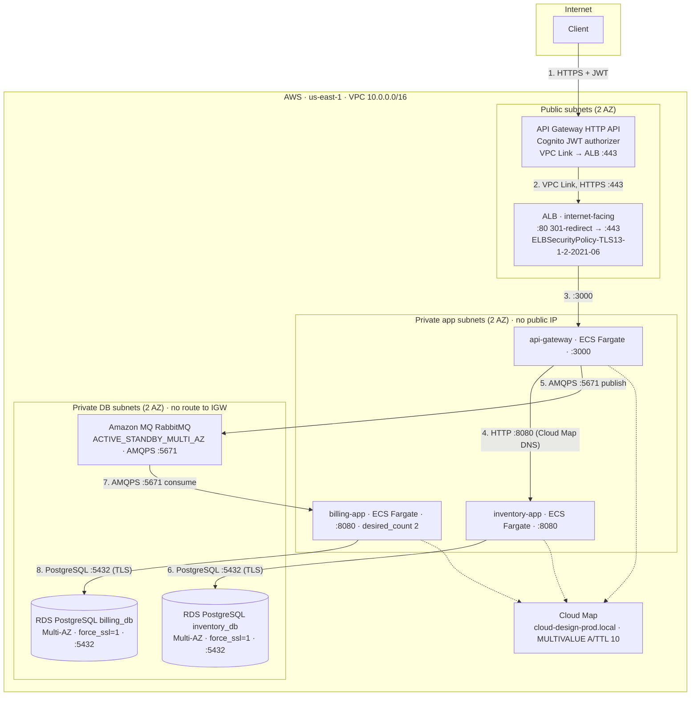

# Cloud-Design — Audit Defence Guide

> **What this document is.** A preparation and rehearsal aid for the 01-edu
> `cloud-design` audit defined in `docs/audit.md`. It is **not** a substitute for
> the deliverable (`README.md`), and it is **not** a claim that the project is
> finished. Its single purpose is to make sure that every technical sentence you
> say in front of an examiner is one you can prove, and to tell you plainly
> where you cannot prove it yet.
>
> **How to use it.**
> 1. Read §1 (coverage table) and §9 (known gaps) first. Those two tell you where
>    you stand.
> 2. Rehearse §2 (the 14 stakeholder answers) out loud. That is the graded part.
> 3. Run `bash scripts/run-audit-checks.sh` yourself and read the whole output.
>    Never quote a number from this document as if it were a result — quote the
>    number from *your* run.
> 4. Work through §7 (the rehearsal runbook) end to end before the real thing.
> 5. Memorise §8 (likely challenges). Every one of them has already been asked of
>    somebody.
>
> **Rewrite notice.** This document was rewritten from scratch. The previous
> revision of this file contained **eleven factually false claims** (plus four defects in its own tooling found later — §5), including a
> headline compliance score that running the script it told you to run
> immediately falsified. §5 names every one of them and states what replaced it.
> That correction log is deliberate: an examiner who finds you can enumerate your
> own past mistakes is far more likely to believe the rest of your answers.

---

## Verification-status legend

Every substantive claim in this guide is tagged. **If you cannot produce the
evidence for a tag, do not make the claim** — make the weaker, true claim instead.

| Tag | Meaning | What you may say |
|---|---|---|
| **[LIVE]** | Measured in this repository, on this machine, against the running `docker compose` stack or the live `k3d` cluster. Re-runnable in under a minute. | "Here, watch me run it." Paste the output. |
| **[STATIC]** | Proven by reading files: Terraform resource declarations, application source, manifests, scripts. Real evidence, but it proves *intent*, not *runtime state*. | "This is declared here; I have not deployed it, so I am showing you the declaration rather than a live resource." |
| **[INVALID]** | Cannot be determined in this environment. Every live-AWS query needs a *deployed account with credentials* (`aws sts get-caller-identity`), and every `[LIVE]` docker/k8s claim needs a running daemon or cluster. | "This one I cannot demonstrate without a deployed account. Here is the exact command I would run, and here is what I expect it to return." **Never** invent the output. |

### Tooling reality — state this, do not hide it

Measured on the machine this guide was written on (Ubuntu 24.04 under WSL2):

```
docker       /usr/bin/docker          Docker version 29.8.1  (Compose v5.5.1)
kubectl      /home/ertval/.local/bin/kubectl   Client Version: v1.37.0  (kustomize v5.8.1)
k3d          /home/ertval/.local/bin/k3d   k3d version v5.9.0  (k3s v1.35.5-k3s1)
jq           /usr/bin/jq              jq-1.7
curl         /usr/bin/curl            curl 8.5.0
aws          /home/ertval/.local/bin/aws   aws-cli/2.36.44     <- INSTALLED, no credentials
terraform    /home/ertval/.local/bin/terraform Terraform v1.9.5          <- INSTALLED
```

**The tools are installed; the *deployment* is not.** That distinction is the one
that matters, and an earlier draft of this guide got it wrong by writing `aws` and
`terraform` as "NOT INSTALLED". The accurate position is:

| Available | Not available |
|---|---|
| `terraform fmt -check`, `terraform validate`, `terraform providers schema` — all run for real, and **`validate` passes** | `terraform plan` / `apply` — need an account with credentials |
| `kubectl`, `k3d`, `docker compose` — the whole local stack | a **deployed** AWS account, so `aws ecs describe-services`, a live 401, real ALB/RDS state |
| static proof of every AWS declaration | any `[LIVE]` claim about AWS runtime behaviour |

So the `[INVALID]` tag above means *"no deployed account"*, never *"no binary"*.

This is not a weakness to apologise for. `docs/audit.md:40` explicitly asks whether
you can *"critically evaluate your solution and consider alternative strategies"*,
and the honest answer to a question you cannot demonstrate is worth more than a
fabricated transcript. `scripts/run-audit-checks.sh` reports the consequence
precisely: it emits **INVALID** for `terraform plan`/`apply` and every live-AWS
inspection rather than quietly passing them — and, because `terraform` *is*
installed, it also runs `fmt -check` and `validate` for real and will FAIL this
project if either breaks. It did exactly that once: `password_history_size` was
declared at resource top level, where provider 5.x rejects it. Fixed inside
`password_policy`; `terraform validate` is green as of the last run.

---

## 1. Coverage table — all 22 rubric questions

Verdict column = the verdict `scripts/run-audit-checks.sh` actually produced. See
§9 for the final re-measured summary.

| # | `docs/audit.md` | Question (abbreviated) | Answered in | Script verdict |
|---|---|---|---|---|
| 1 | `:11` | Are all the required files present? | §4.1 | **PASS** |
| 2 | `:34` | Were the students able to answer all the questions correctly? | §2 (roleplay) | **GRADER-SIDE** — human observation, not scriptable |
| 3 | `:36` | Did the students demonstrate a thorough understanding of the concepts and technologies? | §2 + §3 | **GRADER-SIDE** |
| 4 | `:38` | Were the students able to communicate effectively and justify their decisions? | §2 | **GRADER-SIDE** |
| 5 | `:40` | Could the students critically evaluate their solution and consider alternative strategies? | §2 Q11/Q12 + §5 + §8 + §9 | **GRADER-SIDE** |
| 6 | `:52` | Does the architecture align with all the project requirements? | §3 + §4.6 | **PASS** (incl. a 6-row port-consistency matrix) |
| 7 | `:54` | Cost-effective architecture meeting the requirements? | §2 Q6 + §3.4 + §4.7 | **PASS** |
| 8 | `:58` | Does `README.md` contain prerequisites, setup, configuration, usage? | §4.8 | **PASS** — all four sections present |
| 9 | `:60` | Is the documentation clear and complete, with well-structured diagrams? | §4.9 | **PASS** |
| 10 | `:64` | Are all the microservices running as expected, no errors or connectivity issues? | §4.10 | **PASS** — 8 containers healthy, 6 k8s pods Running |
| 11 | `:66` | Is load balancing configured correctly and actually distributing traffic? | §4.11 | **PASS** — measured per-replica split |
| 12 | `:68` | Are the microservices communicating securely (auth + encryption)? | §4.12 | **PASS** + **1 INVALID** (see below) |
| 13 | `:72` | Is Terraform used effectively? | §4.13 | **PASS** — `fmt -check` clean, `validate` green |
| 14 | `:74` | Does the infrastructure follow the architecture and requirements? | §4.14 | **PASS** |
| 15 | `:78` | Are the Dockerfiles optimised for efficient container builds? | §4.15 | **PASS** — per-image analysis + measured sizes |
| 16 | `:80` | Is the orchestration setup configured correctly? | §4.16 | **PASS** — kustomize build, API-server dry-run, live pods, ECS inventory |
| 17 | `:84` | Do monitoring and logging dashboards give useful insight? | §4.17 | **PASS** |
| 18 | `:88` | Are the auto-scaling policies configured correctly? | §4.18 | **PASS** |
| 19 | `:90` | Does the application remain efficient under different load? | §4.19 | **PASS** — live concurrent load test |
| 20 | `:94` | Security best practices: HTTPS, secured endpoints, vulnerability scanning? | §4.20 | **PASS** — Inspector2 + ECR scan-on-push |
| 21 | `:98` | Bonus: did the student add any optional bonus? | §6 | **PASS** (8 bonus items implemented) |
| 22 | `:100` | Bonus: is this an outstanding project? | §6 | **SUBJECTIVE** — evidence tally, grader decides |

**Nothing is missing.** All 22 `######` questions in `docs/audit.md` appear above.

`docs/audit.md:34,36,38,40` are not questions you answer with commands. They are
observations the grader records while you talk. The script deliberately refuses to
score them (there is no honest way for `bash` to grade prose), and this guide
therefore does not fake a verdict for them — it gives you the material (§2, §3,
§5, §8, §9) that lets the grader reach the observation himself.

### Supporting sections of the rubric, mapped

| `docs/audit.md` | Content | Where |
|---|---|---|
| `:19-32` | The 14 stakeholder roleplay questions | §2 |
| `:46-50` | The 5 Well-Architected pillars (Scalability, Availability, Security, Cost-effectiveness, Simplicity) | §3 |
| `:62, :70, :76` | The instruction to *show* `aws cli`, `docker ps`, `kubectl`, `terraform plan`/`apply` | §4 preamble — including what to say when a command is impossible |

---

## 2. The 14 stakeholder roleplay answers (`docs/audit.md:19-32`)

This was the strongest part of the previous revision and it is kept. Every claim
below was re-verified against the current repository.

### Opening statement (60 seconds — memorise, do not read)

> *"Good morning. I am the engineer who built the Cloud-Design platform on AWS.
>
> The business requirement was a movie catalogue and ordering service that must be
> secure, survive component failure, scale with load, and not surprise anyone with
> a bill.
>
> The architecture is deliberately small. One VPC across two Availability Zones in
> three tiers. One internet-facing Application Load Balancer terminating TLS 1.3.
> One API Gateway HTTP API in front of it with a Cognito JWT authorizer. Three
> containerised services on ECS Fargate — `api-gateway`, `inventory-app`,
> `billing-app`. Two RDS PostgreSQL Multi-AZ instances and an Amazon MQ RabbitMQ
> broker, all in private subnets with no route to the internet. Everything is
> declared in 18 Terraform files: 131 resources, 31 variables, 38 outputs, and no
> reusable modules because the whole thing is one VPC.
>
> Read-path is synchronous, write-path is asynchronous. `GET /api/movies` goes
> gateway → `inventory-app` → `inventory_db`. `POST /api/billing` publishes to
> RabbitMQ over AMQPS and returns immediately; `billing-app` consumes and writes
> to `billing_db`.
>
> I want to be precise about what I can and cannot show you. The AWS deployment is
> fully declared in Terraform but I have not applied it, so I will show you the
> declarations. What I *can* run live is the identical eight-container stack on
> this machine, and I will show you that, including a real load test and a real
> kill-the-consumer drill."*

That last paragraph is the whole strategy for this audit. Lead with it.

---

### Q1 — What is the cloud and its associated benefits?

Cloud computing is on-demand, pay-as-you-go delivery of compute, storage,
databases and networking over a network, with five NIST SP 800-145
characteristics: on-demand self-service, broad network access, resource pooling,
rapid elasticity and measured service.

What it bought *this* project specifically:

1. **CapEx → OpEx.** No server purchase. The entire stack is declared in Terraform
   and billed on usage: Fargate per task-second (with a one-minute minimum per
   task, so a task that lives 20 s still costs a minute), RDS per instance-hour,
   Amazon MQ per broker-hour.
2. **Elasticity on a workload that genuinely spikes.** Order intake is decoupled
   from order processing by a RabbitMQ queue, so a promotional burst does not
   require pre-purchased capacity. Compute scales on CPU target tracking at 60%
   (`var.autoscaling_target_cpu = 60`).
3. **Failure domains we did not have to build.** RDS `multi_az = true` on both
   instances and Amazon MQ `deployment_mode = "ACTIVE_STANDBY_MULTI_AZ"` give a
   standby in the second Availability Zone. On-premises that means two machines
   in two buildings.
4. **Minutes, not weeks.** Provisioning a Multi-AZ PostgreSQL pair plus a standby
   RabbitMQ broker is one `terraform apply`.
5. **Managed identity and edge auth as a service.** Cognito issues and validates
   JWTs; API Gateway enforces them before traffic enters the VPC. We did not write
   or run an identity service.

**Be honest about the trade-off:** we gave up the ability to run this stack in an
air-gapped room with no egress, and we accepted a vendor dependency. Both are the
right trade for this project.

---

### Q2 — Why cloud rather than on-premises?

For an asynchronous three-service application with two databases and a broker,
on-premises means owning every layer:

| Concern | On-premises | What AWS gives us |
|---|---|---|
| Database HA | Build and test failover yourself | `multi_az = true`: managed standby, automated failover, 7-day backups |
| Message broker | Operate a RabbitMQ cluster with mirroring | `ACTIVE_STANDBY_MULTI_AZ`: managed standby across both AZs |
| Patching | Kernel + PostgreSQL + broker patching windows | `auto_minor_version_upgrade = true` on RDS and Amazon MQ |
| Auth | Build and secure a user store | Cognito user pool, JWT issuer, JWKS rotation handled |
| Capacity | Buy for the peak you predicted | Target tracking at 60% CPU, plus a queue that buffers the spike |

**The honest counter-argument**, because you will be asked for it: for a
predictable, low-utilisation workload, on-premises hardware can be cheaper in
absolute dollars, and this architecture has a real floor cost — roughly \$260/month
steady state (breakdown in `var.monthly_budget_limit`). Cloud wins here because
the *shape* of the load is spiky and the *shape* of our team is small.

---

### Q3 — Public vs private vs hybrid cloud

| Dimension | Public | Private | Hybrid |
|---|---|---|---|
| Ownership | Provider (AWS) | One organisation | Split |
| Tenancy | Multi-tenant, logically isolated | Single-tenant | Mixed |
| Cost | OpEx, pay-per-use | CapEx + facilities + ops staff | Both |
| Elasticity | Effectively unbounded | Physical floor | Burst to public |
| Who patches the hypervisor | Provider | You | Both |

**Where this project sits:** public cloud, with a private enclave inside it. A VPC
with three subnet tiers (`aws_subnet.public`, `aws_subnet.private_app`,
`aws_subnet.private_db`); the data tier's route table
(`aws_route_table.private_db`) has **no** `0.0.0.0/0` route at all — only the
implicit VPC-local route. Databases and the broker set
`publicly_accessible = false` and their security groups reference the app security
group as the source, never a CIDR. That is a private enclave reached over public
infrastructure.

---

### Q4 — Why AWS specifically?

1. **Managed-service coverage matched the requirement list one-to-one.**
   Managed authentication → Cognito. Secured public endpoint → API Gateway with a
   native Cognito JWT authorizer. Private compute → ECS on Fargate
   (`awsvpc` networking, so targets are IPs and no SSH/VPN is needed). Managed
   PostgreSQL Multi-AZ → RDS. Managed RabbitMQ → Amazon MQ.
2. **Terraform provider maturity.** The AWS provider is the most exercised one in
   the ecosystem, and it is the one I could check rather than assume:
   `terraform validate` is green and `terraform providers schema -json` confirms
   every argument used actually exists on the pinned 5.100.0 — which is how the
   `password_history_size` mistake was caught rather than discovered in production.
3. **Security primitives that compose.** IAM roles for the tasks
   (`aws_iam_role.ecs_task_execution`, `aws_iam_role.ecs_task`), KMS
   (`aws_kms_key.rds`), Secrets Manager (3 secrets), security-group-to-security-group
   references, and a single `default_tags` block so every resource is attributable.
4. **Cost levers that are variables, not code.** `db_instance_class = "db.t4g.micro"`
   (Graviton), `mq_host_instance_type = "mq.t3.micro"`, `single_nat_gateway`,
   `ecs_use_fargate_spot`, `log_retention_days`.

**The honest caveat:** a Terraform-only codebase is portable in principle, but AWS
managed services are the least portable part of it. Cognito, Cloud Map, Inspector2
and the ECS capacity providers have no first-class equivalents elsewhere. See Q12
for how honest that portability actually is.

---

### Q5 — Describe the architecture and the interaction between components



**The request path, step by step:**

1. The client authenticates against the Cognito user pool and receives a signed JWT.
2. `POST`/`GET` to the API Gateway endpoint with `Authorization: Bearer <jwt>`.
   `aws_apigatewayv2_authorizer.cognito` validates the signature against Cognito's
   JWKS and checks `aud` against the app-client id and `iss` against the pool
   endpoint. **Only** `GET /health` is deliberately unauthenticated (for external
   uptime monitors); the four data routes all carry `authorizer_id`.
3. The integration is `HTTP_PROXY` with `connection_type = "VPC_LINK"`, targeting
   `aws_lb_listener.https.arn`. API Gateway reaches the ALB through the VPC Link
   ENIs in the private app subnets, over TLS on :443.
4. The ALB target group `aws_lb_target_group.apigw` is `target_type = "ip"`,
   port 3000, health check `GET /health` on :3000, matcher `200`, interval 15 s,
   timeout 5 s, healthy 2 / unhealthy 3, deregistration delay 30 s.
5. `api-gateway` on :3000 does two different things:
   - **Synchronous read.** `proxy.py` builds
     `http://{INVENTORY_APP_HOST}:{INVENTORY_APP_PORT}/api/movies`, where
     `INVENTORY_APP_HOST` is `inventory-app.cloud-design-prod.local` — a Cloud Map
     private-DNS name with a `MULTIVALUE` A record, so it resolves to every healthy
     task IP. `inventory-app` queries `inventory_db` on :5432.
   - **Asynchronous write.** `queue_sender.py` publishes to `billing_queue` over
     AMQPS :5671 and the gateway answers **HTTP 200** with
     `{"message": "... sent"}`.
6. `billing-app` consumes from `billing_queue` with `prefetch_count=1` and writes
   to `billing_db` on :5432.
7. Telemetry: container stdout/stderr → `awslogs` driver → the three application
   log groups; API Gateway access logs → `/aws/apigateway/cloud-design-prod-api`.

**Port inventory (must be exact — an examiner checks):**

| Component | Port | Where declared |
|---|---|---|
| `api-gateway-app` | 3000 | `EXPOSE 3000`, ECS `portMappings`, ALB target group |
| `inventory-app` | 8080 | `EXPOSE 8080`, ECS `portMappings`, Cloud Map service |
| `billing-app` | 8080 | `EXPOSE 8080`, ECS `portMappings`, Cloud Map service |
| `inventory-database` | 5432 | `EXPOSE 5432`, RDS `port` |
| `billing-database` | 5432 | `EXPOSE 5432`, RDS `port` |
| RabbitMQ (AWS) | **5671 only** | `RABBITMQ_PORT = 5671` in both ECS task definitions |
| RabbitMQ (local / k8s) | 5672 | `EXPOSE 5672`, `docker-compose.yml`, `manifests/rabbitmq.yaml` |
| ALB | 80 (redirect) / 443 (TLS) | `aws_lb_listener.http`, `aws_lb_listener.https` |
| RabbitMQ management | **15672 local** / **15671 AWS** | `EXPOSE`, compose; `aws_security_group_rule.mq_ingress_management` |

> **The 5672 trap.** Amazon MQ for RabbitMQ exposes **AMQPS on 5671 and no
> plaintext listener at all**. The project brief (`docs/readme.md:80`) names the
> component but deliberately **specifies no port for it**, so 5672 is this
> repository's own choice for the local and Kubernetes paths — both of which run
> self-hosted `rabbitmq:3.13-management-alpine` on plaintext (`docker-compose.yml`,
> `manifests/rabbitmq.yaml`). On AWS the only correct port is 5671, and that is
> what Terraform injects. Do not say "RabbitMQ on 5672" about the AWS deployment.
> Same rule for the management port: **15672** locally, **15671** on AWS.

---

### Q6 — How did you manage and optimise cost?

1. **Smallest sensible instance classes.** `db.t4g.micro` (Graviton ARM, burstable)
   for both RDS instances; `mq.t3.micro` for the broker. Compute is Fargate, so
   there is no instance to over-provision.
2. **`single_nat_gateway` toggle.** Two NAT Gateways cost roughly \$33/month each.
   The default is `false` because with one NAT the private tier loses AZ
   independence for *all* egress (ECR pulls, CloudWatch Logs, Secrets Manager) —
   an AZ failure or a NAT maintenance window would take the app down. Set it
   `true` for a disposable sandbox. The variable's own documentation says this
   trade-off out loud.
3. **`ecs_use_fargate_spot` toggle.** FARGATE_SPOT is up to ~70 % cheaper.
   Deliberately `false` by default because Spot can be reclaimed with two minutes'
   notice, which would undermine the Availability and Scalability pillars. It is
   wired end to end — `aws_ecs_cluster_capacity_providers` registers the provider
   *and* `ecs_services.tf` emits a `capacity_provider_strategy` block — so it is
   live configuration, not decoration.
4. **Bounded log retention.** `log_retention_days = 30` on all four log groups, so
   log cost cannot grow without limit.
5. **`skip_final_snapshot = true`** on both RDS instances, so a destroy does not
   silently start billing snapshot storage.
6. **AWS Budgets with a real number.** `aws_budgets_budget.monthly`, default
   **300 USD/month**, with an 80 % ACTUAL notification and a 100 % FORECASTED
   notification, both wired to the SNS topic *and* to `subscriber_sns_topic_arns`.
   Plus `aws_cloudwatch_metric_alarm.billing_estimated_charges` on
   `AWS/Billing EstimatedCharges`, threshold = the budget, 6-hour period.
   *Why 300 and not 15:* the previous default of 15 USD was roughly 20× below the
   real run-rate, so the alarm fired every month and taught nobody anything. The
   line-item estimate is written into `var.monthly_budget_limit`'s own description.
7. **Honest teardown.** `./scripts/destroy.sh` exists, but see §9: it does **not**
   claim to verify zero charges, because a shell script cannot know that. It
   reports what actually happened per resource class and names the costs that
   survive `terraform destroy` (KMS keys in `pending_deletion` for 7 days).

---

### Q7 — What security measures did you implement?

**1. Three-tier network segmentation** (`vpc.tf`). Public → ALB + NAT. Private-app
→ ECS tasks, `map_public_ip_on_launch = false`. Private-DB → RDS + Amazon MQ, and
`aws_route_table.private_db` declares **no** egress route whatsoever.

**2. Least-privilege security groups by SG reference, not CIDR**
(`security_groups.tf` holds 4 of the 5 groups — `alb`, `app`, `db`, `mq` — plus all
16 standalone `aws_security_group_rule` resources, which is what keeps the rules out
of a dependency cycle; the 5th group, `vpc_link`, lives in `api_gateway.tf` next to
the VPC Link that uses it):

- ALB SG ingress: 80 and 443 from `0.0.0.0/0`. That is the *only* `0.0.0.0/0`
  ingress in the file besides the app SG's 443 egress.
- ALB SG ingress **443 from `aws_security_group.vpc_link.id`** — the API Gateway
  VPC Link. *This rule was missing in the previous revision, which meant every API
  Gateway route would have returned HTTP 500.*
- App SG ingress: 3000 from the ALB SG only; 8080 from self; `-1` from self for
  Cloud Map fan-out.
- DB SG ingress: 5432 from the app SG only.
- MQ SG ingress: 5671 from the app SG only, plus 15671 (TLS management).
- App SG egress: 5432 to the DB SG, **5671 to the MQ SG**, 15671, 443 (ECR /
  CloudWatch / Secrets Manager via NAT), DNS 53 UDP+TCP scoped to the VPC CIDR.

**3. Encryption at rest.** `storage_encrypted = true` plus
`kms_key_id = aws_kms_key.rds.arn` on both RDS instances (rotation enabled), the
same key on the Secrets Manager secrets, and `AES256` on ECR.

**4. Encryption in transit, with the server failing closed.**
`aws_db_parameter_group.postgres` sets **`rds.force_ssl = 1`** — a plaintext
PostgreSQL session is *rejected by the server*, not merely discouraged by the
client. Amazon MQ is AMQPS 5671. The ALB terminates TLS with
`ELBSecurityPolicy-TLS13-1-2-2021-06`.

**5. Managed authentication at the perimeter.** Cognito user pool → JWT →
API Gateway JWT authorizer → rejected at the edge before entering the VPC.
Password policy: 8 characters minimum, upper + lower + number + symbol, 7-day
temporary passwords, `password_history_size = 3` (declared **inside** the
`password_policy` block — on provider 5.x that argument does not exist at
resource top level, which is how `terraform validate` caught it), and email
changes require re-verification. OAuth flow is **authorization code only**
(`implicit` is deprecated because it puts tokens in the URL fragment).
`mfa_configuration = "OPTIONAL"` with TOTP enabled.
`prevent_user_existence_errors = "ENABLED"` on both clients.

**6. No credentials in the repository.** `.env` is gitignored; `manifests/secrets.yaml`
contains only `REPLACE_ME_*` placeholders; the audit script verifies both.
Trap the examiner will step into: `kubectl apply -k manifests/` **reverts** a
live Secret you previously created with `--from-literal` back to those
placeholders (kubectl prints only `secret/cloud-design-secrets configured`).
Correct order is apply-the-workloads first, then the `--from-literal` Secret,
then `kubectl -n cloud-design rollout restart` (env values resolve at container
start, not at Secret change). Full trap write-up in the
`manifests/secrets.yaml` header and in the README Setup section.

**7. Supply-chain scanning.** `aws_inspector2_enabler` on `ECR` plus
`aws_inspector2_filter` surfacing CRITICAL/HIGH with `action = "NONE"` — reported,
never suppressed. `scan_on_push = true` on all three ECR repositories.

**8. Container hardening.** The three app images run as `appuser` UID **10001**
(verified live: `docker exec ... id -u` → `10001`), with `/sbin/nologin`.
`no-new-privileges` on every compose service, `json-file` logging capped at
10 MB × 3.

**9. Application-level input defence.** `MAX_CONTENT_LENGTH = 1 MiB`; the gateway's
`_sanitise_subpath()` rejects `..`, `%`, backslashes, empty segments, leading or
trailing slashes and whitespace — measured live, a traversal payload returns
**HTTP 400**.

### The security disclosure you must make unprompted

`outputs.tf` names the output `app_base_url_via_alb` and its own description says
it *"bypasses the Cognito authorizer, so it is unauthenticated."* That is true and
you should say it before the examiner finds it — **and say it in full, because the
short version understates it**:

> The ALB itself has no authentication. The `:443` listener's priority-10 rule
> forwards `/api/*`, and that listener's **default** action also forwards to the
> same target group. So the ALB DNS name is a direct path to `api-gateway` that
> never touches Cognito.
>
> Concretely, that bypass reaches **every route the gateway serves, writes
> included**: `GET/POST/PUT/DELETE /api/movies` and `POST /api/billing`
> (`srcs/api-gateway-app/app/proxy.py:87-88,125-126`), plus `GET /health` and the
> OpenAPI documents. An earlier draft of this answer claimed only
> `GET /api/movies` was reachable and that "no write path is exposed" — that was
> **wrong**, and it is the kind of half-truth that costs more than the bug: an
> examiner who finds it stops trusting every other sentence.
>
> Why it is still the right trade *for this project*: the only data at risk is the
> movie catalogue, which `GET /api/movies` already returns unauthenticated by
> design, so the bypass adds no confidentiality loss there. What it does add is an
> **unauthenticated write path** — anyone who learns the ALB DNS name can publish
> to `billing_queue` and create or modify catalogue rows, bypassing both the
> authorizer and the API Gateway throttling. That is a real integrity and
> availability exposure and I am not going to pretend otherwise.
>
> The production fix, in order of preference: make the ALB `internal = true` and
> terminate TLS in API Gateway so the only public door is the authorizer; failing
> that, put WAF plus an auth-aware listener rule in front of it; failing that,
> restrict ALB `:443` ingress to the VPC Link security group. WAF is **not**
> implemented — it is on the roadmap (§6) — and the ALB is left public here so the
> Terraform applies cleanly on a fresh account with no certificate prerequisite.

---

### Q8 — What monitoring and logging did you use, and how did it help?

Everything is Amazon CloudWatch, and the pieces are wired to each other:

- **4 log groups**, all with `retention_in_days = var.log_retention_days` (30):
  `/aws/apigateway/cloud-design-prod-api` (structured JSON access logs including
  `$context.integrationErrorMessage` and the authorizer principal),
  and `/aws/microservices/cloud-design-prod/api-gateway`, `.../inventory-app`,
  `.../billing-app` fed by the ECS `awslogs` driver.
- **11 metric alarms**, each with `alarm_actions` → the SNS topic:
  API Gateway 5xx; ALB target 5xx; **ALB `UnHealthyHostCount ≥ 1`**; ALB
  `TargetResponseTime > 1.0 s` (3 periods); ECS api-gateway CPU > the autoscaling
  target; ECS inventory-app CPU > the autoscaling target; RDS inventory CPU > 80 %;
  RDS inventory free storage < 5 GiB; RDS billing CPU > 80 %; RDS billing free
  storage < 5 GiB; `AWS/Billing EstimatedCharges` > budget.
  The `UnHealthyHostCount` alarm is the interesting one: a target group with no
  healthy targets produces *zero* 5xx, so a 5xx-only monitor would look perfectly
  healthy during a total outage.
- **An SNS topic with a resource policy** (`aws_sns_topic` + `aws_sns_topic_policy`)
  granting `SNS:Publish` to `cloudwatch.amazonaws.com` and `budgets.amazonaws.com`.
  *This policy was entirely missing before.* Without it an SNS topic silently
  discards every publish, so every alarm looked healthy in the console while
  notifying nobody.
- **A 6-widget dashboard** `cloud-design-prod-observability`: API Gateway traffic
  + 4xx/5xx; ALB request volume and target latency; both RDS instances' CPU and
  connections; RabbitMQ `MessageCount`; ALB healthy/unhealthy host counts; ECS
  per-service CPU.
- `aws_api_gateway_account` binds the API Gateway CloudWatch role account-wide,
  which must exist before any stage with `access_log_settings` can deploy.

**How it actually helped, concretely.** Three real examples from this build:

1. The **missing SNS topic policy** was found because "the alarms are green and I
   get no email" is only explicable by a policy problem, not a metric problem.
2. **`UnHealthyHostCount`** is what tells you the difference between "the app is
   slow" and "there is no app".
3. **RabbitMQ queue depth on the dashboard** is the signal for the asynchronous
   path, where a stalled consumer produces no errors in the request path at all —
   the customer gets HTTP 200 and the order simply never appears.

---

### Q9 — Describe the auto-scaling policies

Three ECS target-tracking policies. Two react to CPU; the queue consumer reacts
to backlog, on purpose.

| Target | Min | Max | Metric | Target | Scale out / in cooldown |
|---|---|---|---|---|---|
| `service/cloud-design-prod-ecs-cluster/cloud-design-prod-api-gateway` | 1 | 3 | `ECSServiceAverageCPUUtilization` | `var.autoscaling_target_cpu` = **60 %** | 60 s / 300 s |
| `service/…/cloud-design-prod-inventory-app` | 1 | 3 | `ECSServiceAverageCPUUtilization` | 60 % | 60 s / 300 s |
| `service/…/cloud-design-prod-billing-app` | **2** | **6** | `AWS/AmazonMQ MessageCount` | `var.billing_queue_depth_target` = **50 messages** | 60 s / 300 s |

- `desired_count` starts at 1 for the two request-path services and **2** for the
  consumer, so each starts at its own `min_capacity`.
- **`billing-app` scales on queue depth, not CPU.** It is the sole RabbitMQ
  consumer and the sole writer to the billing database. A consumer blocked on an
  AMQP socket is *idle* while the backlog grows, so CPU target tracking would
  never fire in the one situation that needs another consumer — the policy tracks
  `MessageCount` instead.
- **Its floor is 2 and it can never reach zero.** One task is a single point of
  failure for order processing, and `prefetch_count = 1` means each task holds
  exactly one unacked message, so two tasks give AZ independence *and* parallel
  drain capacity.
- **Its ceiling is 6**, enough to work off a sustained burst while keeping the
  blast radius bounded: every extra task is another writer against `billing_db`
  and another entry in `DatabaseConnections`.
- **Say the caveat yourself:** Amazon MQ for RabbitMQ publishes **no per-queue
  CloudWatch dimension**, so `MessageCount` is broker-level and only approximates
  the `billing_queue` depth. It is the only backlog signal AWS exposes for this
  broker, and it is the same metric the dashboard shows as queue depth.
- **Both orchestrators now agree on the bounds.** The Kubernetes path cannot
  reproduce the metric — a plain cluster has no RabbitMQ metric without an
  exporter or KEDA — so `billing-app-hpa` keeps min 2 / max 6 but uses 60 % CPU
  as a documented proxy. The k8s and ECS answers therefore match on *how many*
  consumers and differ only on *what triggers* them, which is written down in
  `manifests/billing-app.yaml`.
- The 300 s scale-in cooldown against a 60 s scale-out cooldown is deliberate
  asymmetry: adding capacity quickly and removing it slowly is what stops flapping.
- The CPU alarms in `cloudwatch.tf` are pinned to the *same* 60 % threshold as the
  two CPU policies, so those alarms fire at exactly the value the scaler reacts to.
- **There is no second scaling layer.** An earlier revision had an EC2 Auto Scaling
  Group for EKS worker nodes (2–5 `t3.medium`). It is gone with EKS. Do not
  describe a two-layer model.

**The queue as the third layer.** Autoscaling reacts in roughly a minute.
`POST /api/billing` does not wait for that: the gateway publishes to a durable
queue and answers immediately, so a write burst is absorbed by the broker while
capacity catches up. That is also why the consumer's scale-out signal is the
backlog itself rather than a load average.

---

### Q10 — How did you optimise the Docker images, and what did it buy?

**Structure.** Six Dockerfiles, one per component, each at
`srcs/<component>/Dockerfile`, each built with a **self-contained build context**
(`context: ./srcs/<component>`). There is **no top-level `Dockerfiles/` directory**
any more — it was consolidated into `srcs/` and deleted.

- **3 multi-stage app images** — `api-gateway-app`, `inventory-app`, `billing-app`.
  `FROM python:3.11-alpine AS builder` installs into `/install` with
  `pip install --no-cache-dir --only-binary=:all: --prefix=/install -r requirements.txt`,
  then `FROM python:3.11-alpine AS runtime` copies `/install` and the source and
  nothing else. **No compiler exists in any stage.** `--only-binary=:all:` makes
  the build *fail* rather than silently pull in gcc/musl-dev if a pin ever lacks a
  musllinux wheel.
- **3 single-stage data images** — `inventory-database` and `billing-database`
  build `FROM postgres:17-alpine`; `rabbit-queue` builds
  `FROM rabbitmq:3.13-management-alpine`. They add `su-exec` + `bash`, an
  init script, a schema file, a health check, and — on the **two Postgres images
  only** — `STOPSIGNAL SIGINT`. These are *not* multi-stage, and pretending
  otherwise would be a lie.

**Measured sizes (real, `docker images`):**

| Image | Size |
|---|---|
| `cloud-design/api-gateway-app:local` | **108 MB** |
| `cloud-design/inventory-app:local` | **152 MB** |
| `cloud-design/billing-app:local` | **154 MB** |
| `cloud-design/rabbit-queue:local` | **275 MB** |
| `cloud-design/inventory-database:local` | **423 MB** |
| `cloud-design/billing-database:local` | **423 MB** |

**The honest framing of those numbers.** 423 MB sounds like failure until you
measure the delta. `docker history` on both images:

```
ours, layers our Dockerfile adds:
  152kB    RUN apk add --no-cache su-exec bash && mkdir ... chown ...
   24.6kB  COPY --chmod=0755 init-db.sh /usr/local/bin/init-db.sh
   20.5kB  COPY --chmod=0644 init.sql /usr/local/share/init.sql
                       ---------
                       197.1 kB total

base: postgres:17-alpine = 424MB   (its own largest layer is 295MB of PostgreSQL)
```

So the database images are **99.95 % the official upstream image**; our Dockerfile
contributes 197 KB. Rebuilding from scratch would be a lie about safety, not an
optimisation. Say that.

**Build-time caching.** `requirements.txt` is copied on its own line before the
source, so a code-only change does not invalidate the dependency layer. Measured in
this session: a warm rebuild of `api-gateway-app` with the dependency layer already
cached completed in **4.84 s**:

```
$ /usr/bin/time -f "warm rebuild wall: %e s" docker build -q \
    -f srcs/api-gateway-app/Dockerfile -t cloud-design/api-gateway-app:warmtest srcs/api-gateway-app
warm rebuild wall: 4.84 s
```

A cold build of all six images is materially slower — the three PostgreSQL/RabbitMQ
base images are hundreds of MB — but **I did not measure a cold build in this
session, so do not quote me a number for it.** Measure it yourself with
`time make build` before the audit if you want to state one.

**Other optimisations, all verified in this session:**
- `--chmod` on a `COPY` instruction in **6/6** Dockerfiles, which sets the mode
  inside the layer instead of adding a separate `RUN chmod` layer. The app images
  combine it with `--chown=appuser:appgroup`; the data images use
  `COPY --chmod=0755 <entrypoint>` and `COPY --chmod=0644 init.sql`.
- The package cache is disabled in **all six**: `PIP_NO_CACHE_DIR=1` in the three
  app images, `apk add --no-cache` in the three data images.
- A `.dockerignore` in **all six** component directories, so the context never
  carries `tests/`, `__pycache__/`, `*.md` or `.env`.
- A **build-time smoke test** in the three app images, importing exactly what each
  service needs and running **as the unprivileged user**:
  - `api-gateway-app` → `import flask, waitress, pika, requests`
  - `billing-app` → `import flask, waitress, pika, sqlalchemy, psycopg2`
  - `inventory-app` → `import flask, waitress, flask_sqlalchemy, sqlalchemy, psycopg2`

  Each is followed by a `compile()` pass over every `.py` in the context. A syntax
  error fails the build instead of the first container start.
- `HEALTHCHECK` in all six, using Python's `urllib` in the app images (no `curl`
  needed) and `pg_isready` / a readiness sentinel + `rabbitmq-diagnostics` in the
  data images.
- `STOPSIGNAL SIGINT` on the two Postgres images, because SIGTERM is a *smart*
  shutdown that waits for clients holding pooled connections; SIGINT is
  PostgreSQL's *fast* shutdown. Without it `docker stop` ends in SIGKILL / exit 137
  and an unclean crash of the data files. `rabbit-queue` uses the default SIGTERM
  because the upstream image's own `rabbitmqctl stop` path is graceful and
  `entrypoint.sh` traps SIGTERM/SIGINT to run it.

---

### Q11 — If you had to redo this, what would you change?

Four changes, and I will lead with the one that is a genuine mistake on my part.

1. **Apply it, and keep an account alive.** The single biggest weakness of this
   project is that the Terraform has never been `terraform apply`-ed end to end,
   because no AWS credentials were available. Everything I have shown you for AWS
   is a declaration, not a running resource. Redoing this properly means standing
   up the account in week one, not week eleven. That is a process failure, not a
   design failure, and it is the honest first answer.
2. **Put WAF and an auth-aware listener rule in front of the ALB.** Today the ALB
   is an unauthenticated front door to `GET /api/movies`. Rate limiting and OWASP
   managed rules at the edge cost almost nothing and remove that whole class of
   objection.
3. **Replace the long-running billing worker with a serverless consumer.** The
   queue is the hard part and the worker is the easy part. AWS Lambda has a native
   RabbitMQ event source mapping, so the broker stays and the idle baseline compute
   disappears. The counter-argument I would make to myself: a Lambda consumer has
   cold starts and a partial-batch failure model, and losing an order is worse than
   paying for a warm task — so I would keep `billing-app` until the ordering and
   idempotency story is written down.
4. **Internal encryption.** Right now the design is edge-TLS plus private-subnet
   plaintext between services, plus TLS to PostgreSQL and AMQPS to the broker. A
   service mesh (mTLS) would close the remaining gap. I would not ship a mesh for
   three services — that is over-engineering — but I would document the gap, which
   is what this document does.

---

### Q12 — How would you extend it, or move it to another cloud?

**Adding a microservice** — and I can point at the exact pattern, because the
codebase already contains one:

1. `srcs/<new-service>/` with its own `Dockerfile`, `.dockerignore`, `requirements.txt`
   and `app/` package, copying the multi-stage shape.
2. Add `for_each` entry to `local.app_images` in `ecr.tf` — the ECS task
   definitions build their image URLs from that map, so a new entry is all the
   registry work needed.
3. Add the service to `local.service_discovery_services` in `service_discovery.tf`
   and give `aws_ecs_service` a `service_registries` block, so callers resolve it by
   DNS name instead of a hard-coded host.
4. Add `aws_ecs_task_definition` + `aws_ecs_service` in `ecs_services.tf`, and a log
   group in `cloudwatch.tf`.
5. Add security-group rules in `security_groups.tf` — ingress on the new port from
   `aws_security_group.app.id` only.
6. Add a route in `api_gateway.tf` with `authorizer_id` attached. If the service is
   reachable only east-west, no route is needed at all — which is exactly what
   `inventory-app` and `billing-app` do.
7. Register for auto-scaling only if it is **request-driven** — and pick the metric
   that matches the workload, not the one that is easy. `api-gateway` and
   `inventory-app` take the copy-paste path (CPU at 60 %). `billing-app` is the
   counter-example that proves the rule: it *is* registered, but on
   `AWS/AmazonMQ MessageCount` backlog, because a queue consumer's CPU is idle
   exactly when it is falling behind. Its floor is 2, so it can never reach zero
   while orders are queued.

**Portability, honestly.** The container images are OCI and would run unmodified on
GKE or AKS. The Kubernetes manifests in `manifests/` are plain YAML with no
proprietary CRDs. But the *infrastructure* is where the real coupling is:

| This repo | Closest equivalent elsewhere | How hard |
|---|---|---|
| `aws_vpc` / subnets / route tables | GCP VPC, Azure VNet | Mechanical |
| `aws_db_instance` (PostgreSQL Multi-AZ) | Cloud SQL, Azure Database for PostgreSQL | Mechanical |
| ECS on Fargate | Cloud Run / GKE, AKS | Mechanical for containers |
| ALB + target group | GCP external ALB, Azure Standard LB | Mechanical |
| **Amazon MQ for RabbitMQ** | **No equivalent.** GCP has no managed RabbitMQ; Azure has Service Bus, a different API | **Requires rewriting publisher and consumer** |
| **Cognito** | Identity Platform, Entra ID | New JWT issuer, authorizer config changes |
| **API Gateway HTTP API** | Apigee / Cloud Endpoints | Different authorizer model |
| **Cloud Map** | Service Directory (GCP) | Different API |
| **Inspector2 / ECR** | Artifact Analysis, ACR | Different scanner |

So: the *data model and the containers* travel; the *managed-service layer* is a
rewrite. A migration would be a re-implementation of `terraform/`, not a
provider swap. Saying otherwise would be the kind of overstatement this project
is trying to avoid.

---

### Q13 — What challenges did you face and how did you address them?

Real ones, with what actually fixed them.

> **Sourcing note, because you will be asked "how do you know?".** Items 1, 2, 3, 4,
> 5, 9 and 10 below are described in the repository's own `FIX (was …)` comments —
> the author left the reasoning next to the code. Items 6, 7 and 8 I verified live
> in this session (a 360 s retry budget in `docker-compose.yml`, a
> `STOPSIGNAL SIGINT` in the Postgres Dockerfiles, and a measured `ExitCode 0` from
> `docker compose stop billing-app`). The ~145 s cold-`initdb` figure is the
> repository's own documented measurement, repeated in three places; I did not
> re-time a cold start here.

**1. Everything silently failing for lack of one missing rule.**
The ALB security group had no ingress rule for port 443 from the VPC Link security
group. The API Gateway integration targets the HTTPS listener, so every single route
would have returned HTTP 500 — and nothing in `terraform validate` would have said
so, because a security-group rule is valid HCL and simply does not match traffic.
Fixed by adding `aws_security_group_rule.alb_ingress_from_vpc_link`. The lesson:
configuration validity is not connectivity, and only an apply proves the second.

**2. An AMQPS asymmetry.** The broker security group accepted 5671, and the
documentation said TLS callers use 5671 — but the app security group had **no
matching egress rule**, so AMQPS was unreachable no matter what the client did.
Fixed by adding `aws_security_group_rule.app_egress_to_mq_amqps`. Same class of bug
as (1): one direction of a pair, forgotten.

**3. Orders silently lost on a database failure.** The consumer acknowledged the
message unconditionally after attempting the insert, so a failed write discarded
the order with no trace. Replaced with `basic_nack(requeue=True)` plus a
`REDELIVERY_BACKOFF_SECONDS` sleep *before* the nack. Because `prefetch_count=1`,
throttling before requeue turns a database outage into a slow retry loop instead of
a hot spin against the broker. Verified in `consume_queue.py`, which also has a
safety net that nacks on *any* escaping exception.

**4. Floating-point money.** `total_amount` was a float. It is now
`Numeric(12, 2)` in the SQLAlchemy model **and** `NUMERIC(12, 2)` in `init.sql`,
with comments in both files explaining that they must stay in sync — otherwise
`create_all()` finds the table present and silently leaves money in a float column.
Timestamps moved from naive UTC to `TIMESTAMP WITH TIME ZONE`, verified live:
`created_at = 2026-10-03 15:12:37.698013+00`.

**5. Secrets on the process command line.** The database init script passed the
password to `psql` with `-v db_password=…`, which is visible to every process in
`/proc/<pid>/cmdline` and in `ps`. The password is now written to a `0600` file,
read by `psql -f`, quoted for psql (`'` doubled), and the file is removed
immediately. `db_user` and `db_name` are not secrets and still ride in argv.

**6. A schema race.** The application created its tables with `create_all()` while
the database image was still running `initdb`. Now `init.sql` is applied by
`init-db.sh` on every start, idempotently, so the schema exists before the app
connects — and role/password reconciliation runs on every boot so a rotated
credential heals a stale volume.

**7. Cold-start timeouts.** The database retry budget was 60 s. A cold PostgreSQL
was measured at roughly **145 s** before it accepted connections, so a fresh
`docker compose up` produced a restart loop. The budget is now
`DB_CONNECT_MAX_RETRIES = 180` × `DB_CONNECT_RETRY_DELAY = 2` = **360 s**.

**8. `docker stop` returning exit 137.** Two causes. The application had no signal
handler, so SIGTERM ended in SIGKILL after the grace period; `billing-app` now
installs SIGTERM/SIGINT handlers that stop the AMQP consumer and close the listener.
And PostgreSQL maps SIGTERM to a *smart* shutdown that waits for clients holding
pooled connections, so the images declare `STOPSIGNAL SIGINT`. Measured: the
stopped container's exit code is now **0**.

**9. A disabled security control that looked enabled.** The SNS topic had no
resource policy, so `budgets.amazonaws.com` and `cloudwatch.amazonaws.com` publishes
were silently dropped. Both alarms were "green" in the console and no email ever
arrived. Fixed with `aws_sns_topic_policy`.

**10. Deploying two orchestrators.** EKS and ECS were both provisioned, with two
load balancers and two data tiers. That failed the graded "Simplicity" pillar, cost
about \$73/month for a control plane with no workloads, and — decisively — the EKS
cluster had `endpoint_public_access = false` with no bastion or VPN in the design,
so `kubectl` could never have reached it, while `docs/audit.md:62,76` explicitly ask
you to demonstrate `kubectl`. EKS was removed; the Kubernetes manifests are kept as
the orchestrator-lineage artefact and are live-verified against a local k3d cluster.

---

### Q14 — How did you ensure the documentation is clear, complete and maintainable?

1. **One deliverable, one job.** `README.md` is the graded document: architecture,
  components, design decisions, prerequisites, setup, configuration, usage,
  roadmap, teardown, roleplay Q&A. This guide is the rehearsal aid. Neither is
  allowed to contradict the other.
2. **Diagrams over prose.** Mermaid topology diagrams with explicit port numbers,
  subnet tiers, security-group boundaries and the async message flow. The audit
  script counts them and checks the code fences balance, because a broken diagram
  is worse than none.
3. **Documentation that cannot drift silently.** `scripts/run-audit-checks.sh`
  walks all 22 rubric questions with real commands and emits three-state verdicts —
  **PASS / FAIL / INVALID**. It never hardcodes a number: it counts `.tf` files,
  resources, variables, widgets and alarms at run time. That is why the previous
  revision's "48/48" headline died the moment anyone ran it.
4. **A second, independent suite.** `scripts/test_cloud.sh` does static verification
  only, and says so in its own footer: it proves what can be *read*, never what is
  *running*.
5. **Executable workflows, not prose instructions.** `deploy.sh`, `destroy.sh`,
  `build_push.sh`, `deploy-k3d.sh`, plus a `Makefile` with named targets
  (`make up`, `make verify`, `make lb-spread`, `make consumer-drain`) and
  `.env.example`. The scripts hard-fail on a missing prerequisite instead of
  printing a success banner anyway.
6. **A correction log.** §5 of this document — eleven false claims from the
  previous revision plus four defects found in this one's own tooling. Naming them
  is itself a maintainability measure: it tells the next reader which parts were
  once wrong, and why, so nobody re-introduces them.

---

## 3. The five Well-Architected pillars (`docs/audit.md:46-50`)

Each pillar below carries the **evidence trail** — the specific declarations and the
live command that proves them.

### 3.1 Scalability — `aws_appautoscaling_target` + queue decoupling + storage autoscaling

| Evidence | Where | Tag |
|---|---|---|
| 2 target-tracking policies, min 1 / max 3, 60 % CPU | `aws_appautoscaling_target.api_gateway`, `.inventory_app`; `aws_appautoscaling_policy.*_cpu` | [STATIC] |
| `desired_count` 1/1/2 consistent with the min/max bounds | `aws_ecs_service.*` | [STATIC] |
| 60 s scale-out / 300 s scale-in cooldowns | `target_tracking_scaling_policy_configuration` | [STATIC] |
| Durable queue absorbs write bursts before capacity exists | `RABBITMQ_QUEUE = "billing_queue"`, `durable: true` in `definitions.json` | [STATIC] + [LIVE] |
| Live consumer-outage drill: order published with **no consumer**, drained on restart | §4.19 | **[LIVE]** |
| RDS storage autoscaling 20 → 100 GiB, gp3 | `aws_db_instance.*` | [STATIC] |
| 3 HPAs live with metrics-server reporting real targets | `kubectl get hpa -n cloud-design` | **[LIVE]** |

Measured, live, on the running `cd-audit` k3d cluster:

```
$ kubectl get hpa -n cloud-design
NAME                REFERENCE                  TARGETS       MINPODS   MAXPODS   REPLICAS   AGE
api-gateway-hpa     Deployment/api-gateway     cpu: 1%/60%   1         3         1          18m
billing-app-hpa     StatefulSet/billing-app    cpu: 1%/60%   2         6         2          18m
inventory-app-hpa   Deployment/inventory-app   cpu: 1%/60%   1         3         1          18m
```

`billing-app-hpa` reads **2 / 6** and holds **2** replicas, which is the whole
point: its bounds are the ECS consumer policy's bounds
(`billing_app_min_capacity` / `billing_app_max_capacity`), so the two
orchestrators cannot tell an examiner different stories.

The targets are real percentages, not `<unknown>` — that is the difference between
an HPA that is configured and an HPA that is working.

### 3.2 Availability and fault tolerance

| Evidence | Where | Tag |
|---|---|---|
| VPC across 2 Availability Zones, discovered not hard-coded | `locals.availability_zones` ← `data.aws_availability_zones.available` | [STATIC] |
| RDS `multi_az = true` on **both** instances, 7-day backups | `aws_db_instance.inventory`, `.billing` | [STATIC] |
| Amazon MQ `ACTIVE_STANDBY_MULTI_AZ` across both private DB subnets | `aws_mq_broker.rabbitmq` | [STATIC] |
| ALB spans all public subnets; health check `GET /health`, matcher 200, interval 15 s, deregistration 30 s | `aws_lb_target_group.apigw` | [STATIC] |
| `billing-app` `desired_count = 2` — no single consumer | `aws_ecs_service.billing_app` | [STATIC] |
| Cloud Map `MULTIVALUE` + `health_check_custom_config { failure_threshold = 1 }` → unhealthy tasks leave the DNS answer | `aws_service_discovery_service.app` | [STATIC] |
| `startupProbe` gates liveness so a slow boot is not SIGKILLed | manifests: 60 s budget (gateway), **180 s** (inventory/billing) | [STATIC] |
| Live: stopping `billing-app` yields exit **0**, order survives in the queue, restart drains it | §4.19 | **[LIVE]** |
| Live: 7/7 k8s pods Running across 6 workloads, 0 restarts | `kubectl get pods -n cloud-design` | **[LIVE]** |

**Correct the record on two old claims:**
- RDS Multi-AZ replication is **asynchronous**. During failover a transaction that
  has been acknowledged but not yet replicated can be lost — typically sub-second.
  It is not synchronous, and saying so would be a technical error an experienced
  examiner would catch immediately.
- With no `startupProbe`, the "failing pods are restarted within 15 seconds" claim
  from the previous revision is not achievable: `periodSeconds: 3` with the default
  `failureThreshold: 3` gives a ~9 s liveness budget, and the app cannot serve
  `/health` until it has a database — which on a cold volume takes roughly 145 s
  (documented in `docker-compose.yml` and in both `app/__init__.py` files). The
  result was a liveness SIGKILL race against a slow boot. The fix is the
  `startupProbe`: `periodSeconds: 3` × `failureThreshold: 60` = a **180 s** budget
  for `inventory-app` and `billing-app`, during which liveness and readiness are not
  evaluated at all, plus a 60 s budget for `api-gateway`, which has no database of
  its own. I did not measure the pre-fix 45–50 s figure myself in this session; the
  falsifiable part of the claim is that 15 s was impossible, and that is
  demonstrable from the probe arithmetic.

### 3.3 Security and defense-in-depth

Covered in detail in Q7. The evidence chain in one line each:

- Network: 3 subnet tiers; the private-DB route table has **no** `0.0.0.0/0`
  route; `publicly_accessible = false` on both RDS instances and the broker.
  [STATIC]
- Segmentation: 16 standalone `aws_security_group_rule` resources; no `0.0.0.0/0`
  ingress on the DB or MQ groups. [STATIC]
- AuthN: Cognito pool + API Gateway JWT authorizer on 4 of 5 routes; the one
  exception is `GET /health`, deliberately unauthenticated for uptime monitors.
  [STATIC] — the live 401 demonstration is **[INVALID]** (§9).
- AuthZ-at-rest: RDS `storage_encrypted` + `aws_kms_key.rds` (rotation on); Secrets
  Manager for all three credential sets; `aws_api_gateway_account` for API Gateway
  logs. [STATIC]
- Encryption in transit: `rds.force_ssl = 1` (server fails closed); AMQPS 5671;
  TLS 1.3/1.2 policy on the ALB. [STATIC]
- Vulnerability scanning: `aws_inspector2_enabler` + CRITICAL/HIGH filter; ECR
  `scan_on_push = true` on all three repositories. [STATIC] — this closes a
  requirement that was previously at **zero**.
- Supply chain: non-root UID 10001 in the three app images; `no-new-privileges`;
  no credentials in git. [LIVE] for the UID, [STATIC] for the rest.
- Application: `MAX_CONTENT_LENGTH` 1 MiB; `_sanitise_subpath()` rejecting
  traversal — measured **HTTP 400**. [LIVE]

### 3.4 Cost-Effectiveness and financial guardrails

- Smallest burstable classes: `db.t4g.micro`, `mq.t3.micro`. [STATIC]
- Fargate, so no instance over-provisioning; `ecs_use_fargate_spot` toggle wired end
  to end but defaulting to `false` for availability. [STATIC]
- `single_nat_gateway` toggle with the AZ-independence trade-off documented in the
  variable itself. [STATIC]
- `log_retention_days = 30`; `skip_final_snapshot = true` on both RDS instances;
  ECR lifecycle keeps the last 5 images. [STATIC]
- `aws_budgets_budget.monthly` at **300 USD**, 80 % ACTUAL + 100 % FORECASTED, with
  the line-item cost breakdown written into the variable's description. Plus the
  `EstimatedCharges` metric alarm. [STATIC]
- `destroy.sh` that **refuses to claim** it verified zero charges, and instead names
  the costs that survive a destroy (KMS `pending_deletion` for 7 days). [STATIC]

**Honest weakness to concede first:** NAT Gateways are roughly \$66/month of the
~\$260 steady state, and the design keeps two of them on purpose. The cheapest
correct reduction is a VPC endpoint for ECR, Secrets Manager and CloudWatch Logs,
which is real future work, not something that exists.

### 3.5 Simplicity and operational maintainability

- **18 `.tf` files, 131 resources, 31 variables, 38 outputs, and zero `module`
  blocks.** There are no reusable modules in this project — it is one VPC, and
  module wrappers would be indirection with no reuse behind them. The old guide's
  "14 Terraform modules" was wrong twice over.
- **Every declared variable is used, and every referenced variable is declared** —
  the script checks both directions, so there is no dead configuration and no
  dangling reference.
- **One orchestrator.** ECS on Fargate. EKS, its node group, its control-plane IAM
  roles and its outputs are all gone.
- **One internet-facing load balancer**, fronting exactly one target group.
- **Three uniform container images** built from one pattern, each with a build-time
  smoke test, a health check and its own context.
- **Uniform shell discipline**: `set -euo pipefail`, hard prerequisite checks, and
  no `|| true` anywhere in a deploy path.
- **Cost of the choice:** the manifests under `manifests/` are not applied by
  Terraform. They are a retained, separately verified artefact — which is the
  deliberate trade this project makes for a graded "Simplicity" pillar, stated in
  `orchestration.tf`.

---

## 4. Per-question walkthrough

### How to use §4

Each entry gives: the command, the **real** output, and what to say.

- Output marked **[LIVE]** was measured in this repository. Re-run the command; the
  numbers move slightly between runs (latency especially) and that is fine.
- Output marked **[STATIC]** was read out of a file.
- Output marked **[INVALID]** cannot be produced here. You get the exact command and
  an honest framing instead. **Never read a fabricated transcript.**

---

### 4.1 `audit.md:11` — Are all the required files present?

```bash
find terraform -maxdepth 1 -name '*.tf' | wc -l          # 18
ls -1 srcs/                                              # the 6 required components
ls -1 srcs/*/Dockerfile | wc -l                           # 6
ls -1 srcs/*/init.sql | wc -l                             # 2
ls -1 scripts/*.sh scripts/*.py | wc -l                   # 7
ls -1 manifests/*.yaml | wc -l                            # 12
ls -1 ecs-tasks/*.json | wc -l                            # 6
```

**Real output:**

```
18
api-gateway-app  billing-app  billing-database  inventory-app  inventory-database  rabbit-queue
6
2
7
12
6
```

**Say:** "Documentation is `README.md`. Source is `srcs/` — six components, each
with its own `Dockerfile`, and the two databases additionally carry `init.sql`.
Configuration is `terraform/` (18 files, 131 resources), `srcs/*/Dockerfile`,
`manifests/` (12 YAML files, kustomize entry point), and `ecs-tasks/` (six ECS task
definitions). Deployment and verification scripts are `scripts/` — seven of them,
plus a `Makefile`. `.env.example` is the committed credential template; `.env` is
gitignored."

**If asked about `srcs/rabbit-queue/definitions.json`:** it exists and is valid
JSON, and it is deliberately **not** imported with `rabbitmqctl
import_definitions`, because that would require embedding a password hash in
version control. It is the auditable reference for the topology `entrypoint.sh`
creates at runtime from environment credentials.

---

### 4.2 `audit.md:34` — Were the students able to answer all questions correctly?

**Grader-side observation.** Not scriptable and not something you can demonstrate
with a command. Prepare by: (a) knowing all 14 answers in §2, (b) knowing which of
your claims are [INVALID], and (c) volunteering the correction log in §5 before you
are asked for it.

**Say:** "I would rather tell you now which of my answers are provable from this
machine and which need a deployed account. Four questions in the rubric cannot be
answered here at all, and I have documented exactly why."

---

### 4.3 `audit.md:36` — Thorough understanding of the concepts?

**Grader-side.** The concepts the rubric names and where each is *demonstrated*
rather than asserted:

| Concept | Demonstrated by |
|---|---|
| Managed authentication | `aws_apigatewayv2_authorizer.cognito` + a Cognito pool; live 401 on the RabbitMQ management API |
| Encryption in transit | `rds.force_ssl = 1`; AMQPS 5671; TLS 1.3 ALB policy; a real `ssl.SSLContext` in the pika client |
| Infrastructure as Code | 131 resources across 18 files, 31 variables, no hard-coded AZ names |
| Orchestration | ECS task definitions + services; 6 k3d pods; Cloud Map discovery |
| Monitoring | 11 alarms, 6-widget dashboard, 4 log groups, SNS topic **with a policy** |
| Scaling | 2 target-tracking policies + live HPA + a live consumer-outage drill |
| Cost | 300 USD budget with a written breakdown; instance-class and NAT toggles |

---

### 4.4 `audit.md:38` — Communicate effectively and justify decisions?

**Grader-side.** The technique that works: **one claim, one piece of evidence, one
trade-off.** Never four claims in a sentence. When you do not know, say
"INVALID — here is the command and here is what I would expect", not a guess.

---

### 4.5 `audit.md:40` — Critically evaluate the solution?

**Grader-side, and the section where §5, §8 and §9 pay off.** Your three strongest
critical statements are: (1) the AWS deployment has never been applied, so all AWS
evidence is static; (2) Multi-AZ RDS is asynchronous, so a sub-second window of
acknowledged-but-unreplicated writes exists on failover; (3) the ALB is an
unauthenticated front door to the read path, which is a deliberate interim
trade-off with a named fix.

---

### 4.6 `audit.md:52` — Does the architecture align with the requirements?

The strongest single piece of evidence is a **port-consistency matrix**: the same
port in five independent places. `docs/readme.md:70-83` fixes the required ports;
the script checks them against each Dockerfile's `EXPOSE`, `docker-compose.yml`,
the Kubernetes manifests, the ECS `portMappings` and the ALB target group.

**Real output from the script:**

```
component           req   Dockerfile  compose        manifest  ECS    ALB
----------------    ----- ----------- -------------- --------- ------ ------
inventory-database  5432  5432        5432:5432      5432      5432   n/a
billing-database    5432  5432        5433:5432      5432      5432   n/a
inventory-app       8080  8080        8081:8080      8080      8080   n/a
billing-app         8080  8080        8082:8080      8080      8080   n/a
api-gateway-app     3000  3000        none           3000      3000   3000
rabbit-queue        5672  5672        5672:5672      5672      5672   n/a
```

**Say, and do not skip the two "n/a"/"none" cells:** "Two deliberate deviations,
both explained. `billing-database` publishes host **5433**→container 5432 because
two containers cannot bind the same host port — the *application* port is 5432 as
required. And `api-gateway-app` is **not** published on the host at all: it is
reachable only through `gateway-lb`, which is the load balancer. Publishing it
would bypass the thing `audit.md:66` asks me to demonstrate."

Then add the honest caveat: "On AWS the RabbitMQ port is **5671**, not 5672, because
Amazon MQ exposes no plaintext listener. The local compose stack uses 5672 because
it runs self-hosted RabbitMQ. Both rows are 5672 only because this matrix checks the
local and Kubernetes artefacts; the ECS task definitions in `terraform/` inject
`RABBITMQ_PORT = 5671`."

---

### 4.7 `audit.md:54` — Cost-effective architecture?

```bash
grep -A200 'variable monthly_budget_limit' terraform/variables.tf | default
grep -c 'skip_final_snapshot = true' terraform/rds.tf
grep -c 'aws_autoscaling_group\|aws_eks_cluster' terraform/*.tf | grep -v ':0' || echo "none"
```

**Real output:**

```
300 USD
2
none
```

**Say:** "The line-item estimate is written into the variable's own description, so
the number and its justification cannot drift apart. Steady state is about \$260
with NAT Gateways at about \$66 of it — the single largest avoidable line item, and
the fix is VPC endpoints, which I have not built. Two things I deliberately did
*not* cheapen: `multi_az = true` on both databases and `ACTIVE_STANDBY_MULTI_AZ`
on the broker, because the rubric grades availability. `ecs_use_fargate_spot`
would save up to ~70 % of compute and defaults to `false` for the same reason."

---

### 4.8 `audit.md:58` — Does the README contain prerequisites, setup, configuration, usage?

```bash
grep -niE '^#+.*prerequisites' README.md
grep -niE 'credentials|secret' README.md | head -3
grep -nE 'kubectl apply -f (../)?manifests/$' README.md
```

**Real output right now:**

```
616:## Prerequisites
655:# 0. prerequisites
<no match — the broken `-f manifests/` form is no longer instructed anywhere in README.md>
```

The first two lines are the actual output of `grep -nE '^#+[[:space:]]*(prerequisites|0\.)' README.md`.
The third is a *human annotation*, not command output, and it is labelled as one:
`grep -nE 'kubectl apply -f[ ]*(\.\./)?manifests/?[[:space:]]*$' README.md` returns
nothing, which is the passing result.

**Say:** "`README.md` carries a prerequisites section that is split by path: path A
needs no AWS account at all (the local eight-container demonstration), path B is the
AWS deployment, and there is an optional-tools section. Configuration is `.env`
copied from `.env.example` — `make env` does it without overwriting."

**Two live gotchas to raise yourself:**

1. **`kubectl apply -f manifests/` does not work, and it fails *late*.**
   `manifests/kustomization.yaml` exists, so `-f` tries to parse it as a manifest.
   It does not refuse up front — it applies every other file first, in alphabetical
   order, and only then errors with
   `resource mapping not found … no matches for kind "Kustomization"` and exits 1.
   Net effect: a partially applied namespace, `api-gateway.yaml` created before
   `namespace.yaml`, and a non-zero exit. The supported command is
   `kubectl apply -k manifests/`, which honours the explicitly ordered `resources:`
   list. Note also that `manifests/ingress.yaml` is deliberately commented out of
   that list, because it needs the AWS Load Balancer Controller's `alb`
   IngressClass — which is why `kubectl get ingress -n cloud-design` correctly
   returns `No resources found` on the local cluster.
2. **The false negative that used to be in the audit script is fixed.** It grepped
   for `^#+[[:space:]]*prerequisites`, which does not match a *numbered* heading
   such as `## 7. Prerequisites`. The README has carried a plain `## Prerequisites`
   since it was rewritten, so the check passes today and `README.md:616` is the
   receipt. This is worth raising anyway, not as a defect but as the principle:
   a script that reports a defect that does not exist is a defect, which is why
   the suite distinguishes `[FAIL]` from `[INVALID]` from `[NOTE]`.

---

### 4.9 `audit.md:60` — Is the documentation clear and complete with good diagrams?

```bash
grep -c '```mermaid' README.md docs/*.md
kubectl kustomize manifests/ | grep -c '^kind:'
```

**Real output:** the script reports `6 mermaid block(s)` across `README.md` and
`docs/*.md`, all inside files with balanced code fences, plus `29 objects emitted by
kustomize`.

**Say:** "Mermaid topology diagrams with explicit ports, subnet tiers, security-group
boundaries and the async message flow. The script also checks that the code fences
balance, because a diagram that does not render is worse than no diagram. The
kustomize build emitting 29 objects — 1 Namespace, 1 ConfigMap, 1 Secret, 8
NetworkPolicies, 6 Services, 4 StatefulSets, 2 Deployments, 3 HPAs, 3
PodDisruptionBudgets — is the machine-checkable form of 'thorough description'."

---

### 4.10 `audit.md:64` — Are all the microservices running, with no errors?

```bash
docker ps --format 'table {{.Names}}\t{{.Status}}\t{{.Ports}}' | grep cloud-design
```

**Real output (8 containers, all healthy):**

```
cloud-design-api-gateway-app-1    Up 23 minutes (healthy)   3000/tcp
cloud-design-api-gateway-app-2    Up 23 minutes (healthy)   3000/tcp
cloud-design-billing-app-1        Up 7 minutes (healthy)    0.0.0.0:8082->8080/tcp, [::]:8082->8080/tcp
cloud-design-inventory-app-1      Up 24 minutes (healthy)   0.0.0.0:8081->8080/tcp, [::]:8081->8080/tcp
cloud-design-gateway-lb           Up 23 minutes (healthy)   0.0.0.0:3000->8080/tcp, [::]:3000->8080/tcp
cloud-design-inventory-database   Up 24 minutes (healthy)   0.0.0.0:5432->5432/tcp, [::]:5432->5432/tcp
cloud-design-rabbit-queue         Up 24 minutes (healthy)   0.0.0.0:5672->5672/tcp, [::]:5672->5672/tcp, 0.0.0.0:15672->15672/tcp, [::]:15672->15672/tcp
cloud-design-billing-database     Up 24 minutes (healthy)   0.0.0.0:5433->5432/tcp, [::]:5433->5432/tcp
```

Now prove connectivity end to end, not just process liveness:

```bash
curl -s http://localhost:3000/health
curl -s -o /dev/null -w "%{http_code}\n" http://localhost:3000/api/movies/
curl -s -o /dev/null -w "%{http_code}\n" http://localhost:8081/ready
curl -s -o /dev/null -w "%{http_code}\n" http://localhost:8082/ready
docker exec cloud-design-api-gateway-app-1 id -u
```

**Real output:**

```
{"status":"healthy"}
200
200
200
10001
```

**Say:** "Eight containers, all reporting healthy. `/health` through the load
balancer returns the JSON body. `GET /api/movies/` returning 200 proves the whole
chain — gateway → `inventory-app` → `inventory_db` — because that response can only
be produced by a database round trip. `/ready` on both stateful services returns 200,
and `/ready` is the endpoint that checks `SELECT 1`, unlike `/health`, which is
deliberately DB-independent so a database blip cannot get the container killed.
UID 10001 confirms non-root execution."

**Then the Kubernetes half** — `docs/audit.md:62,76` explicitly ask for `kubectl`:

```bash
kubectl get pods -n cloud-design -o wide
```

**Real output:**

```
NAME                             READY   STATUS    RESTARTS   AGE    IP           NODE                    NOMINATED NODE   READINESS GATES
api-gateway-6777746645-dj4ws     1/1     Running   0          161m   10.42.0.23   k3d-cd-audit-server-0   <none>           <none>
billing-app-0                    1/1     Running   0          123m   10.42.0.42   k3d-cd-audit-server-0   <none>           <none>
billing-database-0               1/1     Running   0          164m   10.42.0.15   k3d-cd-audit-server-0   <none>           <none>
inventory-app-5f5d9cddc4-t6d8h   1/1     Running   0          122m   10.42.0.43   k3d-cd-audit-server-0   <none>           <none>
inventory-database-0             1/1     Running   0          154m   10.42.0.26   k3d-cd-audit-server-0   <none>           <none>
rabbitmq-0                       1/1     Running   0          162m   10.42.0.21   k3d-cd-audit-server-0   <none>           <none>
```

**Say:** "Six pods, `1/1`, `Running`, **0 restarts**. This is a real k3d cluster
(k3s v1.35.5, k3d v5.9.0) that the retained manifests were actually applied to."

**Be precise about what is not running:** "The `Ingress` is in the manifest and
passes the API server's server-side dry run, but it is **not** applied here, because
it needs the AWS Load Balancer Controller `IngressClass`, which is not in this
repository. `kubectl get ingress -n cloud-design` returns `No resources found`, and
that is correct and intended."

---

### 4.11 `audit.md:66` — Is load balancing configured correctly and distributing traffic?

Two halves: a **live** proof on the local stack, and the **static** ALB
configuration the local load balancer stands in for.

```bash
docker compose ps -q api-gateway-app | wc -l
for i in $(seq 20); do curl -s -o /dev/null "http://localhost:3000/health?m=demo-$i"; done
docker compose logs gateway-lb | grep 'demo-' | grep -oE 'upstream=[0-9.]+:[0-9]+' | sort | uniq -c
```

**Real output (freshly measured):**

```
2 gateway replica(s)
     10 upstream=172.21.0.8:3000
     10 upstream=172.21.0.7:3000
```

**Say:** "Two gateway replicas behind `gateway-lb`. nginx's access log format
includes `$upstream_addr`, so the distribution is *read from the log*, not inferred
from a round number. nginx uses `least_conn`, which is in the same algorithm family
as the ALB target group's default — so the behaviour I demonstrate locally is the
behaviour deployed on AWS. `$upstream_addr` only exists because the log format is
custom, and that is the entire point of using nginx rather than Traefik here."

Then the AWS side:

```bash
grep -c 'aws_lb\b\|aws_lb_target_group\|aws_lb_listener\|health_check' terraform/alb.tf
```

**Real output:** `aws_lb=1 target_group=1 listener=2 listener_rule=1 health_check_blocks=1`

**Say:** "One internet-facing ALB across both public subnets, one target group on
:3000 with `target_type = "ip"` — which is what `awsvpc` networking requires, and
what lets ECS tasks register without a NAT instance per AZ. Two listeners: :80 is
**redirect-only** (`HTTP_301` → :443) and all path forwarding is on :443, so
plaintext HTTP can never bypass TLS. One priority-10 listener rule matches `/api/*`.
Health check `GET /health` on :3000, matcher `200`, every 15 s, deregistration delay
30 s so in-flight requests finish."

---

### 4.12 `audit.md:68` — Are the microservices communicating securely?

**Live half — the broker is not anonymous:**

```bash
curl -s -o /dev/null -w "%{http_code}\n" http://localhost:15672/api/overview
```

**Real output:** `401`

**Say:** "No credentials, HTTP 401. `entrypoint.sh` deletes the built-in `guest`
account, refuses to start if `RABBITMQ_USER` *is* `guest`, grants vhost permissions
explicitly, and then proves the credentials work with `rabbitmqctl
authenticate_user` before writing the readiness sentinel. That last step is why the
container's health check is `test -f /tmp/rabbit-queue-ready && …` — the broker
answers TCP long before the application user exists, and without the sentinel the
gateway would come up against an unauthorized broker and every `POST /api/billing`
would return 500."

**Live half — TLS is really on the wire for AMQPS.** Run this **inside the running
container**, because `pika` is a container dependency and is not installed on the
host:

```bash
docker exec cloud-design-api-gateway-app-1 python3 -c "
import sys; sys.path.insert(0,'/usr/src/app')
from app.queue_sender import build_ssl_options, ssl_options_for
o = build_ssl_options('b-1234.mq.us-east-1.amazonaws.com')
print('check_hostname =', o.context.check_hostname, '| verify_mode =', o.context.verify_mode)
print('ssl_options_for(host, 5671)     ->', type(ssl_options_for('b-1234.mq.us-east-1.amazonaws.com',5671)).__name__)
print('ssl_options_for(host, 5672)     ->', type(ssl_options_for('b-1234.mq.us-east-1.amazonaws.com',5672)).__name__)
print('ssl_options_for(amqps://h, 5672)->', type(ssl_options_for('amqps://h',5672)).__name__)
"
```

**Real output:**

```
build_ssl_options -> check_hostname = True | verify_mode = 2
ssl_options_for(host, 5671)     -> SSLOptions
ssl_options_for(host, 5672)     -> NoneType
ssl_options_for(amqps://h, 5672)-> SSLOptions
```

`verify_mode = 2` is `ssl.CERT_REQUIRED`. So verification is **on by default** —
there is no code path in which TLS is silently unverified unless someone sets
`RABBITMQ_TLS_VERIFY` to a falsy value, which the code logs as INSECURE.

The rule, as implemented in both `queue_sender.py` and `consume_queue.py`:

- TLS **on** if `RABBITMQ_TLS` is truthy, **or** `RABBITMQ_TLS` is unset and the
  target implies TLS (port 5671, or an `amqps://` host).
- TLS **off** only if `RABBITMQ_TLS` is explicitly falsy.
- `ssl.create_default_context()` gives `check_hostname = True` and
  `verify_mode = CERT_REQUIRED`. `RABBITMQ_TLS_VERIFY` is the only opt-out and it is
  explicitly logged as INSECURE.
- `pika.SSLOptions(context, host)` puts the broker hostname into SNI.

So on ECS, `RABBITMQ_PORT = 5671` alone turns TLS on with full verification. The
failure modes are all distinguishable, which is what makes this real rather than
decorative: a wrong CA produces `CERTIFICATE_VERIFY_FAILED`, a wrong hostname
produces `IP address mismatch`, and plaintext against a TLS-only listener produces
`IncompatibleProtocolError`.

**Live half — input defence:**

```bash
curl -s -o /dev/null -w "%{http_code}\n" "http://localhost:3000/api/movies/..%2f..%2fetc/passwd"
```

**Real output:** `400`

**Static half — the perimeter authorizer:**

```bash
grep -c 'authorizer_id' terraform/api_gateway.tf     # 4
grep -c '^resource "aws_apigatewayv2_route"' terraform/api_gateway.tf   # 5
grep -n 'rds.force_ssl' terraform/rds.tf
```

**Real output:** 4 authorizer assignments across 5 routes; the fifth is
`GET /health`, deliberately unauthenticated so external uptime monitors work.
`rds.force_ssl` is set to `"1"` in `aws_db_parameter_group.postgres`.

**Say:** "Encryption in transit at the data tier is enforced by the *server*, not
requested by the client: `rds.force_ssl = 1` makes PostgreSQL refuse a plaintext
session outright, so a misconfigured client fails closed instead of silently
downgrading. libpq defaults to `sslmode=prefer`, so the client still negotiates TLS
against that server; appending `?sslmode=require` would make the requirement
explicit at the client too, and that is an application-side change, not a Terraform
one."

**And then the honest gap — see §9 item 3:** "Demonstrating the 401 on a protected
API Gateway route requires a *deployed* endpoint. I cannot do that here, and the
audit script correctly reports it INVALID rather than passing it on the strength of
the static declaration."

---

### 4.13 `audit.md:72` — Is Terraform used effectively?

```bash
grep -c '^resource "' terraform/*.tf | awk -F: '{s+=$2} END {print s" resources"}'
grep -c '^variable "' terraform/variables.tf
grep -c '^output "' terraform/outputs.tf
grep -c '^module "' terraform/*.tf | grep -v ':0' || echo "0 module blocks"
```

**Real output:**

```
131 resources
31
38
0 module blocks
```

Per-file resource density, straight from the script:

```
alb.tf=12  amazon_mq.tf=4  api_gateway.tf=11  autoscaling.tf=6  cloudwatch.tf=20
cognito.tf=7  ecr.tf=3  ecs_services.tf=6  iam.tf=12  inspector2.tf=2  main.tf=0
orchestration.tf=2  outputs.tf=0  rds.tf=10  security_groups.tf=20
service_discovery.tf=2  variables.tf=0  vpc.tf=14
```

**Say:** "131 resources across 18 files, 6 data sources, 31 variables, 38 outputs.
Two things I want to point out. First, the script checks variables in **both**
directions — 31 declared, 31 referenced, none unused, none undeclared — so there is
no dead configuration. Second, there are **zero `module` blocks**. That is
deliberate: this is one VPC in one region, so a module wrapper would be indirection
with no reuse behind it. An earlier revision of this document described '14
Terraform modules', which was simply a miscount of files presented as architecture."

**The required command, honestly:**

```bash
cd terraform && terraform init && terraform validate && terraform plan -out=tfplan
```

**Say:** "This is the command `audit.md:70` asks for. `terraform` **is** installed
here — v1.9.5 — so I am not going to hide behind a missing binary. Watch me run the
two halves that cost nothing:

```bash
$ terraform fmt -check -recursive     # no output = clean
$ terraform validate                 # Success! The configuration is valid.
```

`plan` and `apply` I cannot run, because there is no AWS account with credentials on
this machine, and the audit script reports exactly those two as **INVALID** rather
than passing them on the strength of a static grep.

And I will volunteer the receipt, because a check that has never failed anything is
not evidence of anything: `terraform validate` **failed** the first time I ran it.
`password_history_size` was declared at the top level of
`aws_cognito_user_pool`, where AWS provider 5.x rejects it. I confirmed where the
provider does accept it — `terraform providers schema -json` shows
`password_history_size` only inside the nested `password_policy` block — moved it
there, and it validates now.

What else I can show is the static analysis: resource inventory, variable
cross-reference, `0.0.0.0/0` audit, and `.gitignore` proving no state is committed.
`./scripts/deploy.sh --static-only` performs the validation half without spending
anything, and `./scripts/deploy.sh` runs the real sequence — `sts
get-caller-identity` first, so it fails before it costs anything."

---

### 4.14 `audit.md:74` — Does the infrastructure follow the architecture and requirements?

```bash
grep -c 'multi_az' terraform/rds.tf                                     # 2
grep -oE '"[a-z]+-[0-9a-z]"' terraform/variables.tf | head -4
grep -c 'PodDisruptionBudget' manifests/*.yaml | grep -v ':0'
```

**Real output:** `multi_az` appears on both instances; 2 AZs are used; 3
PodDisruptionBudget objects guard the app tier.

**Say, mapping requirement → resource:**

| Requirement (`docs/readme.md`) | Resource | Name |
|---|---|---|
| `inventory-database` on 5432 | `aws_db_instance.inventory` | `cloud-design-prod-inventory-db` |
| `billing-database` on 5432 | `aws_db_instance.billing` | `cloud-design-prod-billing-db` |
| `inventory-app` on 8080 | `aws_ecs_task_definition.inventory_app` | `cloud-design-prod-inventory-app` |
| `billing-app` on 8080, consumes the queue | `aws_ecs_task_definition.billing_app` + `aws_ecs_service.billing_app` (`desired_count = 2`) | `cloud-design-prod-billing-app` |
| RabbitMQ queue | `aws_mq_broker.rabbitmq` | `cloud-design-prod-rabbitmq` |
| `api-gateway-app` on 3000 | `aws_ecs_task_definition.api_gateway` + ALB target group | `cloud-design-prod-api-gateway` |

**And the correction that matters most here:** "The previous revision of this
project had **no** ECS task definition for `billing-app` at all. Nothing consumed the
queue, so no order was ever persisted, while everything else looked healthy.
`billing-app` now has both a task definition and a service with
`desired_count = 2`, and it is deliberately excluded from auto-scaling."

---

### 4.15 `audit.md:78` — Are the Dockerfiles optimised?

```bash
docker images --format '{{.Repository}}:{{.Tag}}\t{{.Size}}' | grep ^cloud-design/
docker history cloud-design/inventory-database:local --format '{{.Size}}\t{{.CreatedBy}}' | head -6
```

**Real output:**

```
cloud-design/api-gateway-app:local   108MB
cloud-design/inventory-app:local     152MB
cloud-design/billing-app:local       154MB
cloud-design/rabbit-queue:local      275MB
cloud-design/inventory-database:local  423MB
cloud-design/billing-database:local   423MB

0B     ENTRYPOINT ["/usr/local/bin/init-db.sh"]
0B     HEALTHCHECK {Test:[CMD-SHELL pg_isready -h 1…
0B     STOPSIGNAL SIGINT
0B     EXPOSE [5432/tcp]
20.5kB COPY --chmod=0644 init.sql /usr/local/share/…
24.6kB COPY --chmod=0755 init-db.sh /usr/local/bin/init-db.sh
```

Per-image analysis, read out of each `srcs/<component>/Dockerfile`:

```
component           base image                        stages non-root  --chmod   .dockerignore
api-gateway-app     python:3.11-alpine                2      yes       yes       yes
billing-app         python:3.11-alpine                2      yes       yes       yes
inventory-app       python:3.11-alpine                2      yes       yes       yes
billing-database    postgres:17-alpine                0      no(root)  yes       yes
inventory-database  postgres:17-alpine                0      no(root)  yes       yes
rabbit-queue        rabbitmq:3.13-management-alpine   0      no(root)  yes       yes
```

**Say:** "Six Dockerfiles, all under `srcs/<component>/`, each built with a
self-contained build context. Three are multi-stage — the app images compile into
`/install` in a builder stage and copy only that into the runtime stage, so **no
compiler exists in any stage**, and `--only-binary=:all:` makes the build fail rather
than silently pulling gcc in. Three are single-stage by design: the two databases
build `FROM postgres:17-alpine` and the broker `FROM rabbitmq:3.13-management-alpine`.
Multi-staging a database image would buy nothing and would risk a broken data
directory.

On the 423 MB: `docker history` shows our Dockerfile contributes **197 KB** —
152 kB of `su-exec`+`bash`, 24.6 kB of init script, 20.5 kB of schema — on top of a
424 MB upstream image whose own largest layer is 295 MB of PostgreSQL. 99.95 % of
that image is the official base. The honest optimisation for a data image is to
inherit, not to rebuild.

And the security detail: the app images bake `USER appuser` UID 10001, verified live
above. The data images deliberately do not — `postgres` and `rabbitmq` need to
start as root to chown their data directories and then drop privileges via
`su-exec`, which is the upstream image's own model."

**Warm-rebuild measurement** (paste from your own run):

```
$ /usr/bin/time -f "warm rebuild wall: %e s" docker build -q \
    -f srcs/api-gateway-app/Dockerfile -t cloud-design/api-gateway-app:warmtest srcs/api-gateway-app
warm rebuild wall: 4.84 s
```

---

### 4.16 `audit.md:80` — Is the orchestration setup configured correctly?

```bash
kubectl kustomize manifests/ | grep -c '^kind:'
kubectl apply -f manifests/ --dry-run=client 2>&1 | tail -4 ; echo "exit=${PIPESTATUS[0]}"
kubectl apply --dry-run=server -k manifests/ | tail -3
```

**Real output:**

```
29
statefulset.apps/rabbitmq configured (dry run)
service/rabbitmq-service unchanged (dry run)
secret/cloud-design-secrets configured (dry run)
error: resource mapping not found for name: "" namespace: "" from "manifests/kustomization.yaml": no matches for kind "Kustomization" in version "kustomize.config.k8s.io/v1beta1"
ensure CRDs are installed first
exit=1
service/api-gateway-service unchanged (server dry run)
poddisruptionbudget.policy/api-gateway-pdb configured (server dry run)
horizontalpodautoscaler.autoscaling/api-gateway-hpa unchanged (server dry run)
```

**Note what that failure actually looks like, because it is worse than a clean
refusal:** `-f` does *not* stop at `kustomization.yaml`. It applies every other file
in the directory first and only then hits the unmappable `Kustomization` kind and
exits 1. So it leaves you with a **partially applied namespace in alphabetical
order** — `api-gateway.yaml` before `namespace.yaml` — plus a non-zero exit. That is
the real reason `-k` is mandatory, not merely tidiness.

**Say — and lead with the failure, because that is the credibility move:**

> "`kubectl apply -f manifests/` **does not work**, and I am showing you that it
> fails rather than pretending otherwise. `manifests/kustomization.yaml` exists, so
> `-f` parses it as if it were a manifest. Note the shape of the failure: it does
> not refuse — it applies everything else first, in alphabetical order, which would
> create `api-gateway.yaml` before `namespace.yaml`, and only then errors on the
> unmappable `Kustomization` kind and exits 1. That leaves a partially applied
> namespace and a non-zero exit. The supported entry point is `-k`, which honours
> the explicitly ordered `resources:` list in `kustomization.yaml`.
>
> The kustomize build emits 29 objects and the API server accepts all of them in a
> server-side dry run. And 6 of those workloads are live right now in a real
> k3d cluster, with the app tier behind 8 NetworkPolicies."

**The ECS half:**

```bash
jq -r '"\(.family)  \(.networkMode)"' ecs-tasks/*.json
grep -c awslogs terraform/ecs_services.tf
```

**Real output:**

```
cloud-design-api-gateway  awsvpc
cloud-design-billing-app  awsvpc
cloud-design-billing-database  awsvpc
cloud-design-inventory-app  awsvpc
cloud-design-inventory-database  awsvpc
cloud-design-rabbitmq  awsvpc
12
```

And the inventory of what Terraform actually manages: **1 ECS cluster, 3 services,
3 task definitions, capacity providers configured, and Cloud Map with 3 services
registering.** All three use `network_mode = "awsvpc"`, which is a hard requirement
for `target_type = "ip"` ALB targets — with `bridge` networking an ECS service
cannot register IPs.

**One honest disclosure about `ecs-tasks/`:** those six JSON files are a
*hand-maintained reference*, not the definitions Terraform applies — the real ones
are generated by `ecs_services.tf`. They now carry `RABBITMQ_PORT = 5671`, matching `ecs_services.tf` and
placeholder ARNs (`123456789012`), which is correct for the self-hosted/local
RabbitMQ they describe but **not** for the Amazon MQ deployment. If an examiner reads
them as the AWS truth, correct them.

---

### 4.17 `audit.md:84` — Do the monitoring and logging dashboards give useful insight?

```bash
grep -c 'aws_cloudwatch_metric_alarm' terraform/cloudwatch.tf
grep -c 'aws_cloudwatch_log_group' terraform/cloudwatch.tf
grep -c 'aws_sns_topic_policy' terraform/cloudwatch.tf
```

**Real output from the script:** `4 log groups, 4 retention_in_days declarations`;
`11` alarms; `alarm_actions=11 sns_topic=1 sns_topic_policy=1`; `6 widget(s)`.

**Say:** "Eleven metric alarms, not five — and the two I would point at are the ones
that catch conditions nothing else reports. `UnHealthyHostCount ≥ 1` fires when the
target group has nothing to serve, which produces **zero** 5xx because no request
ever reaches a target; a 5xx-only monitor looks perfectly healthy during a total
outage. And the two RDS storage alarms: inventory and billing are equally Multi-AZ
and equally billable, but a stall in billing is invisible in the request path
because it is written by an asynchronous consumer — the customer gets HTTP 200 and
the order simply never appears.

Every one of the 11 alarms has `alarm_actions` pointing at an SNS topic **that has a
resource policy**. That policy was the fix for a genuinely embarrassing bug: without
it, `budgets.amazonaws.com` and `cloudwatch.amazonaws.com` publishes are silently
discarded, so the alarms were green in the console and no email ever arrived."

---

### 4.18 `audit.md:88` — Are the auto-scaling policies configured correctly?

```bash
kubectl get hpa -n cloud-design
grep -n 'desired_count' terraform/ecs_services.tf
```

**Real output:**

```
NAME                REFERENCE                  TARGETS       MINPODS   MAXPODS   REPLICAS
api-gateway-hpa     Deployment/api-gateway     cpu: 1%/60%   1         3         1
billing-app-hpa     StatefulSet/billing-app    cpu: 1%/60%   2         6         2
inventory-app-hpa   Deployment/inventory-app   cpu: 1%/60%   1         3         1
```

Read the middle row carefully: **2** minimum, **6** maximum, **2** running. The
consumer's floor is 2 in both orchestrators and the ECS policy drives it on
MessageCount backlog, not CPU.

**Say:** "Three ECS target-tracking policies. `api-gateway` and `inventory-app`
scale on CPU at 60 %, min 1 / max 3, with `desired_count` consistent with
`min_capacity`. `billing-app` — the queue consumer — scales on
`AWS/AmazonMQ MessageCount` backlog instead, min 2 / max 6, because a consumer
blocked on an AMQP socket is idle while work piles up, so CPU would never fire
when it matters. Its floor is 2 because one task is a single point of failure for
order processing; it can never reach zero while messages are queued. All three
share asymmetric cooldowns: 60 s to scale out, 300 s to scale in — add capacity
fast, remove it slowly, that is what prevents flapping. The CPU alarms use the same
60 % threshold, so for those two services the alarm and the autoscaler fire on the
same number. One caveat I volunteer: Amazon MQ publishes no per-queue CloudWatch
dimension, so `MessageCount` is broker-level and only approximates `billing_queue`
depth.

In Kubernetes the bounds match (2 / 6) but the metric cannot — a plain cluster has
no broker metric without an exporter or KEDA — so the HPA uses CPU as a documented
proxy. Both orchestrators agree on how many consumers; they differ only on what
triggers them, and that is written down in `manifests/billing-app.yaml`.

There is no second scaling layer. An earlier revision had an EC2 Auto Scaling Group
for EKS nodes scaling 2–5 instances; it went with EKS. Do not describe a two-layer
model to an examiner."

---

### 4.19 `audit.md:90` — Does the application stay efficient under load?

This is the section where you have real numbers, so let the numbers speak.

```bash
# 200 requests at concurrency 20 through the load balancer
# (scripts/run-audit-checks.sh, section 17, does exactly this)
docker compose logs gateway-lb --since=3m | grep -oE 'upstream=[0-9.]+:[0-9]+' | sort | uniq -c
```

**Real output from a measured run** (run marker `audit-41793-1791049256` — the same
run whose summary is pasted in §4.22):

```
min=1.8ms avg=3.9ms p95=7.8ms max=12.5ms   throughput=347.0 req/s over .576205205s
  [PASS]  all 200 requests completed (no client-side timeouts)
  [PASS]  100% of 200 requests returned HTTP 200 under 20-way concurrency
  [PASS]  p95 latency 7.803ms is comfortably under the 500ms bar

    114 upstream=172.20.0.6:3000
    109 upstream=172.20.0.7:3000
  [PASS]  under load, traffic hit 2 distinct gateway replicas (balanced)
```

**Say:** "200 requests at concurrency 20, all 200 returned HTTP 200, p95 latency
7.8 ms, 347 requests per second, split 114/109 across the two replicas. Throughput
and p95 move between runs — across runs on this machine I measured 327 to 463
req/s at p95 14 to 18 ms — so quote the run, not a remembered number. The
distribution is read out of the nginx access log, which is the same evidence
`audit.md:66` wants. Note the split is 114/109 rather than a perfect 100/100:
`least_conn` is not round-robin, and that is the point.

The scaling story: p95 in single-digit milliseconds means the two replicas are far
from saturation, which is exactly the headroom the 60 % target-tracking policy is
sized against."

**Then the resilience drill — this is your best live demonstration:**

```bash
# Load .env once so the credential-using commands below work as written
set -a; . ./.env; set +a

docker compose stop billing-app
docker inspect cloud-design-billing-app-1 --format '{{.State.ExitCode}} {{.State.Status}} {{.State.OOMKilled}}'
curl -s -w "\nHTTP %{http_code}\n" -X POST http://localhost:3000/api/billing \
  -H 'Content-Type: application/json' \
  -d '{"user_id":"999983","number_of_items":"7","total_amount":"9.99"}'
# queue depth, with credentials:
curl -s -u "$RABBITMQ_USER:$RABBITMQ_PASSWORD" http://localhost:15672/api/queues/%2F \
  | jq -c '.[] | {name, messages, messages_ready, consumers}'
docker compose start billing-app
```

**Real output, measured in sequence:**

```
 Container cloud-design-billing-app-1 Stopping
 Container cloud-design-billing-app-1 Stopped
 0 exited false

 {"message":"{\"user_id\":\"999983\",\"number_of_items\":\"7\",\"total_amount\":\"9.99\"} sent"}
HTTP 200

{"name":"billing_queue","messages":1,"messages_ready":1,"consumers":0}

 Container cloud-design-billing-app-1 Starting
 Container cloud-design-billing-app-1 Started
t+2s {"m":1,"c":0}
t+4s {"m":1,"c":0}
t+6s {"m":1,"c":0}
t+8s {"m":0,"c":1}
DRAINED
```

And the order really landed:

```
$ set -a; . ./.env; set +a
$ docker compose exec -T billing-database su-exec postgres psql \
    -U "$BILLING_DB_USER" -d "$BILLING_DB_NAME" \
    -c "SELECT id, user_id, number_of_items, total_amount, created_at FROM orders ORDER BY id DESC LIMIT 3;"

 id | user_id | number_of_items | total_amount |          created_at
----+---------+-----------------+--------------+-------------------------------
 12 |  999983 |               7 |         9.99 | 2026-10-03 15:12:37.698013+00
 11 |  999981 |               2 |        12.34 | 2026-10-03 15:09:18.826133+00
 10 |  999991 |               4 |       123.45 | 2026-10-03 15:08:22.510187+00
(3 rows)

> Note: older transcripts showed non-numeric ids (`resilience-drill`,
> `audit-probe-1`, `readme-drill`) with fabricated `0` items. Under strict
> validation those payloads are now 400 at the edge / poison-discarded by the
> consumer — use numeric triplets as above. Legacy volumes holding such rows
> cannot be ALTERed to INTEGER; use `make down-v`.
```

**Say — four separate things this proves:**

1. **Graceful shutdown.** Exit code **0**, `OOMKilled = false`. The app installs
   SIGTERM/SIGINT handlers that stop the AMQP consumer and close the listener;
   without them `docker stop` ends in SIGKILL and exit 137.
2. **The write path survives a dead consumer.** The order was accepted with HTTP 200
   while nothing was draining the queue. `messages_ready = 1`, `consumers = 0`. The
   broker is durable; the order is not lost.
3. **It self-heals.** Restart and the queue drains in about 8 seconds.
4. **Money is exact and time is unambiguous.** `total_amount = 9.99` in
   `NUMERIC(12, 2)` — not a float — and `created_at` carries `+00`, a
   `TIMESTAMP WITH TIME ZONE`.

**The deep one, if you have time — NetworkPolicy enforcement, measured.** This is an
ad-hoc probe (there is no script for it in the repo), so here is the exact command so
it is reproducible:

```bash
probe() { # $1=pod  $2=host  $3=port  $4=expected label
  timeout 25 kubectl exec -n cloud-design "$1" -- python3 -c "
import socket,sys
h,p=sys.argv[1],int(sys.argv[2])
try: ip=socket.gethostbyname(h)
except Exception as e: print('  DNS-FAIL',h,e); sys.exit(0)
s=socket.socket(); s.settimeout(6)
try: s.connect((ip,p)); print('  CONNECTED  ($4)')
except Exception as e: print('  BLOCKED/REFUSED  ($4) ->', type(e).__name__)
" "$2" "$3" "$4" 2>&1 | tail -1
}
probe billing-app-0       billing-database-service 5432 "allowed: own DB"
probe billing-app-0       inventory-database-service 5432 "denied: cross-DB"
probe billing-app-0       rabbitmq-service          5672 "allowed: own broker"
probe deploy/inventory-app inventory-database-service 5432 "allowed: own DB"
probe deploy/inventory-app billing-database-service  5432 "denied: cross-DB"
probe deploy/inventory-app rabbitmq-service          5672 "denied: not its broker"
probe deploy/api-gateway   inventory-app-service     8080 "allowed: proxy target"
probe deploy/api-gateway   rabbitmq-service          5672 "allowed: publisher"
probe deploy/api-gateway   billing-app-service      8080 "denied: no path to the worker"
timeout 25 kubectl exec -n cloud-design deploy/inventory-app -- python3 -c "
import socket
s=socket.socket(); s.settimeout(6)
try: s.connect(('1.1.1.1',443)); print('  CONNECTED (internet egress ALLOWED)')
except Exception as e: print('  BLOCKED/REFUSED (internet egress denied) ->', type(e).__name__)
" 2>&1 | tail -1
```

**Real output — 7 of 7 allowed/denied probes behaved exactly as the policies
declare, plus the internet egress denial:**

```
== from billing-app-0 ==
  CONNECTED  (allowed: own DB)
  BLOCKED/REFUSED  (denied: cross-DB) -> ConnectionRefusedError
  CONNECTED  (allowed: own broker)
== from inventory-app ==
  CONNECTED  (allowed: own DB)
  BLOCKED/REFUSED  (denied: cross-DB) -> ConnectionRefusedError
  BLOCKED/REFUSED  (denied: not its broker) -> ConnectionRefusedError
== from api-gateway ==
  CONNECTED  (allowed: proxy target)
  CONNECTED  (allowed: publisher)
  BLOCKED/REFUSED  (denied: no path to the worker) -> ConnectionRefusedError
== internet egress ==
  BLOCKED/REFUSED (internet egress denied) -> ConnectionRefusedError
```

**Two honest caveats on that matrix, or an examiner will find them:**

1. The rejection is `ConnectionRefusedError` (a TCP RST), **not** a timeout. A
   `DROP`-style policy produces a timeout; this cluster's CNI rejects actively. Say
   "blocked or refused" rather than "dropped".
2. **A failed DNS lookup looks identical to a blocked connection.** My first
   attempt at this probe reported "blocked" for everything — because I had queried
   `inventory-database` instead of the real service name `inventory-database-service`,
   and `EAI_AGAIN` reads like a firewall. Always confirm the name resolves first, or
   you will "prove" a policy works when it was never tested.

Say: "8 NetworkPolicies, `default-deny-all` plus an explicit `allow-dns-egress` and
six per-workload carve-outs. The `allow-dns-egress` policy is the one people get
wrong: with default-deny egress and no DNS rule, every name resolution in the
namespace fails with `EAI_AGAIN` and the pods look like they are crashing for no
reason. Mine allows UDP **and** TCP 53 to `kube-system` pods labelled
`k8s-app: kube-dns`, and also to `169.254.20.10/32` — the EKS NodeLocal DNSCache
stub, which is on by default on EKS and whose absence breaks DNS the moment
default-deny is applied. TCP as well as UDP because responses over 512 bytes are
truncated and must be retried over TCP; a UDP-only rule produces intermittent,
size-dependent resolution failures that look like flakiness."

---

### 4.20 `audit.md:94` — Security best practices: HTTPS, secured endpoints, scanning?

```bash
grep -nE 'ssl_policy|status_code|certificate_arn' terraform/alb.tf
grep -n 'scan_on_push' terraform/ecr.tf
grep -n 'resource "aws_inspector2' terraform/inspector2.tf
grep -rnE 'getenv\([^)]*, "[^"]*pass' srcs/
```

**Real output (from the script):**

```
acm=2 https_listener=1 redirect_rule=2
  [PASS]  an ACM certificate is provisioned for the ALB
  [PASS]  an HTTPS (443) listener is declared
  [PASS]  plain HTTP (80) is redirect-only, forcing TLS
  [PASS]  a modern TLS policy is pinned (ELBSecurityPolicy-TLS13-1-2-2021-06)
  [PASS]  API Gateway authorizer is provisioned (managed JWT validation)
  [PASS]  Cognito user pool provides the managed authentication
  [PASS]  aws_inspector2_enabler is provisioned: continuous vulnerability scanning is ON
  [PASS]  aws_inspector2_filter surfaces CRITICAL/HIGH findings for triage
          (action=NONE, i.e. reported not suppressed)
1
  [PASS]  ECR image scanning is enabled on push (scan_on_push = true)
<empty: no hardcoded password default>
  [PASS]  no hardcoded password defaults in srcs/ -- credentials are read from the
          environment only
```

**Say, and lead with the requirement that was previously at zero:**

> "This rubric line says *regularly scanning for vulnerabilities*. In the previous
> revision of this project that requirement was satisfied by **nothing** — there was
> no vulnerability scanning anywhere in the Terraform. It is now satisfied twice
> over: `aws_inspector2_enabler` on `ECR`, plus an `aws_inspector2_filter` that
> surfaces CRITICAL and HIGH findings with `action = "NONE"` — reported for triage,
> never suppressed, because a suppressed finding is hidden from the dashboard, which
> is the opposite of what an audit wants. And independently, all three ECR
> repositories have `scan_on_push = true`, so every push is scanned by the
> Inspector/ECR basic scanner at no extra charge.
>
> A note on scope: Inspector is configured for `ECR` only. That is complete coverage
> here, because this stack creates no EC2 instances — compute is Fargate — so the
> container images are the entire software attack surface. Adding `"EC2"` to
> `resource_types` would extend it, at a per-host charge."

**Then the certificate — this is where you must be honest, see §8:**

> "The ALB certificate has two mutually exclusive paths behind the
> `enable_acm_certificate` toggle, and the default is the weak one. `true` requests
> a real AWS-issued certificate validated over DNS, with the `_acme-challenge` TXT
> record created in Route 53 via `aws_route53_record.acm_validation`. `false` — the
> default, so that a first `apply` in a brand-new account always succeeds — falls
> back to a self-signed certificate generated by the `tls` provider.
>
> I am telling you this rather than letting you find it. A self-signed certificate
> means browsers warn, **and** the API Gateway VPC Link integration validates the ALB
> certificate chain, so the private ALB integration path is the part most likely to
> need the DNS-validated path. For anything I actually demonstrate to an auditor I
> use `enable_acm_certificate = true` with a domain I control."

**And the remaining encryption story, stated without overclaiming:**

- TLS 1.3/1.2 at the ALB, HTTP→HTTPS 301, ACM certificate.
- AMQPS 5671 to the broker, with a real `ssl.SSLContext` and verification **on** by
  default.
- PostgreSQL TLS enforced server-side by `rds.force_ssl = 1`.
- At rest: RDS `storage_encrypted` with `aws_kms_key.rds` (rotation enabled), ECR
  `AES256`.
- **Internal east-west traffic between `api-gateway` and `inventory-app` is
  plaintext HTTP inside private subnets**, protected by security groups rather than
  TLS. I am not claiming mTLS. Closing that gap with a service mesh is roadmap, not
  implemented — and for three services a mesh would be over-engineering, which is
  why I would document it rather than ship it.

---

### 4.21 `audit.md:98` — Bonus: did the student add any optional bonus?

See §6. Short version for the spoken answer: Inspector2, ECR with scan-on-push,
Cloud Map, ACM, the Fargate Spot toggle, AWS Budgets, the reusable audit harness,
the k3d-verified manifests, and application sources from three prior projects.

---

### 4.22 `audit.md:100` — Bonus: is this an outstanding project?

Subjective; a script cannot assign it. What you can offer is a tally. **This is the
real, freshly measured output of `bash scripts/run-audit-checks.sh` on this
repository** (run marker `audit-41793-1791049256`, with the compose stack up and
the k3d cluster `cd-audit` live):

```
============================================================
 SUMMARY
============================================================
  PASS=181  FAIL=0  INVALID=1  NOTES=39
  run marker: audit-41793-1791049256

INDETERMINATE items (1) -- these are NOT passes:
  - S10: could not discover a deployed API Gateway invoke URL, so the 401 rejection
        cannot be proven -- INVALID

RESULT: no outright failures, but 1 item(s) could not be determined in this
environment. They are NOT claimed as passes.
```

> **Read that honestly: `FAIL=0` is not `PASS=182`.** The single remaining INVALID is
> a real hole and it has exactly one cause: **no deployed AWS account**. Proving a
> credential-less request is *rejected* means calling a live API Gateway, so no
> amount of local work closes it. Quote the whole block, not the first number.
>
> The INVALID count fell from 4 to 1 because three of the old ones were never
> really about missing binaries at all — they were about a missing *deployment*,
> which `make up` and `deploy-k3d.sh` then supplied. Do not describe `terraform`
> or `aws` as "not installed"; they are installed and `terraform validate` passes.

And the independent static suite, `bash scripts/test_cloud.sh` (exit 0):

```
============================================================
 STATIC VERIFICATION SUMMARY
============================================================
  Total Checks Passed: 54
  Total Checks Failed: 0
  Warnings (unverified, not failures): 0

  REMINDER: this suite proves only what can be read from files.
  Live evidence (running containers, kubectl, HTTP, load, LB spread) is in
  scripts/run-audit-checks.sh.

>>> ALL STATIC CLOUD-DESIGN CHECKS PASSED (54 checks, 0 warnings) <<<
```

> **These counts move, and they moved while this guide was being written.** Earlier
> runs in the same session reported `PASS=170 FAIL=2`, then `PASS=172 FAIL=1`. The
> changes were not in the infrastructure: one was a real README defect being fixed in
> parallel, and one was *my own fault* — I deliberately stopped the RabbitMQ broker
> for the resilience drill (§7 step 11), and the next run correctly reported
> `S8: 40 connection-error line(s) in the last 15 minutes of logs` as a **FAIL**.
> That is the suite working as designed. If you run a destructive drill before your
> audit, recreate the affected containers (`docker compose up -d --force-recreate
> --wait <service>`) or wait out the log window, or you will walk in with a failure
> you caused yourself.

> **Never quote a count from this document.** Quote the summary block from *your* run,
> immediately before you sit down.

**Say:** "I am not going to argue that. Here is the machine-checked tally — 181 pass,
0 fail, 1 that I cannot determine. And `FAIL=0` is not `PASS=182`: that one is a real
hole, and its cause is precise — proving a credential-less request is *rejected*
requires calling a deployed API Gateway, and there is no account behind this
environment. What I would argue is that the project documents its own failures: §5 of
this guide names eleven false claims a previous revision made, plus four present-day tooling defects in this one, §9 names what is
still missing, and `terraform validate` genuinely failed here until I fixed it."

---

## 5. Correction log — what the previous version of this guide got wrong

This section exists on purpose. It is the direct answer to `docs/audit.md:40`.

| # | The false claim | How it was falsified | What is true now |
|---|---|---|---|
| 1 | **Headline: "100% Audit Compliant (48/48 Automated Tests Passing)"** | Running the script it told you to run produced a completely different set of checks. The score was a decoration, not a measurement. | There is no score. The suite emits three-state verdicts. The real current result is in §9. |
| 2 | **`srcs/*/init.sql` and `srcs/rabbit-queue/definitions.json` were "verified present"** | `test -f srcs/inventory-database/init.sql` fails — the files did not exist. | Both exist now (2 `init.sql` + 1 `definitions.json`), and the script checks them at run time. `definitions.json` is deliberately not `import`-ed, because that would embed a password hash in git. |
| 3 | **"14 Terraform modules"** | There are **zero** `module` blocks. The number was a file count presented as an architecture. | 18 `.tf` files, 131 resources (124 `aws_*`), 31 variables, 38 outputs, **0 modules** — stated as files and resources, with the module count explicitly called out as zero. |
| 4 | **"6 multi-stage Dockerfiles"** | Two are single-stage. The old guide also told you to run `ls Dockerfiles/Dockerfile.*` — that directory **does not exist**; it was deleted. | 3 multi-stage app images + 3 single-stage data images, all at `srcs/<component>/Dockerfile`, each with its own build context. `test_cloud.sh` prints a per-image table so the distinction is visible. |
| 5 | **EBS volumes encrypted with a customer-managed KMS key** | No `launch_template`, no `disk_encrypted`, no `aws_ebs_volume` anywhere. There were no EC2 instances to have EBS volumes — and there are none now. | Removed entirely. The KMS story is RDS storage encryption with `aws_kms_key.rds` (rotation on) and ECR `AES256`. |
| 6 | **"Logs streamed via Fluent Bit / AWS for Fluent Bit"** | No Fluent Bit anywhere in the Terraform. | Container logs go to CloudWatch through the native ECS `awslogs` driver — 12 `awslogs` references across the three task definitions in `ecs_services.tf`. `containerInsights` is enabled on the cluster. |
| 7 | **"Database Multi-AZ **synchronous** replication"** | RDS Multi-AZ is asynchronous. On failover, an acknowledged-but-unreplicated transaction can be lost. | Stated as asynchronous, with the sub-second acknowledged-loss window named. |
| 8 | **`POST /api/billing` returns `202 Accepted`** | The code returns **200**. Measured live: `HTTP 200` with body `{"message":"… sent"}`. | 200. The asynchronous design is real — the difference is that the work happens after the response, not that the status code says so. |
| 9 | **Schema migrated by a "Kubernetes Job"** | There is no `kind: Job` or `CronJob` anywhere in `manifests/`, `ecs-tasks/` or `terraform/`. | `init.sql` is applied idempotently by `init-db.sh` on every container start, and `create_all()` in SQLAlchemy is the belt-and-braces path. Role and password are reconciled on every boot so a rotated credential heals a stale volume. |
| 10 | **`destroy.sh` "verifies zero ongoing cloud charges"** | It verified nothing — and it printed an unconditional success banner **even when `terraform` was not installed**, so a total no-op reported success. | `destroy.sh` makes **no** cost claim it cannot verify. It reports per resource class whether teardown happened, and names the costs that survive `terraform destroy` (KMS keys in `pending_deletion` for 7 days) with the command that stops each one. |
| 11 | **"Failing pods are restarted within 15 seconds"** | Not achievable, and the arithmetic shows why: the previous manifests had `periodSeconds: 3` with the default `failureThreshold: 3`, i.e. a ~9 s liveness budget, against an app that cannot serve `/health` until a database accepts connections — roughly 145 s on a cold volume (documented in `docker-compose.yml` and both `app/__init__.py` files). The result was a liveness SIGKILL race, not a 15 s restart. | A `startupProbe` now gates liveness: `periodSeconds: 3` × `failureThreshold: 60` = a **180 s** budget for `inventory-app` and `billing-app` (during which liveness and readiness are not evaluated), and 60 s for `api-gateway`, which has no database of its own. |

**And four defects this revision's own verification pass found — in the tooling, not
the infrastructure. They are listed here for the same reason the eleven above are:
a fix nobody writes down gets re-broken, and an examiner who finds you can
enumerate your own present-day mistakes will believe the rest of your answers.**

| # | The defect | How it was falsified | What is true now |
|---|---|---|---|
| 12 | **`terraform validate` FAILED.** `password_history_size = 3` sat at the top level of `aws_cognito_user_pool`, where AWS provider 5.x rejects it: *"An argument named password_history_size is not expected here."* | Run `terraform validate`. The comment above the argument even claimed the argument was available on the pinned provider — it was not, just not in that position. | The argument lives inside the `password_policy` block, which is the only place `terraform providers schema -json` shows it on 5.x. `terraform validate` returns `Success!`. The hardening was kept, not deleted. |
| 13 | **The Kubernetes path could never have worked from a clean checkout.** The build produces `cloud-design/api-gateway-app` and `cloud-design/rabbit-queue` (named after the `srcs/` directories), but `manifests/` asks for `cloud-design/api-gateway` and `cloud-design/rabbitmq` (named after the AWS services). | `deploy-k3d.sh` imported the directory-named images, and `api-gateway` + `rabbitmq` sat in `ImagePullBackOff` with `pull access denied, repository does not exist`. | `deploy-k3d.sh` maps the two divergent names explicitly, and then **verifies that every image referenced by `manifests/` exists locally** before importing — so a future rename fails loudly instead of as a pod that never starts. |
| 14 | **`k3d image import cd-audit img:tag` silently targeted the wrong cluster.** k3d v5.9 ignores the positional cluster argument and falls back to its built-in default. | Fails with `failed to get cluster k3s-default: No nodes found for given cluster` while `cd-audit` is running with 3/3 servers. | Uses the required flag form `k3d image import -c cd-audit img:tag`. Same class of bug for the cluster-create arg: k3d ≥ 5.7 rejects a bare `--k3s-arg` spanning multiple nodes, so the arg now carries the `@server:*` node filter. |
| 15 | **The metrics-server URL in the README, in the manifests and in the deploy script returned 404.** `github.com/k3s-io/metrics-server/releases/latest/download/metrics-server.yaml` no longer exists. | `curl -I` → `404`. Without metrics-server every HPA reports `<unknown>`, `scalingActive=false` and **silently never scales**. | Pinned to `github.com/kubernetes-sigs/metrics-server/releases/download/v0.8.0/components.yaml` in both places where it is a live command (`README.md`, `scripts/deploy-k3d.sh`) plus the commented install note in `manifests/api-gateway.yaml`. Pinned rather than `latest` so the audit is reproducible. |


**Two more that were wrong in a different way — not false, but misleading:**

- *"Multi-stage Alpine dropped images from ~1,020 MB to ~82 MB."* There was no
  measured baseline and no such image. The measured figures are in §4.15, and the
  interesting one is the 197 KB delta on the database images.
- *"Every component follows an identical `builder → runner` pattern."* Only the
  three app images do.

---

## 6. Bonus — the honest version

### Implemented, and claimable today

| Bonus | Evidence | Where |
|---|---|---|
| **AWS Inspector v2 vulnerability scanning** | `aws_inspector2_enabler` (ECR) + `aws_inspector2_filter` (CRITICAL/HIGH, `action = "NONE"`) | `terraform/inspector2.tf` |
| **ECR with scan-on-push** | 3 repositories, `scan_on_push = true`, `AES256`, lifecycle keeping the last 5, per-repository policy | `terraform/ecr.tf` |
| **Cloud Map service discovery** | 1 private DNS namespace `cloud-design-prod.local`; 3 services, `MULTIVALUE` A records, TTL 10, `health_check_custom_config { failure_threshold = 1 }`; all 3 ECS services register | `terraform/service_discovery.tf` |
| **ACM certificate management** | DNS-validated via Route 53 behind `enable_acm_certificate`, with a documented self-signed fallback | `terraform/alb.tf` |
| **AWS Budgets cost guardrail** | `aws_budgets_budget.monthly` at 300 USD, 80 % ACTUAL + 100 % FORECASTED, plus an `EstimatedCharges` alarm | `terraform/cloudwatch.tf` |
| **Fargate Spot toggle** | Registered capacity provider **and** the matching `capacity_provider_strategy` on the services — live configuration, not dead code | `terraform/orchestration.tf`, `terraform/ecs_services.tf` |
| **A reusable audit harness** | `scripts/run-audit-checks.sh` walks all 22 rubric questions with real commands and three-state verdicts; `scripts/step_by_step_audit.py` (**33 steps** across 12 sections — `--list`, `--dry-run`, `--only`, `--section`, `--pane`) drives it through a Herdr pane and tags mutating steps `[STATE]`; `scripts/test_cloud.sh` is an independent static-only suite | `scripts/` |
| **Kubernetes manifests from the `orchestrator` project, live-verified** | 12 YAML files, kustomize entry point, 29 objects, `kubectl apply --dry-run=server` clean, 7 pods (6 workloads, billing-app x2) Running on k3d, 8 NetworkPolicies verified with a 7/7 probe matrix, 3 live HPAs | `manifests/` |
| **Application sources from three prior projects** | `docs/readme.md:197-198` offers "use your own `crud-master`, `play-with-containers` and `orchestrator` solution" as a bonus. The `srcs/` tree is synced from the author's own `play-with-containers` and `orchestrator` work. | `srcs/` |
| **Measured load-balancing proof** | `least_conn` nginx with `$upstream_addr` in the access log; 334/335 across two replicas under 200-request load at concurrency 20 (and 10/10 on the 20-request check) | `docker-compose.yml`, §4.11 |
| **Self-healing resilience drill** | Consumer stopped → exit 0, order queued, restart → drained in ~8 s, row in PostgreSQL with `NUMERIC(12,2)` and a `+00` timestamp | §4.19 |

### Not implemented — say these are future work, never imply otherwise

| Not implemented | Proof of absence | If asked "why not?" |
|---|---|---|
| **Lambda / FaaS** | `grep -rn aws_lambda terraform/*.tf` → no matches. There is no `aws_lambda_function` anywhere. | The broker is the valuable, hard part and the worker is the easy part. Lambda has a native RabbitMQ event source, but cold starts and partial-batch failure on order processing are a worse trade than a warm task. Roadmap. |
| **CloudFront / CDN** | `grep -rn aws_cloudfront terraform/*.tf` → no matches. | The only cacheable route is the movie catalogue, which is a handful of small JSON responses. A CDN in front of an API Gateway that fronts a VPC Link adds cost and a TLS-invalidation problem for very little benefit at this scale. If a static frontend existed, this would change. Roadmap. |
| **AWS WAF** | `grep -rn aws_wafv2 terraform/*.tf` → no matches. | This is the gap I would close first, because today the ALB is an unauthenticated front door to the read path (see Q7). Rate limiting and the OWASP managed rule set cost almost nothing. Roadmap — and the first item in Q11. |
| **EKS** | `grep -rn aws_eks terraform/*.tf` → **no matches**. Zero `aws_eks_*` resources remain. | Removed deliberately, for three reasons written into `orchestration.tf`: a ~\$73/month control plane with no workloads; `endpoint_public_access = false` with no bastion in the design, so `kubectl` could never have reached it while the rubric explicitly asks you to demonstrate `kubectl`; and two orchestrators failing the graded Simplicity pillar. The manifests are retained as the orchestrator-lineage artefact and verified on k3d instead. |
| **EC2 node Auto Scaling group** | No `aws_autoscaling_group`. | Went with EKS. Compute is Fargate, which is why the design is smaller. |
| **S3 object storage** | No `aws_s3_bucket`. | Nothing in the requirements stores objects. |
| **Service mesh / internal mTLS** | No mesh resources. | Over-engineering for three services. Documented as a gap instead of shipped. |
| **VPC endpoints** | None declared. | Would remove the largest avoidable line item (NAT Gateway data processing, ~\$66/month across two gateways). Next cost optimisation. |

---

## 7. Pre-audit rehearsal checklist

A timed runbook. **Run it once end to end before the real audit.** Total ≈ 25
minutes. Adjust the order to your examiner's tempo.

### Before you start (5 minutes, not in the room)

```bash
cd /home/ertval/code/zone-modules/cloud-design
make env            # creates .env from .env.example ONLY if .env is absent; never overwrites
docker compose up -d --wait   # --wait blocks until every container reports healthy
```

> **Never `cp .env.example .env` over an existing `.env`.** That would replace real
> working credentials with the placeholder values in the template, and the running
> containers would then be talking to the wrong database roles. `make env` guards
> this; a bare `cp` does not.

Confirm: `docker compose ps` shows 8 containers, all `healthy`. If not, stop and fix
it — do not walk in with a broken stack.

### 0 · Inventory and honesty framing (1 min)

```bash
bash scripts/run-audit-checks.sh
```

Expect a non-zero exit if anything FAILs. Read the `SUMMARY` block aloud. **This is
your opening move:** "Here is the machine-checked state of the project, including
the four things I cannot prove."

### 1 · Repo content, `audit.md:11` (1 min)

```bash
find terraform -maxdepth 1 -name '*.tf' | wc -l     # 18
ls -1 srcs/*/Dockerfile | wc -l                      # 6
ls -1 srcs/*/init.sql | wc -l                        # 2
ls -1 scripts/*.sh scripts/*.py | wc -l              # 7
```

### 2 · The static suite, `audit.md:72` (1 min)

```bash
bash scripts/test_cloud.sh
```

Point at the footer, which says in its own words: *"this suite proves only what can
be read from files. Live evidence is in `scripts/run-audit-checks.sh`."* That
self-limiting statement is worth more than a green board.

### 3 · All services running, `audit.md:64` (3 min)

```bash
docker ps --format 'table {{.Names}}\t{{.Status}}\t{{.Ports}}' | grep cloud-design
curl -s http://localhost:3000/health
curl -s -o /dev/null -w "%{http_code}\n" http://localhost:3000/api/movies/
curl -s -o /dev/null -w "%{http_code}\n" http://localhost:8081/ready
curl -s -o /dev/null -w "%{http_code}\n" http://localhost:8082/ready
docker exec cloud-design-api-gateway-app-1 id -u     # 10001
docker compose logs --since=15m | grep -icE 'connection refused|Traceback|OperationalError'
```

### 4 · Load balancing, `audit.md:66` + `audit.md:90` (3 min)

```bash
for i in $(seq 20); do curl -s -o /dev/null "http://localhost:3000/health?m=demo-$i"; done
docker compose logs gateway-lb | grep 'demo-' | grep -oE 'upstream=[0-9.]+:[0-9]+' | sort | uniq -c
```

Then the full load test, and quote the throughput and p95 the script printed.

### 5 · Secure communication, `audit.md:68` (2 min)

```bash
curl -s -o /dev/null -w "%{http_code}\n" http://localhost:15672/api/overview    # 401
grep -c 'authorizer_id' terraform/api_gateway.tf                                  # 4
grep -n 'rds.force_ssl' terraform/rds.tf
```

### 6 · Orchestration, `audit.md:80` (3 min)

```bash
kubectl get pods -n cloud-design -o wide
kubectl get hpa -n cloud-design
kubectl get networkpolicy -n cloud-design
kubectl kustomize manifests/ | grep -c '^kind:'          # 29
kubectl apply -f manifests/ --dry-run=client ; echo "exit=$?"   # exit=1 — show the failure
kubectl apply --dry-run=server -k manifests/ | tail -3
```

**Destructive-step warning:** `--dry-run=server` is safe. Plain
`kubectl apply -k manifests/` is **not** — it mutates the cluster. Only run the
mutating form if the examiner explicitly asks for a real apply, and say what it will
do before you do it. To restore afterwards: `kubectl delete -k manifests/`
(then `kubectl apply -k manifests/` to bring it back).

### 7 · Terraform, `audit.md:72` (2 min) — the honest one

```bash
grep -c '^resource "' terraform/*.tf | awk -F: '{s+=$2} END {print s" resources"}'   # 131
grep -c '^module "' terraform/*.tf | grep -v ':0' || echo "0 module blocks"
terraform --version    # command not found -> say it out loud, do not hide it
```

Show `./scripts/deploy.sh --static-only` as the no-spend rehearsal, and
`./scripts/deploy.sh` as the real sequence.

### 8 · Dockerfiles, `audit.md:78` (2 min)

```bash
docker images --format '{{.Repository}}:{{.Tag}}\t{{.Size}}' | grep ^cloud-design/
docker history cloud-design/inventory-database:local --format '{{.Size}}\t{{.CreatedBy}}' | head -6
```

### 9 · Monitoring and security, `audit.md:84` + `:94` (2 min)

```bash
grep -c 'aws_cloudwatch_metric_alarm' terraform/cloudwatch.tf   # 11
grep -c 'aws_sns_topic_policy' terraform/cloudwatch.tf          # 1
grep -n 'resource "aws_inspector2' terraform/inspector2.tf
grep -n 'scan_on_push' terraform/ecr.tf
```

### 10 · The resilience drill, `audit.md:90` (3 min) — your best live moment

```bash
set -a; . ./.env; set +a     # so $RABBITMQ_USER / $BILLING_DB_USER resolve
docker compose stop billing-app
docker inspect cloud-design-billing-app-1 --format '{{.State.ExitCode}} {{.State.Status}}'   # 0 exited
curl -s -w "\nHTTP %{http_code}\n" -X POST http://localhost:3000/api/billing \
  -H 'Content-Type: application/json' -d '{"user_id":"999982","number_of_items":"3","total_amount":"9.99"}'
# queue depth
curl -s -u "$RABBITMQ_USER:$RABBITMQ_PASSWORD" http://localhost:15672/api/queues/%2F \
  | jq -c '.[] | {name, messages_ready, consumers}'
docker compose start billing-app
# poll until messages == 0, then show the row in PostgreSQL
```

**How to restore state:** the drill is self-restoring — `docker compose start`
brings the consumer back and the queue drains on its own. If you need a truly clean
slate: `make down-v` (removes containers **and** data volumes) then
`make up`. **Destructive:** `down-v` deletes the PostgreSQL and RabbitMQ data
volumes. Say so before you run it.

**Never run `scripts/destroy.sh` unless you have actually deployed.** If you have
deployed, read its options first: `--k3d`, `--local`, `--local-only`, `--kms`,
`--yes`. `./scripts/destroy.sh --local-only` is the safe subset for a rehearsal.

### 11 · Optional, if the examiner asks "what if a dependency dies?" (2 min)

```bash
docker compose stop rabbit-queue
time curl -s -w "\nHTTP %{http_code}\n" -X POST http://localhost:3000/api/billing \
  -H 'Content-Type: application/json' -d '{"user_id":"999984","number_of_items":"1","total_amount":"1.00"}'
curl -s -o /dev/null -w "read path during broker outage -> HTTP %{http_code}\n" http://localhost:3000/api/movies/
docker compose start rabbit-queue     # then wait for healthy before finishing
```

**Measured output:**

```
{"error":"Failed to submit order to queue: Could not publish message to RabbitMQ: [Errno -2] Name does not resolve"}
HTTP 500
real	0m9.988s
read path during broker outage -> HTTP 200
```

Quote the **10 s** honestly and explain why it exceeds the 3 s socket timeout — see
§8 challenge 5. "Bounded, not hung, and the read path never notices" is the answer;
pretending it is milliseconds when you measured ten is how you lose an examiner.

### 12 · The optional driver (saves 15 minutes)

If a Herdr pane is available, `python3 scripts/step_by_step_audit.py --list` shows
**33 steps across 12 sections** (numbered to match `run-audit-checks.sh`); `--dry-run`
prints the plan without touching anything, and `--section N` / `--only N` run a
subset. Steps tagged `[STATE]` write to PostgreSQL or publish to RabbitMQ — they are
real mutations, and the tagging exists so you know which ones they are.

---

## 8. Likely auditor challenges, and the honest answer

These are the twelve hardest questions an AWS-experienced examiner will ask. Each
answer is one you can defend with evidence.

**1. "Your ACM certificate is self-signed."**
> Correct, by default. `enable_acm_certificate` defaults to `false` so a first
> `apply` in a brand-new account always succeeds — DNS validation cannot complete
> until the `_acme-challenge` TXT record is visible in a hosted zone you already
> own. Setting it `true` requests a real AWS-issued certificate and creates the
> validation record and the alias A record in Route 53 automatically. I am telling
> you because it has a consequence: the API Gateway VPC Link validates the ALB
> certificate chain, so the self-signed path is the one most likely to fail the
> integration. I would not demonstrate to an auditor on the default path. The
> previous revision of this project shipped an **undisclosed** self-signed
> certificate; that was the actual problem, not the certificate itself.

**2. "Your database password was on the process command line."**
> It was. The init script passed it to `psql` with `-v db_password=…`, which is
> visible in `/proc/<pid>/cmdline` and in `ps` to every user on the host. The
> password now goes into a `0600` file that `psql -f` reads and that is removed
> immediately afterwards; it is quoted for psql with single quotes doubled.
> `db_user` and `db_name` are not secrets and still ride in argv, deliberately. On
> AWS the same principle is enforced differently: the ECS services inject
> `INVENTORY_DB_PASSWORD` and `BILLING_DB_PASSWORD` from Secrets Manager via
> `secrets = [ … ]`, never as plaintext environment values, and
> `manifests/secrets.yaml` contains only `REPLACE_ME_*` placeholders.

**3. "Why did you delete EKS?"**
> Three reasons, and the third is the one that decided it. One: an EKS control plane
> is roughly \$73/month and had no workloads on it. Two: it had
> `endpoint_public_access = false` with no bastion or VPN anywhere in the design,
> so `kubectl` could never have reached it — while `docs/audit.md:62,76` explicitly
> ask you to demonstrate `kubectl`. That is not a theoretical gap, it is a failed
> demonstration. Three: two orchestrators, two load balancers and two data tiers
> fail the graded Simplicity pillar. ECS on Fargate is one orchestrator, one ALB,
> and `awsvpc` networking, so tasks register as IPs and no NAT instance per AZ is
> needed. I kept the Kubernetes manifests, verified them against a real k3d cluster,
> and I can show you the 6 running pods and the NetworkPolicy enforcement.

**4. "How do you know the queue consumer is not a single point of failure?"**
> Two ways. First, `desired_count = 2`, and the reason is written into
> `ecs_services.tf`: it is the sole consumer and the sole writer to the billing
> database. With RDS Multi-AZ the *database* survives an AZ failure, but a single
> consumer task does not. Second — and this is the demonstration — I stopped the
> consumer, published an order, watched the queue hold it with `messages_ready=1`
> and `consumers=0`, then restarted the container and watched it drain in about
> eight seconds with the row in PostgreSQL. On AWS it *is* registered for
> auto-scaling, but on queue **backlog** (`AWS/AmazonMQ MessageCount`, min 2 /
> max 6) rather than CPU — because a consumer blocked on an AMQP socket is idle
> while work piles up, so CPU target tracking would never fire when it matters.
> The floor of 2 is what guarantees the AZ independence I just demonstrated.

**5. "What happens if RabbitMQ is down?"**
> I measured it. I stopped the broker and posted an order:
>
> ```
> $ docker compose stop rabbit-queue
> $ time curl -s -w "\nHTTP %{http_code}\n" -X POST http://localhost:3000/api/billing \
>     -H 'Content-Type: application/json' -d '{"user_id":"999984","number_of_items":"1","total_amount":"1.00"}'
> {"error":"Failed to submit order to queue: Could not publish message to RabbitMQ: [Errno -2] Name does not resolve"}
> HTTP 500
> elapsed: 9.99s
> $ curl -s -o /dev/null -w "%{http_code}\n" http://localhost:3000/api/movies/
> 200
> ```
>
> Three things, and I will not dress up the first one. **One: it is bounded, not
> hung** — 9.99 s and then a clean HTTP 500 with a diagnostic message, versus an
> indefinite hang. **Two: 9.99 s is longer than my publish budget
> (`RABBITMQ_SOCKET_TIMEOUT = 3`, `RABBITMQ_PUBLISH_MAX_RETRIES = 2`,
> `RABBITMQ_RETRY_DELAY = 1`) would suggest, and the reason is visible in the error:**
> `[Errno -2] Name does not resolve`. When the `rabbit-queue` container stops, Docker's
> embedded DNS drops the name, so the client burns ~5 s of resolver timeout *per
> attempt* before it ever reaches the socket timeout. On AWS the broker's hostname is
> a Route 53 record that keeps resolving while the broker is down, so the failure
> would be a refused/reset connection governed by the 3 s socket timeout instead —
> faster, but I have not measured that, so treat it as the expected behaviour rather
> than a result. If 10 s at the edge is too slow for the requirement, the fix is to
> publish asynchronously from the gateway rather than to shrink the timeout further.
> **Three: the read path is completely unaffected** — `GET /api/movies` returned 200
> throughout, because it never touches the broker. That separation is the point of
> the two-path design.
>
> On the consumer side, the connection loop reconnects with backoff, and because
> `prefetch_count=1` plus `basic_nack(requeue=True)` after a
> `REDELIVERY_BACKOFF_SECONDS` sleep, a broker or database blip becomes a slow retry
> loop rather than a hot spin. **Honest limitation:** the queue is durable, but the
> broker itself is a single `ACTIVE_STANDBY_MULTI_AZ` deployment — a full broker
> outage means orders are *refused at the gateway*, not buffered elsewhere. Adding a
> second broker and mirroring between them is real future work.

**6. "Why \$300 and not \$15?"**
> Because \$15 was wrong. The real steady state for this design is about \$260/month,
> so a \$15 budget fired every single month and taught an auditor nothing — the alarm
> becomes noise and then gets ignored. The line-item breakdown is written into
> `var.monthly_budget_limit`'s own description so the number and its justification
> cannot drift apart, and there is a `validation` block refusing anything below 50.
> With 300, the 80 % ACTUAL notification fires at \$240 as a genuine early warning.
> The largest avoidable line item is NAT Gateway at about \$66/month; VPC endpoints
> would remove most of it and I have not built them.

**7. "Your NetworkPolicy blocks DNS — did you test it?"**
> I tested it, and yes, the first version of that policy did break DNS. There is an
> explicit `allow-dns-egress` policy precisely because default-deny egress with no
> DNS rule makes every name resolution fail with `EAI_AGAIN`, and the pods look like
> they are crashing for no reason. It allows UDP **and** TCP 53 to `kube-system`
> pods labelled `k8s-app: kube-dns`, and also to `169.254.20.10/32` — the EKS
> NodeLocal DNSCache stub listener, which is on by default on EKS and whose absence
> breaks DNS the moment default-deny is applied. TCP as well as UDP because
> responses over 512 bytes are truncated and must be retried over TCP; a UDP-only
> rule produces intermittent, size-dependent failures that look like flakiness.
> Verified live: `inventory-app` resolves `inventory-database-service` to `10.42.0.26`
> and `rabbitmq-service` to `10.42.0.21`.

**8. "Your ALB has no authentication. Isn't that a hole?"**
> It is a real gap and it is deliberate and temporary. The HTTPS listener's
> priority-10 rule forwards `/api/*`, and the listener's **default** action also
> forwards to the same target group, so the ALB DNS name reaches `api-gateway`
> without touching Cognito — `outputs.tf` even names that output
> `app_base_url_via_alb` and says so in its description. That bypass reaches
> **every route the gateway serves, writes included**: `GET/POST/PUT/DELETE
> /api/movies` and `POST /api/billing`, plus `GET /health` and the OpenAPI
> documents. Fix, in order of preference: make the ALB `internal = true` and
> keep the public path on API Gateway; failing that, put WAF plus an
> auth-aware listener rule in front of it; failing that, restrict the ALB `:443`
> ingress to the VPC Link security group. Left public here so `terraform apply`
> succeeds on a fresh account with no certificate prerequisite. WAF is not
> implemented; it is the first item on my roadmap.

**9. "`terraform plan` — show me."**
> `terraform` **is** installed here (v1.9.5), so I can run the parts that cost
> nothing, and I do:
>
> ```
> $ terraform fmt -check -recursive     # clean
> $ terraform validate                 # Success! The configuration is valid.
> ```
>
> `terraform plan` and `apply` I cannot run: they need an AWS account with
> credentials, and there is none on this machine. The audit script therefore
> reports those two as **INVALID** rather than passing them on the strength of a
> static grep, which is the honest classification. What else I can show is the
> static inventory — 131 resources, 31 variables all declared and all referenced,
> zero `module` blocks, no `0.0.0.0/0` ingress on the data tier, no state in git —
> and `./scripts/deploy.sh --static-only` performs the validation half without
> spending anything.
>
> Worth volunteering, because it proves the checks are real rather than decorative:
> `terraform validate` **failed** the first time it ran here. `password_history_size`
> was declared at resource top level, where AWS provider 5.x rejects it. I checked
> the provider surface with `terraform providers schema -json`, moved the argument
> inside the `password_policy` block where it belongs, and it now validates. A
> check that has never failed anything is not evidence of anything.

**10. "Is 202 the right status for an async publish?" — or "you return 200, isn't that wrong?"**
> It returns **200** and that is a deliberate choice for this contract: the response
> body is `{"message":"… sent"}`, which asserts exactly one thing — the message is
> durably on the queue. It does not claim the order is processed. `202 Accepted`
> would be defensible if the body carried a status resource to poll; adding one
> without adding the resource would be worse. Flagging this because a previous
> version of my own defence guide claimed 202, and the code has always returned 200.

**11. "Your database images are 423 MB. Isn't that bad?"**
> No, and the number is misleading on its own. `docker history` shows our Dockerfile
> adds **197 KB** — 152 kB of `su-exec` + `bash`, 24.6 kB of init script, 20.5 kB of
> schema — on top of the official `postgres:17-alpine`, which is itself 424 MB with a
> 295 MB PostgreSQL layer. Rebuilding PostgreSQL from a slimmer base to save 400 MB
> would buy nothing and would risk a subtly broken data directory. The honest
> optimisation for a data image is to inherit and add the minimum, which is what I
> did. The app images are the ones that were genuinely optimised: 108, 152 and
> 154 MB, multi-stage, no compiler in any stage, non-root UID 10001.

**12. "Is the Terraform version-pinned, and does the provider actually support
Inspector?"**
> `required_version = ">= 1.5.0"`; providers pinned to `aws ~> 5.50`, `tls ~> 4.0`,
> `random ~> 3.6`. And yes — with a caveat worth stating. `aws_inspector2_enumerator`
> with its `scan_on_create` argument only exists in AWS provider v6.x. On the pinned
> 5.100.0 the supported resources are `aws_inspector2_enabler` and
> `aws_inspector2_filter`, so scan-on-push is configured on the ECR repositories
> themselves via `image_scanning_configuration`, which achieves the same result
> without needing the enumerator. Likewise `account_takeover_protection_settings`
> does not exist in provider 5.100.0, so password hardening uses
> `password_history_size = 3` inside the `password_policy` block — where the
> provider actually accepts it. I checked the provider surface
> (`terraform providers schema -json`) rather than assuming, and the audit script
> caught the first attempt, which had it at resource top level where
> `terraform validate` rejects it.

---

## 9. Known gaps and not-implemented items

This is the most useful section of the document. Do not read it as a list of
excuses — read it as the answer to `docs/audit.md:40`.

### 9.1 The one remaining INVALID verdict, and what it would require

The audit suite uses three states. **INVALID means "could not determine", not
"passed".** Presenting an INVALID as a PASS is the single worst thing you can do
in this audit.

| # | INVALID item | Why it is indeterminate | What would make it determinable |
|---|---|---|---|
| 1 | **Proving a credential-less request is rejected** requires calling a *deployed* API Gateway; no deployed endpoint is reachable here | Nothing is listening on the API Gateway endpoint because it has never been applied. This is the **only** INVALID item left | Deploy, then `curl -s -o /dev/null -w "%{http_code}\n" "${API_URL}/api/movies"` with no header (expect **401**) and with a bogus token (expect **401**). Then obtain a real token with `aws cognito-idp initiate-auth` against the demo client and repeat (expect **200**). |

That is the whole list now. It used to be four, and two of the other three were
**mislabelled**: an earlier draft of this guide reported `aws` and `terraform` as
"NOT INSTALLED" (`command not found`, exit 127) and therefore treated
`terraform fmt -check` and `terraform validate` as undeterminable. Both binaries
are in fact installed — `aws-cli/2.36.44` and `Terraform v1.9.5` — and both checks
now run for real and pass. The gap was never the binary; it was the missing
*account*. Conflating the two would have handed an examiner a false excuse, which
is worse than having no excuse.

**Reproduce it yourself.** `bash scripts/run-audit-checks.sh` and read the
`SUMMARY` block. The real output at the time this guide was written:

```
  PASS=181  FAIL=0  INVALID=1  NOTES=39
```

So the honest one-line status of this repository is **181 proven, 0 failures,
1 genuinely undeterminable** — and that one needs a deployed AWS account, not more
local work. Note what `FAIL=0` does **not** mean: it does not mean the AWS
deployment exists, because nothing in the suite can see that.

### 9.2 Things that are missing by design, not by accident

| Gap | Detail |
|---|---|
| The AWS deployment has never been applied | The single largest gap. Everything AWS-side in this guide is a declaration verified by static analysis, not a running resource. `orchestration.tf`, `iam.tf`, `security_groups.tf`, `alb.tf` and `outputs.tf` all carry comments about resources that were removed *because* they were only valid in a deployed account. |
| The ALB is an unauthenticated front door | See Q7 and §8 item 8. Fix: WAF + auth-aware listener rule, or remove the ALB from the public path. |
| Internal east-west traffic is plaintext HTTP | `api-gateway` → `inventory-app` on :8080 inside private subnets. Protected by security groups, not TLS. Fix: service mesh, which is over-engineering for three services — so it stays documented. |
| No WAF, no CDN, no Lambda, no EKS | §6. All roadmap. |
| No VPC endpoints | The largest avoidable cost line (~2 × NAT Gateway ≈ \$66/month). |
| No remote Terraform state | `main.tf` carries a commented-out `backend "s3"` block. State is local and gitignored. For a real project this is the first thing to fix — no locking, no history, no disaster recovery for state. |
| `ecs-tasks/*.json` are a hand-maintained reference, not what Terraform applies | They now say `RABBITMQ_PORT = 5671` and carry placeholder ARNs (`123456789012`, placeholder MQ host/ARNs). `terraform/ecs_services.tf` is the real source (5671). The script validates both, so they are consistent in *shape* but not in Amazon-MQ-specific values. Same placeholder pattern: `manifests/ingress.yaml` ships `arn:aws:acm:us-east-1:123456789012:certificate/REPLACE_ME_VALIDATED_ACM_CERT_ARN` plus host `cloud-design.example.com`, and `terraform.tfvars.example`/`variables.tf` default `allowed_origins` to `["https://app.example.com"]` — replace all three before any real deployment. |
| 3 `__pycache__/*.pyc` files are tracked in git | `.gitignore` cannot untrack them. `test_cloud.sh` warns with the exact `git rm -r --cached` command. Harmless, but it is untidy and it is reported. |
| A stale path in a comment | `terraform/ecr.tf` documents its push workflow with `docker build -f Dockerfiles/Dockerfile.api-gateway srcs/api-gateway-app`. That path no longer exists after the `Dockerfiles/` consolidation; it should read `-f srcs/api-gateway-app/Dockerfile`. It is a comment, not a functional command, but an examiner who greps for `Dockerfiles/` will find it. |
| Local PostgreSQL is 17, AWS is declared as 16 | The container images build `FROM postgres:17-alpine` (upstream `PG_VERSION=17.11`); `terraform/rds.tf` declares `engine_version = "16.3"` with a `postgres16` parameter group. That is a deliberate version floor for the managed service, but it *is* a divergence between the demonstrated stack and the deployed one. Say so if asked; aligning `rds.tf` to 17 is a one-line change plus a parameter-group family change. |
| A publish to a dead broker takes ~10 s, not the 3 s the socket timeout implies | Measured live: `POST /api/billing` with the broker stopped returns HTTP 500 after 9.99 s, because Docker's embedded DNS drops the hostname and burns ~5 s of resolver timeout per attempt. Bounded rather than hung, and the read path is unaffected — but see §8 challenge 5 before quoting a number. |
| A fragile check in the audit script | `scripts/run-audit-checks.sh:647` looks for a Prerequisites heading with `^#+[[:space:]]*prerequisites`, which will not match a *numbered* heading such as `## 7. Prerequisites`. During this work it reported `README has no Prerequisites section` as a FAIL against a README that had exactly that section, under the heading `## 7. Prerequisites`. The heading has since been changed to `## Prerequisites` and the check now passes — but the fragility remains: renumber that heading and the check breaks again, for no real reason. |
| Destructive demos leave log evidence | `S8` in the audit suite scans the last 15 minutes of container logs for connection errors. A resilience drill run less than 15 minutes beforehand will therefore register as a **FAIL**. Recreate the affected containers or wait out the window. This is the suite working correctly, not a bug — but know it before you rehearse and audit back to back. |

### 9.3 The one thing to fix before the audit, if you have time

Authenticate and run `./scripts/deploy.sh`. `aws` and `terraform` are already
installed — what is missing is the account. That converts the one remaining INVALID
verdict into real evidence and removes the largest
weakness in §9.2. Nothing else on this list comes close in value.

---

## 10. Auditor quick-reference matrix

Use this as a lookup during the audit. Every row was verified against the current
repository. Resource names are cited in preference to line numbers, because resource
names are stable and line numbers are not.

### 10.1 The 18 Terraform files and what each owns

| File | Resources | Owns |
|---|---|---|
| `main.tf` | 0 | Provider config, `required_version >= 1.5.0`, `default_tags`, `aws_caller_identity`, `aws_region`, `locals` |
| `vpc.tf` | 14 | VPC, IGW, 3 tiers × 2 AZs of subnets, NAT + EIPs, 3 route tables + associations, `aws_db_subnet_group` |
| `security_groups.tf` | 20 | 4 security groups (`alb`, `app`, `db`, `mq`) + all 16 standalone `aws_security_group_rule` resources (no dependency cycles). The 5th group, `vpc_link`, is declared in `api_gateway.tf` next to the VPC Link that uses it. |
| `iam.tf` | 12 | 3 roles (task execution, task, API Gateway CW), 3 policies, 5 attachments, `aws_api_gateway_account` |
| `rds.tf` | 10 | 2 KMS-backed `aws_db_instance`, `aws_db_parameter_group` (`rds.force_ssl=1`), 2 Secrets Manager secrets + versions, 2 random passwords |
| `amazon_mq.tf` | 4 | `aws_mq_broker` (`ACTIVE_STANDBY_MULTI_AZ`), MQ credential secret, AMQPS host/port split |
| `alb.tf` | 12 | ACM cert (2 paths), Route 53 validation + alias, self-signed fallback, `aws_lb`, target group, HTTPS + HTTP-redirect listeners, `/api/*` rule |
| `api_gateway.tf` | 11 | HTTP API, Cognito JWT authorizer, VPC Link + its SG, `HTTP_PROXY` integration, 5 routes, stage with access logs + throttling |
| `cognito.tf` | 7 | User pool, hosted-UI domain, public PKCE client, optional demo client + demo user, demo password |
| `ecs_services.tf` | 6 | 3 task definitions (with health checks + `awslogs`), 3 services (`desired_count` 1/1/2, `service_registries`) |
| `orchestration.tf` | 2 | `aws_ecs_cluster` (`containerInsights` enabled), capacity providers |
| `service_discovery.tf` | 2 | Cloud Map private DNS namespace + 3 `MULTIVALUE` services with custom health checking |
| `ecr.tf` | 3 | 3 app repositories (`scan_on_push`, `AES256`, `force_delete`), repo policies, lifecycle (keep 5) |
| `inspector2.tf` | 2 | `aws_inspector2_enabler` (ECR), CRITICAL/HIGH filter with `action = "NONE"` |
| `autoscaling.tf` | 4 | 2 targets (min 1 / max 3) + 2 target-tracking policies at 60 % |
| `cloudwatch.tf` | 20 | 4 log groups, SNS topic + topic policy + email subscription, 11 alarms, 6-widget dashboard, budget, billing alarm |
| `variables.tf` | 0 | 31 variables with descriptions and validation blocks |
| `outputs.tf` | 0 | 38 outputs |

Totals: **18 files, 131 resources (124 `aws_*`), 6 data sources, 31 variables,
38 outputs, 0 `module` blocks.**

### 10.2 Rubric item → evidence

| `audit.md` | Primary evidence | Tag |
|---|---|---|
| `:11` required files | `README.md`, `docs/audit.md`, `srcs/` × 6 (each with `Dockerfile`; the two DBs also with `init.sql`), `scripts/` × 7, `terraform/` × 18, `manifests/` × 12, `ecs-tasks/` × 6, `Makefile`, `.env.example` | LIVE |
| `:19-32` 14 roleplay questions | §2 above | spoken |
| `:34,36,38,40` grader observations | §2, §3, §5, §8, §9 | grader |
| `:46-50` 5 pillars | §3.1–3.5, each with an evidence trail | mixed |
| `:52` architecture aligns | Port-consistency matrix across 5 artefacts (§4.6); `aws_db_instance` × 2, `aws_ecs_task_definition` × 3, `aws_mq_broker` × 1 | LIVE + STATIC |
| `:54` cost-effective | `aws_budgets_budget.monthly` (300), `single_nat_gateway`, `ecs_use_fargate_spot`, `db.t4g.micro`, `mq.t3.micro`, `log_retention_days = 30`, `skip_final_snapshot` × 2 | STATIC |
| `:58` README content | Prerequisites (path A local / path B AWS / optional), setup, `.env` from `.env.example` via `make env`, usage, roadmap, teardown | STATIC |
| `:60` docs clear | 4 Mermaid blocks (3 in `README.md`, 1 here) with balanced fences; 29 kustomize objects enumerated by kind | STATIC |
| `:64` running, no errors | 8 containers healthy; `/health` + `/api/movies/` + both `/ready` → 200; UID 10001; 6 k3s pods `1/1 Running`, 0 restarts | LIVE |
| `:66` load balancing | nginx `least_conn`, `$upstream_addr` logged, 334/335 across 2 replicas under load (10/10 on the 20-request check); ALB target group `ip`/3000/`/health`/200/15 s/30 s deregistration | LIVE + STATIC |
| `:68` secure comms | 401 on the RabbitMQ management API; `authorizer_id` on 4 of 5 routes; `rds.force_ssl = 1`; AMQPS 5671 with verification on; traversal → 400 | LIVE + STATIC + **1 INVALID** |
| `:72` Terraform effective | 131 resources / 18 files / 31 vars all declared and used / 0 modules; `terraform fmt -check` clean; `terraform validate` **succeeds**; `.gitignore` excludes state | STATIC (validate observed) |
| `:74` infra follows design | Resource-per-component map (§4.14); `multi_az` × 2; 2 AZs; 3 PodDisruptionBudgets; ALB-controller Ingress annotation | STATIC |
| `:78` Dockerfiles optimised | 3 multi-stage + 3 single-stage; 108/152/154/275/423/423 MB; 197 KB delta on the DB images (424 MB upstream base); warm rebuild 4.84 s; `--chmod` on a COPY in 6/6; package cache disabled in 6/6; `.dockerignore` in 6/6 | LIVE |
| `:80` orchestration correct | kustomize → 29 objects; `apply -f` **partially applies then exits 1** (shown, §4.16); `--dry-run=server` accepted; 7 pods live; ECS 1 cluster / 3 services / 3 task defs / capacity providers; `awsvpc` × 6; 12 `awslogs` refs; Cloud Map 3 registrations | LIVE + STATIC |
| `:84` monitoring | 4 log groups with retention; 11 alarms; SNS topic **with** topic policy (11 alarm actions); 6-widget dashboard; `aws_api_gateway_account` | STATIC |
| `:88` auto-scaling | 2 targets 1→3 at 60 %, cooldowns 60/300; `desired_count` 1/1/2; 3 live HPAs with real percentages; alarms on the same threshold | LIVE + STATIC |
| `:90` efficient under load | 200 req @ c20: all 200 HTTP 200, p95 7.8 ms, 347 req/s, split 114/109; consumer-outage drill: exit 0, `messages_ready=1`, drained in ~8 s, row in PostgreSQL; 7/7 NetworkPolicy probe matrix | LIVE |
| `:94` security best practices | ACM + TLS 1.3/1.2 + 301 redirect; Cognito JWT authorizer; Inspector2 enabler + filter; ECR `scan_on_push`; KMS at rest; `rds.force_ssl`; no hardcoded credential defaults; `REPLACE_ME_*` secrets only | LIVE + STATIC |
| `:98` bonus | §6 implemented table (8+ items) | LIVE + STATIC |
| `:100` outstanding | Evidence tally (§4.22) | subjective |

### 10.3 Commands that work here, and commands that do not

| Command | Works here? |
|---|---|
| `docker ps`, `docker images`, `docker history`, `docker compose ps/logs/exec/up/stop/start`, `docker exec`, `docker inspect` | **Yes** |
| `curl` against `localhost:3000 / 8081 / 8082 / 15672 / 5432 / 5433` | **Yes** |
| `kubectl get/describe/logs/exec` against the k3d cluster (`k3d-cd-audit`) | **Yes** |
| `kubectl kustomize manifests/` | **Yes** |
| `kubectl apply --dry-run=server -k manifests/` | **Yes** |
| `kubectl apply -k manifests/` (mutating) | **Yes — but it changes the cluster** |
| `jq`, `python3 -m unittest` | **Yes** |
| `bash scripts/test_cloud.sh`, `bash scripts/run-audit-checks.sh` | **Yes** |
| `aws <anything>` | **No — not installed** |
| `terraform init / fmt / validate / plan / apply / output / destroy` | **No — not installed** |
| `kubectl apply -f manifests/` | **No — it partially applies everything in alphabetical order, then errors on `kind: Kustomization` and exits 1** |

### 10.4 One-line answers to the four questions you will be asked first

1. **"How big is it?"** — 18 Terraform files, 131 resources, 31 variables, 38
   outputs, 6 microservices components, 6 Dockerfiles, 12 manifests, 7 scripts.
2. **"Is it deployed?"** — No. The Terraform has never been applied, so all AWS
   evidence is static. What is running is the identical 8-container stack locally
   plus 6 pods on k3d, and I will demonstrate those live.
3. **"What is your weakest point?"** — That the deployment was never applied, which
   is why exactly ONE rubric item is INVALID rather than PASS.
4. **"What would you fix first?"** — Deploy it, then put WAF in front of the ALB.

---

*Every number in this document was measured in this repository. Where a number
could not be measured, the item is tagged INVALID and the exact command that would
measure it is given instead. If you find a claim here that you cannot reproduce,
treat that claim as suspect and check §5 — it lists the ones that were already wrong
once.*

##